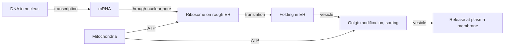

# Cell structure

## Summary

A human cell is a membrane-bound compartment filled with cytoplasm and organized by internal membranes into organelles. The nucleus stores DNA, ribosomes make proteins, the endoplasmic reticulum and Golgi apparatus process and ship them, mitochondria make most of the ATP, and lysosomes recycle waste. The cytoskeleton gives shape and moves things around. Human cells are eukaryotic, which distinguishes them from bacteria, which have no nucleus.

## Prerequisites

No prior notes are needed.

## Core concepts

### Definition

A *cell* is the smallest structural and functional unit of an organism that can live and reproduce on its own. A *eukaryotic* cell has a nucleus and membrane-bound organelles. An *organelle* is a specialized structure inside a cell with a specific function. The adult human body has an estimated 30 to 37 trillion human cells of more than 200 types.

### Analogy

A cell is like a factory town. The nucleus is the head office with the blueprints (DNA), ribosomes are assembly lines, the endoplasmic reticulum and Golgi apparatus are the processing and shipping departments, mitochondria are the power plants, lysosomes are the recycling center, the cytoskeleton is the road network and scaffolding, and the cell membrane is the town wall with guarded gates. The analogy breaks because a cell can divide into two complete towns, and because its "workers" are molecules that find their way by diffusion and chemical signals, not by plans.

### Mechanism

| Organelle | Structure | Function |
| --- | --- | --- |
| Plasma membrane | Lipid bilayer with proteins | Barrier, transport, signaling ([Cell membrane and transport](cell-membrane.md)) |
| Nucleus | Double membrane with pores | Stores DNA, transcription of genes into RNA |
| Nucleolus | Dense region in nucleus | Makes ribosome components |
| Ribosomes | RNA and protein particles | Translate mRNA into protein |
| Rough endoplasmic reticulum | Membrane sheets with ribosomes | Makes and folds membrane and secreted proteins |
| Smooth endoplasmic reticulum | Membrane tubes | Lipid synthesis, detoxification, calcium storage (sarcoplasmic reticulum in muscle) |
| Golgi apparatus | Stacked membrane sacs | Modifies, sorts and packages proteins |
| Mitochondria | Double membrane, own DNA | ATP production ([Mitochondria](mitochondria.md)) |
| Lysosomes | Acidic vesicles with enzymes | Break down worn-out parts and ingested material |
| Peroxisomes | Vesicles with oxidative enzymes | Break down very long fatty acids, detoxify hydrogen peroxide |
| Cytoskeleton | Actin filaments, microtubules, intermediate filaments | Shape, movement, transport, cell division |
| Centrosome | Pair of centrioles | Organizes microtubules for cell division |

The diagram follows a secreted protein, such as insulin, from gene to release.

### Cell types differ in their organelles

Muscle fibers are packed with myofibrils and mitochondria, liver cells with smooth ER for detoxification, plasma cells with rough ER for antibody production, and mature red blood cells have lost their nucleus and mitochondria entirely to make room for hemoglobin. Structure follows function.

## Worked example

Why does a red blood cell live only about 120 days? It has no nucleus, so it cannot make new proteins to repair itself, and no mitochondria, so it relies on glycolysis. As its membrane and enzymes wear out, macrophages in the spleen remove it. The body replaces about 2 million red cells every second, which is why the bone marrow needs a steady supply of iron, vitamin B12 and folate.

## Trade offs and when to use it

- The organelle table is a simplified map. Organelles exchange membranes and molecules constantly, and their boundaries are dynamic.
- Specialization is a trade off: a red blood cell gains oxygen capacity but loses the ability to repair itself.

## Common mistakes

- **Thinking all cells have one nucleus.** Skeletal muscle fibers have hundreds; mature red blood cells have none.
- **Equating cytoplasm with cytosol.** Cytosol is the fluid; cytoplasm includes the organelles in it.

## Practice

1. Which organelle makes proteins destined for secretion?
2. Why do mature red blood cells depend on glycolysis?
3. Which organelle stores calcium in muscle fibers?

### Answers

1. Ribosomes on the rough endoplasmic reticulum.
2. They have no mitochondria.
3. The sarcoplasmic reticulum, a specialized smooth endoplasmic reticulum.

## Further reading

- Alberts, B., Johnson, A., Lewis, J. et al. (2002). *Molecular Biology of the Cell (4th ed.)*. Garland Science, free on NCBI Bookshelf. [Link](https://www.ncbi.nlm.nih.gov/books/NBK21054/). The standard reference on cell structure.
- Betts, J. G., Young, K. A., Wise, J. A. et al. (2022). *Anatomy and Physiology 2e*. OpenStax, Rice University. [Link](https://openstax.org/details/books/anatomy-and-physiology-2e). Chapter 3 on the cellular level of organization.
- Clark, M. A., Douglas, M., Choi, J. (2018). *Biology 2e*. OpenStax, Rice University. [Link](https://openstax.org/details/books/biology-2e). Chapter 4 on cell structure.
