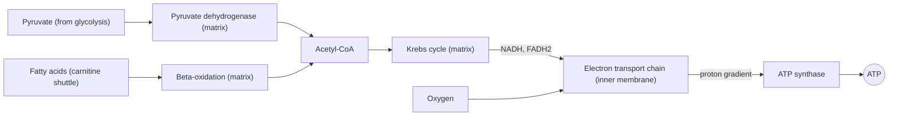

# Mitochondria

## Summary

Mitochondria are organelles with two membranes that produce most of the cell's ATP through the Krebs cycle and oxidative phosphorylation. They also burn fatty acids, make heat in brown fat, help control cell death and store calcium. They carry their own small DNA, inherited from the mother, a trace of their origin as bacteria. Endurance training increases the number and size of mitochondria in muscle, which raises the capacity for aerobic work.

## Prerequisites

- [Cell structure](cell-structure.md)

## Core concepts

### Definition

A *mitochondrion* is a membrane-bound organelle, typically 0.5 to 1 µm wide, with a smooth outer membrane, a folded inner membrane (the folds are called *cristae*) and an inner space called the *matrix*. The matrix contains the enzymes of the Krebs cycle and beta-oxidation, ribosomes and circular mitochondrial DNA (mtDNA) with 37 genes. The *endosymbiotic theory* holds that mitochondria descend from bacteria taken up by an ancestral cell about 1.5 to 2 billion years ago.

### Analogy

Mitochondria are the power plants of the cell factory town. Fuel trucks (pyruvate and fatty acids) deliver to the plant, furnaces (Krebs cycle) burn the fuel, and turbines in the inner membrane (ATP synthase) generate power. Cristae are like the folded walls that give room for more turbines. The analogy breaks because these power plants also act as the town's safety service: they can trigger the controlled demolition of the cell (apoptosis).

### Mechanism

The compartments and their tasks:

| Compartment | Main processes |
| --- | --- |
| Outer membrane | Porins let small molecules through; carnitine shuttle begins |
| Intermembrane space | Proton reservoir; cytochrome c (released during apoptosis) |
| Inner membrane with cristae | Electron transport chain, ATP synthase, transporters |
| Matrix | Krebs cycle, beta-oxidation, pyruvate dehydrogenase, part of urea cycle, mtDNA |

The diagram shows the flow of fuels through a mitochondrion.

### Other functions

- **Heat:** brown fat mitochondria use uncoupling protein 1 to release energy as heat.
- **Apoptosis:** release of cytochrome c starts a cascade of programmed cell death.
- **Calcium buffering** and signaling.
- **Synthesis:** parts of heme and steroid hormone production happen in mitochondria.
- **Reactive oxygen species:** a small share of electrons leaks to oxygen, forming signals and, in excess, damage ([Oxidative stress](../../chemistry/biochemistry/oxidative-stress.md)).

### Training adaptations

Endurance training stimulates *mitochondrial biogenesis* through the coactivator PGC-1 alpha, increasing mitochondrial volume in muscle by roughly 40 to 50 percent or more over weeks to months of training in previously untrained people. More mitochondria means more pyruvate and fat can be oxidized at a given workload, so less lactate is formed and fat use rises. The changes reverse within weeks of stopping training.

## Worked example

Heart muscle cells are about 30 to 35 percent mitochondria by volume, skeletal muscle fibers about 3 to 8 percent, and red blood cells 0 percent. The heart beats about 100,000 times a day and cannot rest, so it depends almost entirely on aerobic ATP production. This is why a blocked coronary artery damages heart muscle within minutes to hours: without oxygen, its mitochondria stop and the small glycolytic capacity cannot keep up.

## Trade offs and when to use it

- Aerobic ATP production is efficient but needs oxygen and produces some reactive oxygen species.
- Mitochondrial DNA mutates more than nuclear DNA and is inherited only from the mother, so mitochondrial diseases follow a maternal pattern.

## Common mistakes

- **Saying mitochondria "make energy".** They convert the chemical energy of fuels into ATP.
- **Thinking all cells have the same number of mitochondria.** The count ranges from none (red blood cells) to thousands (heart and liver cells).

## Practice

1. Where in the mitochondrion does the Krebs cycle take place?
2. Which coactivator drives mitochondrial biogenesis after endurance training?
3. Why are mitochondrial diseases inherited from the mother?

### Answers

1. In the matrix.
2. PGC-1 alpha.
3. Mitochondria in the embryo come from the egg cell; sperm mitochondria are eliminated.

## Further reading

- Alberts, B., Johnson, A., Lewis, J. et al. (2002). *Molecular Biology of the Cell (4th ed.)*. Garland Science, free on NCBI Bookshelf. [Link](https://www.ncbi.nlm.nih.gov/books/NBK21054/). Chapter 14 on mitochondria.
- Berg, J. M., Tymoczko, J. L., Stryer, L. (2002). *Biochemistry (5th ed.)*. W. H. Freeman, free on NCBI Bookshelf. [Link](https://www.ncbi.nlm.nih.gov/books/NBK21154/). Mitochondrial structure in the oxidative phosphorylation chapter.
- Kenney, W. L., Wilmore, J. H., Costill, D. L. (2020). *Physiology of Sport and Exercise (7th ed.)*. Human Kinetics. Mitochondrial adaptations to endurance training.
