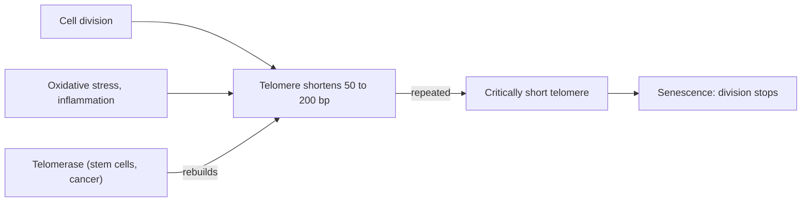

# Telomeres

## Summary

Telomeres are protective caps of repeated DNA at the ends of chromosomes. They shorten a little each time a cell divides, and when they become too short, the cell stops dividing. Telomere length in blood cells is associated with age and with some diseases and lifestyle factors, such as smoking, chronic stress, obesity and physical activity. Diets rich in certain nutrients are associated with longer telomeres in observational studies, but no trial shows that changing diet slows aging through telomeres.

## Prerequisites

- [Cell structure](cell-structure.md)

## Core concepts

### Definition

A *telomere* is a region of repeated DNA (in humans the sequence TTAGGG repeated thousands of times) with bound proteins (the shelterin complex) at each end of a chromosome. *Telomerase* is the enzyme that can rebuild telomeres; it is active in stem cells, germ cells and most cancer cells, but low in most adult body cells. Elizabeth Blackburn, Carol Greider and Jack Szostak received the 2009 Nobel Prize for discovering how telomeres and telomerase protect chromosomes.

### Analogy

Telomeres are like the plastic tips (aglets) on shoelaces. They keep the lace from fraying. Each time the cell copies its DNA, a little of the tip is lost, because the copying machinery cannot reach the very end. When the tip is gone, the lace frays, and the cell stops dividing to avoid damage. The analogy breaks because telomerase can rebuild the tip, which plastic aglets cannot do.

### Mechanism

1. **End replication problem.** DNA polymerase needs a primer and copies in one direction, so the very end of one strand cannot be fully copied. Each division loses roughly 50 to 200 base pairs.
2. **Senescence.** When telomeres reach a critical length, the cell senses a DNA damage signal and permanently stops dividing (replicative senescence, the *Hayflick limit* of about 40 to 60 divisions for human fibroblasts in culture).
3. **Accelerating factors.** Oxidative stress and inflammation damage telomeric DNA, which repairs poorly, so these factors speed shortening.
4. **Cancer.** Cancer cells reactivate telomerase, which lets them divide without limit.

The diagram shows the cycle of telomere shortening.

### Factors associated with telomere length

Observational studies, summarized by Blackburn, Epel and Lin (2015), associate shorter telomeres with older age, smoking, obesity, chronic psychological stress, poor sleep and physical inactivity, and longer telomeres with regular exercise and diets rich in vegetables, fruit, whole grains and omega-3 fatty acids. Effects are small, measurements vary between laboratories, and cause and effect are not established.

### Nutrients linked to longer telomeres

Some sources list dietary components associated with longer telomeres, with food sources:

| Nutrient | Food sources | Link to telomeres |
| --- | --- | --- |
| Zinc | Turkey, goose, fish, seafood, pumpkin and sunflower seeds, cashews, lentils, beans, chickpeas, sesame | Cofactor of DNA repair enzymes and of superoxide dismutase |
| Selenium | Goose liver, cod, flounder, halibut, herring, egg yolks, Brazil nuts | Part of glutathione peroxidase, an antioxidant enzyme |
| Copper | Hazelnuts, cashews, sunflower seeds, dark chocolate, potatoes, seafood (lobster, mussels, oysters) | Part of superoxide dismutase |
| Vitamin C | Kiwi, strawberries, currants, peppers, Brussels sprouts, cauliflower, kale, broccoli, citrus | Antioxidant |
| Vitamin B2 | Eggs, lean meat, millet, dairy (hard and cottage cheese) | Cofactor in redox reactions and glutathione recycling |
| Dietary fiber | Fresh vegetables and fruit, brown rice, wholemeal rye bread, unroasted buckwheat, pearl barley | Associated with lower inflammation |

The links are associations from observational studies or mechanisms. Including these foods is consistent with a healthy diet (see [Healthy aging diet](../../../applied-sciences/medicine-and-health/nutrition/foundations/healthy-aging-diet.md)), but claims that they "slow aging at the cellular level" go beyond the evidence.

## Worked example

Telomere length in white blood cells is often reported as a T/S ratio from a PCR test. Adults lose on average roughly 20 to 40 base pairs per year in blood cells. A cross-sectional study might report that people who exercise vigorously have telomeres "equivalent to 9 years younger". That figure is derived by dividing the difference in average length by the yearly loss, which turns a small, noisy difference in a single measurement into a dramatic-sounding age. It does not show that exercise caused the difference.

## Trade offs and when to use it

- Telomere length is a research marker, not a clinical test of biological age. Commercial telomere tests are not recommended for individual decisions.
- Activating telomerase is not a safe anti-aging strategy, because unlimited division is a hallmark of cancer.

## Common mistakes

- **Treating telomere length as a measure of how fast one is aging.** It varies by cell type and method and predicts individual outcomes poorly.
- **Assuming supplements lengthen telomeres.** No trial has shown this reliably.

## Practice

1. What is the repeated sequence of human telomeres?
2. Why do telomeres shorten with each division?
3. Why is telomerase activation risky?

### Answers

1. TTAGGG.
2. DNA polymerase cannot fully copy the very end of a linear chromosome (the end replication problem).
3. Cancer cells use telomerase to divide without limit.

## Further reading

- Blackburn, E. H., Epel, E. S., Lin, J. (2015). Human telomere biology: a contributory and interactive factor in aging, disease risks, and protection. Science, 350(6265), 1193-1198. [DOI](https://doi.org/10.1126/science.aab3389). Review of telomere biology and its links to lifestyle and disease.
- Alberts, B., Johnson, A., Lewis, J. et al. (2002). *Molecular Biology of the Cell (4th ed.)*. Garland Science, free on NCBI Bookshelf. [Link](https://www.ncbi.nlm.nih.gov/books/NBK21054/). The end replication problem and telomerase.
