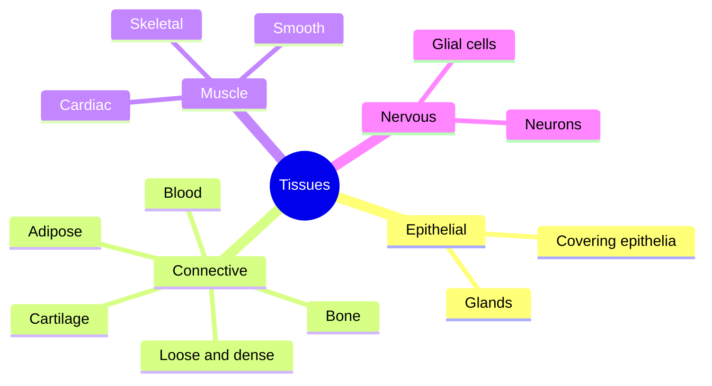

# Tissues

## Summary

A tissue is a group of similar cells and the material between them, working together for a common function. The human body has four basic tissue types: epithelial tissue covers surfaces and forms glands, connective tissue supports and binds (bone, cartilage, fat, blood), muscle tissue contracts, and nervous tissue sends signals. Organs are built from several tissue types. Muscle tissue itself comes in three forms: skeletal, cardiac and smooth.

## Prerequisites

- [Cell structure](cell-structure.md)

## Core concepts

### Definition

A *tissue* is a group of cells with a similar structure and function together with their *extracellular matrix*, the material outside the cells (fibers such as collagen and a ground substance of water, proteoglycans and minerals). *Histology* is the study of tissues.

### Analogy

Tissues are like the trades on a building site. Epithelium is the cladding and the plumbing lining, connective tissue is the concrete, steel and insulation, muscle is the machinery that moves things, and nervous tissue is the wiring and control system. A building (an organ) needs all four. The analogy breaks because tissues are alive and constantly renew themselves, at very different speeds: gut epithelium in days, bone over years.

### Mechanism

The four types and their subtypes:

| Tissue | Features | Subtypes and examples | Function |
| --- | --- | --- | --- |
| Epithelial | Tightly packed cells, little matrix, no blood vessels, sits on a basement membrane | Simple squamous (lung alveoli), cuboidal (kidney tubules), columnar (gut), stratified squamous (skin), glandular | Protection, absorption, secretion, filtration |
| Connective | Few cells in abundant matrix | Loose (under skin), dense (tendons, ligaments), cartilage (hyaline, elastic, fibrocartilage), bone, adipose tissue, blood | Support, connection, storage, transport, defense |
| Muscle | Elongated cells with contractile proteins | Skeletal, cardiac, smooth | Movement, heat |
| Nervous | Neurons and supporting glial cells | Brain, spinal cord, nerves | Signal conduction and processing |

The map shows the four tissue types and their main subtypes.

### The three muscle tissues

| Feature | Skeletal | Cardiac | Smooth |
| --- | --- | --- | --- |
| Location | Attached to bones | Heart wall | Walls of vessels, gut, airways, bladder, uterus |
| Cells | Long, cylindrical fibers with many nuclei | Branched cells with one or two nuclei, joined by intercalated discs | Spindle-shaped cells with one nucleus |
| Striations | Yes | Yes | No |
| Control | Voluntary, by motor nerves | Involuntary, own pacemaker | Involuntary, autonomic nerves and hormones |
| Regeneration | Limited, through satellite cells | Very limited | Good |

Skeletal muscle is covered in [Skeletal muscle structure](../../../applied-sciences/medicine-and-health/physiology/muscle/skeletal-muscle-structure.md).

## Worked example

A tendon heals slowly while a skin scrape heals in days. The epidermis is epithelium whose basal cells divide constantly and renew the skin surface in about four weeks. A tendon is dense connective tissue with few cells, little blood supply and a matrix of type I collagen that turns over over months to years. This difference explains why tendon injuries need months of graded loading in rehabilitation.

## Trade offs and when to use it

- Tissue classification is a teaching scheme. Some tissues, such as blood and bone, look very different but share the connective tissue pattern of cells in an abundant matrix.

## Common mistakes

- **Calling blood a liquid, not a tissue.** Blood is a connective tissue whose matrix is plasma.
- **Thinking cartilage heals well.** Adult cartilage has no blood vessels and repairs poorly.

## Practice

1. Name the four basic tissue types.
2. Which muscle tissue has intercalated discs?
3. Why does cartilage heal slowly?

### Answers

1. Epithelial, connective, muscle and nervous tissue.
2. Cardiac muscle.
3. It has no blood vessels and few cells.

## Further reading

- Betts, J. G., Young, K. A., Wise, J. A. et al. (2022). *Anatomy and Physiology 2e*. OpenStax, Rice University. [Link](https://openstax.org/details/books/anatomy-and-physiology-2e). Chapter 4 on the tissue level of organization.
