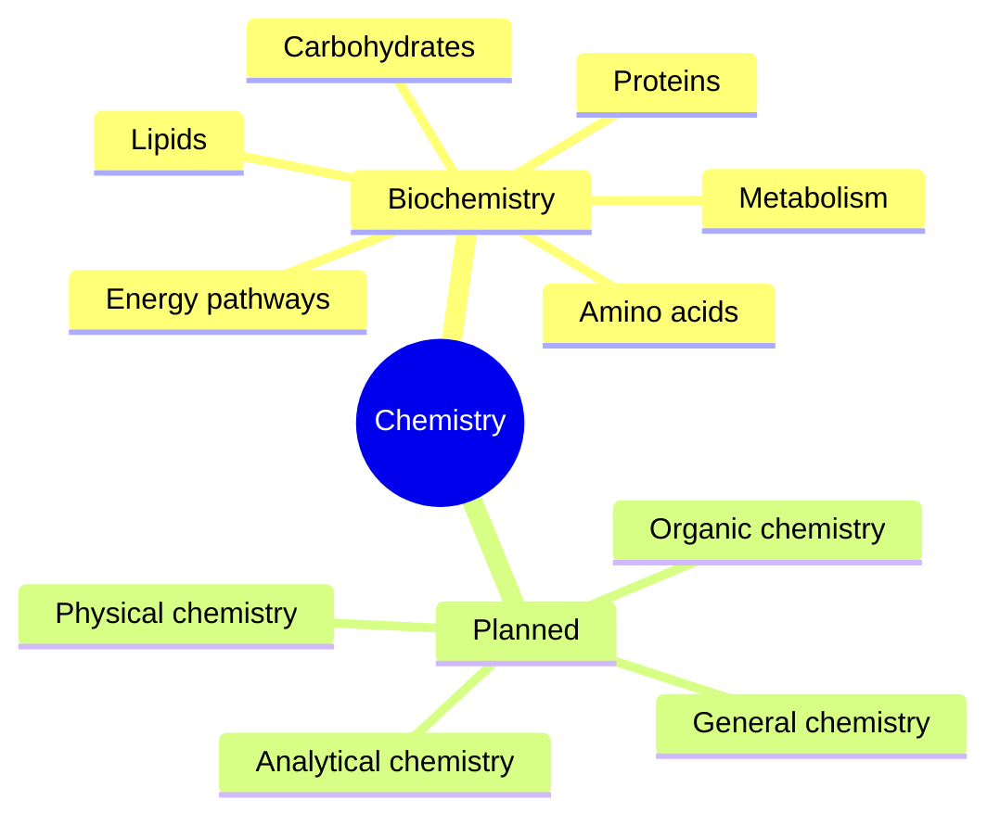

# Chemistry

The composition, structure and reactions of substances. This field belongs to [Natural sciences](../README.md). The first subfield with notes is biochemistry, the chemistry of living things.

## Map of the field

The diagram shows the subfields. Only biochemistry has notes so far.

## Subfields

- [Biochemistry](biochemistry/README.md): metabolism, the energy pathways that make ATP, and the molecules of life (amino acids, proteins, lipids, carbohydrates).

## Planned topics

- General chemistry
- Organic chemistry
- Physical chemistry
- Analytical chemistry

## Related

- [Medicine and health](../../applied-sciences/medicine-and-health/README.md): applies the biochemistry notes to nutrition, training and health.
- [Biology](../biology/README.md): cells and tissues, where the reactions take place.
