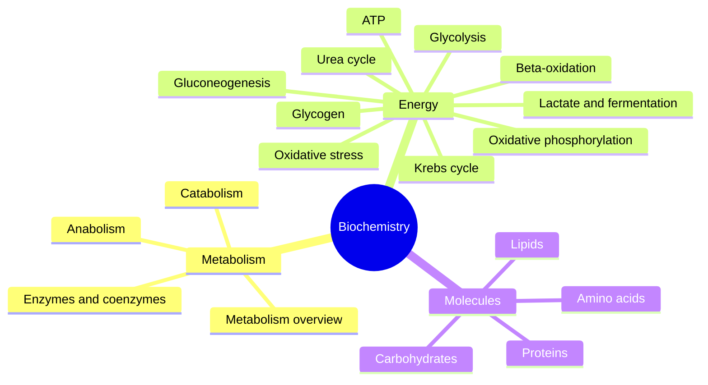
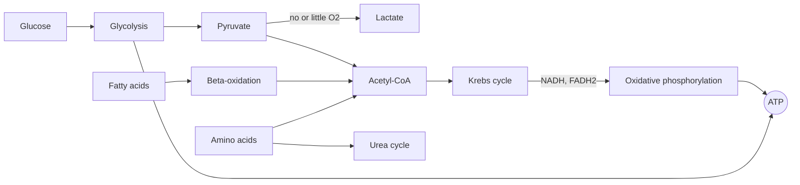

# Biochemistry

Biochemistry studies the molecules of living organisms and the reactions that build, break and convert them. These notes explain metabolism and the pathways that turn food into usable energy, then describe the main classes of biological molecules one by one. Nutrition, training and physiology notes in [Medicine and health](../../../applied-sciences/medicine-and-health/README.md) link here instead of repeating the chemistry.

## Map of the subfield

The map shows the four groups of notes. Metabolism comes first because every later note refers to anabolism, catabolism and ATP.

The second diagram shows how the energy pathways feed each other. Glucose, fatty acids and amino acids all end up as acetyl-CoA, which the Krebs cycle oxidizes, and the electron transport chain turns the released electrons into ATP.

## Reading order

1. [Metabolism](metabolism.md): what metabolism is, what it needs and how it is controlled.
2. [Anabolism](anabolism.md): building complex molecules, which costs energy.
3. [Catabolism](catabolism.md): breaking molecules down, which releases energy.
4. [Enzymes and coenzymes](enzymes-and-coenzymes.md): the catalysts and helpers that make reactions fast enough for life.
5. [ATP](atp.md): the energy currency of the cell.
6. [Glycolysis](glycolysis.md): glucose to pyruvate in the cytoplasm.
7. [Krebs cycle](krebs-cycle.md): oxidation of acetyl-CoA in the mitochondria.
8. [Oxidative phosphorylation](oxidative-phosphorylation.md): the electron transport chain and ATP synthase.
9. [Beta-oxidation](beta-oxidation.md): how fatty acids are burned.
10. [Lactate and fermentation](lactate-and-fermentation.md): what happens to pyruvate when oxygen is short.
11. [Glycogen metabolism](glycogen-metabolism.md): storing and releasing glucose.
12. [Gluconeogenesis](gluconeogenesis.md): making new glucose from non-carbohydrates.
13. [Urea cycle](urea-cycle.md): disposing of the nitrogen from amino acids.
14. [Oxidative stress](oxidative-stress.md): free radicals and antioxidant defenses.
15. [Amino acids](amino-acids/README.md): one note per amino acid.
16. [Proteins](proteins/README.md): structure and folding, with collagen as an example.
17. [Lipids](lipids/README.md): fatty acids, phospholipids, cholesterol and lipoproteins.
18. [Carbohydrates](carbohydrates/README.md): sugars, starch, glycogen and glycosaminoglycans.

## Scope and evidence

- The pathway notes follow standard textbook biochemistry, which is settled science. Numbers such as ATP yields are given with the range found in current textbooks and the reason the range exists.
- The molecule notes also cover supplements made from these molecules. Claims about supplements are graded with the scale in [Evidence grades](../../../applied-sciences/medicine-and-health/nutrition/evidence-grades.md).
