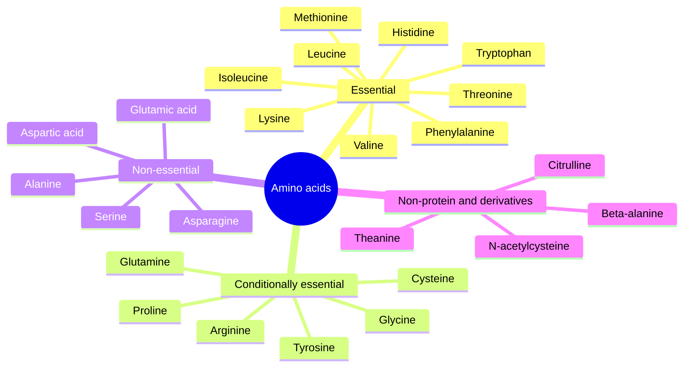

# Amino acids

Amino acids are the building blocks of proteins and the starting material for many hormones, neurotransmitters and other molecules. This subfield has one note per amino acid: the 20 that the genetic code builds into proteins, and four non-protein amino acids or derivatives that are common supplements. Each note covers the chemistry, the roles in the body, food sources, and, where the amino acid is sold as a supplement, each proposed effect with a grade of evidence.

## Map of the subfield

The map groups the amino acids by whether the body can make them. "Conditionally essential" means the body usually makes enough, but not in illness, injury or rapid growth.

## Reading order

1. [Amino acids overview](amino-acids-overview.md): structure, classification, essential amino acids and protein quality. Read this first.

Essential amino acids:

2. [Histidine](histidine.md): precursor of histamine and carnosine.
3. [Isoleucine](isoleucine.md): branched-chain amino acid, fuel and glucose uptake.
4. [Leucine](leucine.md): branched-chain amino acid and the main trigger of muscle protein synthesis.
5. [Lysine](lysine.md): limiting amino acid in cereals, carnitine precursor, used against herpes.
6. [Methionine](methionine.md): start of every protein, methyl donor through SAMe.
7. [Phenylalanine](phenylalanine.md): precursor of tyrosine, relevant in phenylketonuria.
8. [Threonine](threonine.md): part of mucins and collagen.
9. [Tryptophan](tryptophan.md): precursor of serotonin, melatonin and niacin.
10. [Valine](valine.md): the third branched-chain amino acid.

Conditionally essential amino acids:

11. [Arginine](arginine.md): precursor of nitric oxide and creatine.
12. [Cysteine](cysteine.md): sulfur amino acid, part of glutathione.
13. [Glutamine](glutamine.md): the most abundant amino acid in blood, fuel for gut and immune cells.
14. [Glycine](glycine.md): the smallest amino acid, a third of collagen.
15. [Proline](proline.md): the rigid amino acid of collagen.
16. [Tyrosine](tyrosine.md): precursor of dopamine, adrenaline and thyroid hormones.

Non-essential amino acids:

17. [Alanine](alanine.md): carries nitrogen from muscle to liver.
18. [Asparagine](asparagine.md): links to acrylamide formation in fried foods.
19. [Aspartic acid](aspartic-acid.md): urea cycle and excitatory signaling.
20. [Glutamic acid](glutamic-acid.md): main excitatory neurotransmitter and umami taste.
21. [Serine](serine.md): precursor of phospholipids and glycine.

Non-protein amino acids and derivatives:

22. [Citrulline](citrulline.md): urea cycle intermediate that raises arginine.
23. [Theanine](theanine.md): tea amino acid with calming effects.
24. [Beta-alanine](beta-alanine.md): precursor of the muscle buffer carnosine.
25. [N-acetylcysteine](n-acetylcysteine.md): cysteine donor, glutathione precursor and antidote.

## Scope and evidence

- Supplement claims are graded with [Evidence grades](../../../../applied-sciences/medicine-and-health/nutrition/evidence-grades.md). Most effects claimed for single amino acids rest on small trials, and a note says so.
- Doses are given only where a position stand or review supports them, and always as information, not advice.
