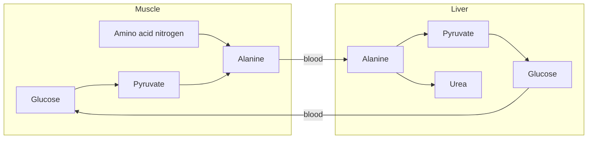

# Alanine

## Summary

L-alanine is a small non-essential amino acid. Muscle uses it to send nitrogen and carbon to the liver, which turns the carbon back into glucose: the glucose-alanine cycle. It is different from beta-alanine, the supplement that raises muscle carnosine.

*This note is educational. It is not medical advice and does not replace a doctor, dietitian or pharmacist, especially during pregnancy, illness or when taking medicines.*

## Prerequisites

- [Amino acids overview](amino-acids-overview.md)

## Core concepts

### Definition

*Alanine* (Ala, A) is a nonpolar amino acid with a methyl group as its side chain. It is made from pyruvate by transamination (alanine aminotransferase, ALT, which needs vitamin B6). It is found in almost all protein foods.

### Analogy

The glucose-alanine cycle is like a returnable bottle system. Muscle receives full bottles (glucose), empties them, and returns the bottles to the plant (the liver) with a deposit attached (the nitrogen). The liver refills the bottles with glucose and disposes of the deposit as urea. The analogy breaks because the liver pays an energy cost to refill the bottles, so the cycle is not free.

### Mechanism

1. In muscle, amino acids are broken down and their amino groups are transferred to pyruvate, forming alanine.
2. Alanine travels in the blood to the liver.
3. In the liver, ALT transfers the amino group away (to the [Urea cycle](../urea-cycle.md)) and pyruvate is turned into glucose by [Gluconeogenesis](../gluconeogenesis.md).
4. Glucose returns to muscle.

ALT in the blood is used as a marker of liver cell damage, because it leaks out of injured liver cells.

The diagram shows the cycle.

## Worked example

A blood test reports ALT of 80 U/L, with a typical upper reference limit around 35 to 45 U/L depending on the laboratory and sex. This is about twice the upper limit and suggests liver cell stress, for example from fatty liver, alcohol, medication or hepatitis, which needs medical follow-up. Hard exercise can also raise ALT, partly because muscle contains it.

## Trade offs and when to use it

Alanine supplements have no established use. Confusing it with beta-alanine is the main practical risk.

## Common mistakes

- **Buying alanine instead of beta-alanine.** Only beta-alanine raises muscle carnosine.

## Practice

1. Which enzyme converts pyruvate to alanine, and which vitamin does it need?
2. Why does ALT in the blood indicate liver damage?

### Answers

1. Alanine aminotransferase (ALT), which needs vitamin B6.
2. It leaks out of injured liver cells.

## Further reading

- Berg, J. M., Tymoczko, J. L., Stryer, L. (2002). *Biochemistry (5th ed.)*. W. H. Freeman, free on NCBI Bookshelf. [Link](https://www.ncbi.nlm.nih.gov/books/NBK21154/). Biosynthesis and roles of the non-essential amino acids.
