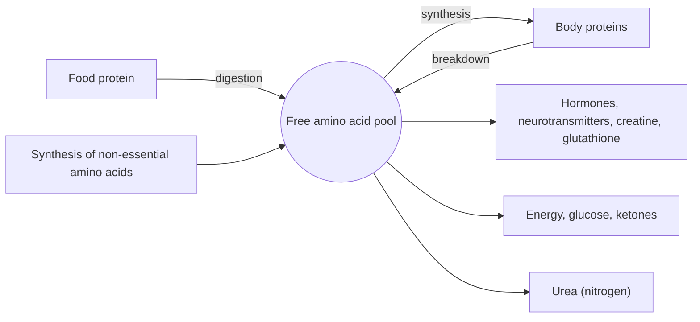

# Amino acids overview

## Summary

Amino acids are small organic molecules with an amino group and a carboxyl group on the same carbon. Twenty of them are built into proteins according to the genetic code. Nine are essential: the body cannot make them, so they must come from food. The rest can be made from other molecules, although some become conditionally essential in illness or growth. Amino acids are also used for energy and as the raw material for hormones, neurotransmitters and other compounds.

## Prerequisites

No prior notes are needed. The note on [Metabolism](../metabolism.md) explains the terms anabolism and catabolism used here.

## Core concepts

### Definition

An *amino acid* is a molecule with a central carbon (the alpha carbon) carrying four groups: an amino group (-NH2), a carboxyl group (-COOH), a hydrogen atom and a *side chain* (R group). The side chain differs between amino acids and gives each its properties. All protein amino acids except glycine exist in two mirror-image forms, L and D. Proteins use the L form, which is why supplements are labeled L-arginine or L-tyrosine.

*Proteinogenic* amino acids are the 20 encoded by the genetic code (plus selenocysteine and pyrrolysine, which are added by special mechanisms). *Non-proteinogenic* amino acids, such as citrulline, ornithine, theanine and beta-alanine, occur in the body or in food but are not built into proteins during translation.

### Analogy

Amino acids are like letters of an alphabet. Twenty letters can spell millions of different words (proteins), and the meaning of a word depends on the order of its letters. Each letter also has its own shape (side chain) that decides how words fold on the page. The analogy breaks because amino acids also have uses of their own outside "words": tryptophan becomes serotonin and arginine becomes nitric oxide.

### Mechanism

Amino acids join through *peptide bonds* between the carboxyl group of one and the amino group of the next, releasing water. Chains of up to about 50 amino acids are called peptides, and longer chains are proteins. See [Proteins](../proteins/proteins.md).

The body keeps a small *free amino acid pool* (about 100 g in an adult), fed by digestion of food protein and by the breakdown of body proteins. The pool is used in four ways:

1. Synthesis of body proteins (about 250 to 300 g of protein are made and broken down each day in an adult).
2. Synthesis of other molecules: hormones, neurotransmitters, creatine, heme, nucleotides, glutathione.
3. Energy: after removal of the amino group, the carbon skeleton is oxidized or made into glucose or ketone bodies.
4. Nitrogen disposal: the amino group becomes urea in the [Urea cycle](../urea-cycle.md).

The diagram shows the flows into and out of the pool.

### Classification by side chain

| Class | Amino acids | Property |
| --- | --- | --- |
| Nonpolar, aliphatic | Glycine, alanine, valine, leucine, isoleucine, methionine, proline | Avoid water, found inside folded proteins |
| Aromatic | Phenylalanine, tyrosine, tryptophan | Ring structures, precursors of signaling molecules |
| Polar, uncharged | Serine, threonine, cysteine, asparagine, glutamine | Form hydrogen bonds, often on protein surfaces |
| Acidic (negative) | Aspartic acid, glutamic acid | Negatively charged at body pH |
| Basic (positive) | Lysine, arginine, histidine | Positively charged at body pH (histidine partly) |

Leucine, isoleucine and valine are called *branched-chain amino acids* (BCAAs) because of their branched side chains.

### Classification by nutritional need

| Group | Amino acids |
| --- | --- |
| Essential (indispensable) | Histidine, isoleucine, leucine, lysine, methionine, phenylalanine, threonine, tryptophan, valine |
| Conditionally essential | Arginine, cysteine, glutamine, glycine, proline, tyrosine |
| Non-essential (dispensable) | Alanine, asparagine, aspartic acid, glutamic acid, serine |

The terms "endogenous" (made in the body) and "exogenous" (must come from food) are used in some languages for non-essential and essential amino acids.

### Protein quality

A food protein is of high quality if it supplies all essential amino acids in the proportions humans need and is well digested. The current measure recommended by the Food and Agriculture Organization (FAO) is the Digestible Indispensable Amino Acid Score (DIAAS). The essential amino acid in shortest supply relative to need is the *limiting amino acid*: lysine in most cereals, methionine and cysteine in many legumes. Combining cereals and legumes over the day covers both.

## Worked example

The WHO/FAO/UNU 2007 requirement for lysine in adults is 30 mg per kg body weight per day. A 70 kg adult needs about 2.1 g of lysine. Wheat protein contains about 25 to 30 mg lysine per gram of protein, so meeting the need from wheat alone would take about 75 g of wheat protein. Lentil protein contains about 70 mg per gram, so about 30 g of lentil protein would do. This is why mixing cereals with legumes improves protein quality on plant-based diets.

## Trade offs and when to use it

- Whole proteins from food supply all amino acids together and are the default source. Single amino acid supplements are used for a specific purpose, and most of their claimed effects rest on small trials.
- Large doses of one amino acid can compete with others for transport into cells and the brain (for example tryptophan, tyrosine and the BCAAs share a transporter).

## Common mistakes

- **Calling an amino acid "essential" because it is important.** "Essential" only means that it must come from food.
- **Thinking plant proteins lack essential amino acids.** Most contain all of them but in lower proportions of one or two. Variety solves this.
- **Taking BCAAs to replace protein.** Muscle protein synthesis needs all essential amino acids. BCAAs alone give a short signal without the building blocks.

## Practice

1. Which four groups sit on the alpha carbon of an amino acid?
2. List the nine essential amino acids.
3. What is the limiting amino acid in most cereals?

### Answers

1. An amino group, a carboxyl group, a hydrogen atom and a side chain.
2. Histidine, isoleucine, leucine, lysine, methionine, phenylalanine, threonine, tryptophan and valine.
3. Lysine.

## Further reading

- World Health Organization (2007). *Protein and amino acid requirements in human nutrition: report of a joint WHO/FAO/UNU expert consultation (WHO Technical Report Series 935)*. WHO. Gives the requirements for each essential amino acid used in the worked example.
- Institute of Medicine (2005). *Dietary Reference Intakes for Energy, Carbohydrate, Fiber, Fat, Fatty Acids, Cholesterol, Protein, and Amino Acids*. National Academies Press. [DOI](https://doi.org/10.17226/10490). US reference values for protein and amino acids.
- Berg, J. M., Tymoczko, J. L., Stryer, L. (2002). *Biochemistry (5th ed.)*. W. H. Freeman, free on NCBI Bookshelf. [Link](https://www.ncbi.nlm.nih.gov/books/NBK21154/). Chapter 2 on amino acid structure and classification.
