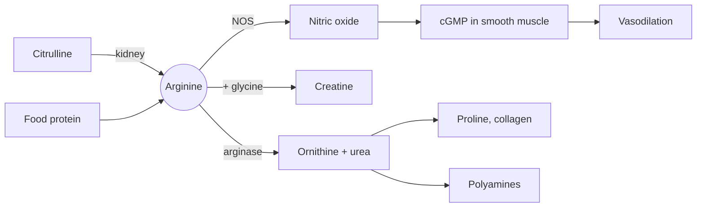

# Arginine

## Summary

L-arginine is a conditionally essential amino acid: the body makes it, but in stress, illness or growth the synthesis may not cover the need. It is the substrate for nitric oxide (NO), which widens blood vessels, and a building block of creatine and urea. It is sold as a supplement for blood flow, exercise, erectile function and wound healing. Oral arginine is partly broken down before it reaches the circulation, which is one reason its effects in healthy people are small and inconsistent.

*This note is educational. It is not medical advice and does not replace a doctor, dietitian or pharmacist, especially during pregnancy, illness or when taking medicines.*

## Prerequisites

- [Amino acids overview](amino-acids-overview.md)

## Core concepts

### Definition

*Arginine* (Arg, R) is a basic amino acid with a positively charged guanidino group on its side chain. It is part of proteins and is made in the body from citrulline, mainly in the kidneys, in a pathway linked to the [Urea cycle](../urea-cycle.md). It is classed as *conditionally essential* (semi-essential): healthy adults make enough, but synthesis may fall short during stress, illness, trauma, burns or rapid growth. It occurs naturally in protein-rich foods such as meat, fish, nuts, seeds and dairy. Supplements come as powder, tablets, capsules and drinks.

### Analogy

Arginine is like the fuel line to a gas lamp. The enzyme nitric oxide synthase is the lamp, and nitric oxide is the light that tells the muscle in the vessel wall to relax. Feeding more fuel helps only when the lamp is starved of fuel. If the lamp already has plenty, as in most healthy people, extra fuel changes little. This is the "arginine paradox": cells hold far more arginine than the enzyme needs, yet extra arginine sometimes still raises NO in disease.

### Mechanism

Nitric oxide synthase (NOS) in the inner lining of blood vessels (the endothelium) converts arginine and oxygen into nitric oxide and citrulline. NO diffuses into the smooth muscle of the vessel wall, activates the enzyme guanylate cyclase, and the rise in cyclic GMP relaxes the muscle, so the vessel widens (vasodilation). The same signal relaxes the smooth muscle of the penis during erection. Drugs for erectile dysfunction such as sildenafil act one step later, by blocking the breakdown of cyclic GMP.

Arginine has other roles: with glycine it forms guanidinoacetate, the precursor of creatine; arginase splits it into urea and ornithine, and ornithine is the starting point for proline (needed for collagen) and polyamines (needed for cell growth); and it stimulates the release of insulin and growth hormone when infused in large doses.

When taken by mouth, a large share of arginine is broken down by arginase in the gut and liver before it reaches the general circulation (first-pass metabolism). Citrulline avoids this and raises blood arginine more reliably (see [Citrulline](citrulline.md)).

The diagram shows the main fates of arginine.

### Food sources

Turkey and chicken, pork, beef, fish, pumpkin seeds, peanuts, almonds, walnuts, soybeans, lentils and dairy. A mixed diet supplies about 4 to 6 g of arginine a day.

### Proposed effects and evidence

Each entry states the proposed effect and how strong the human evidence is, using the grades defined in the [Evidence grades](../../../../applied-sciences/medicine-and-health/nutrition/evidence-grades.md) note.

- **Cardiovascular function.** Through NO, arginine widens blood vessels, improves blood flow and may lower blood pressure, which could support heart health and reduce the risk of hypertension and atherosclerosis. Meta-analyses of small trials found modest reductions in blood pressure (a few mmHg). A trial in patients after heart attack (VINTAGE MI, 2006) found no benefit and was stopped for more deaths in the arginine group. Evidence: limited, with a safety signal after heart attack.
- **Exercise performance.** Better blood flow could deliver more oxygen and nutrients to muscles, improving performance and recovery. Results in trained people are inconsistent; a 2020 review found possible benefits for aerobic and anaerobic performance at acute doses of about 0.15 g/kg, but many trials show no effect. Evidence: limited.
- **Erectile dysfunction.** More NO improves blood flow to the genitals, and arginine is used as an aid in erectile dysfunction. Small trials suggest benefit in mild to moderate cases, mostly at 2.5 to 5 g per day, sometimes combined with other substances. Evidence: limited.
- **Immune function and wound healing.** Arginine supports the production of immune cells, speeds wound healing through collagen synthesis (via ornithine and proline) and improves blood flow to damaged tissue. Arginine-enriched formulas are used in clinical nutrition for surgery and pressure ulcers, with some benefit for wound healing. Evidence: moderate in clinical nutrition, not studied for healthy people.
- **Kidney function.** Arginine may improve blood flow through the kidneys and support their function, especially in chronic kidney disease. Human evidence is small and mixed. Evidence: very limited.
- **Blood vessel elasticity.** Arginine may help keep vessels elastic and so help prevent stiffening and atherosclerosis. Short-term studies show improved endothelial function in some groups; long-term outcomes are not shown. Evidence: limited.
- **Fertility.** Arginine may improve sperm quality in men and support reproductive function in women. Small, older studies, often combined with other nutrients. Evidence: very limited.
- **Metabolic health.** Arginine may help control blood glucose, which could benefit people with insulin resistance or type 2 diabetes. A few small trials show improved insulin sensitivity. Evidence: very limited.
- **Anti-inflammatory action.** Arginine may reduce inflammation and help in chronic inflammatory diseases. Evidence is mostly from laboratory and animal studies. Evidence: very limited.

## Worked example

A label recommends 3 g of L-arginine three times a day. A 2020 review of performance studies used about 0.15 g per kg body weight taken 60 to 90 minutes before exercise. For a 70 kg person that is 10.5 g in one dose, a level at which stomach upset and diarrhea become common. Citrulline at 6 to 8 g raises blood arginine at least as much with fewer gut effects. The comparison shows why many sports formulas replaced arginine with citrulline.

## Trade offs and when to use it

- **Safety.** Doses up to about 9 g per day are usually tolerated. Higher single doses cause nausea, cramps and diarrhea.
- **Who should avoid it.** People after a heart attack (VINTAGE MI result), people with herpes infections (arginine is used by the herpes virus, see [Lysine](lysine.md)) and people taking blood pressure drugs or nitrates, because effects can add up.
- **Alternatives.** Citrulline for raising arginine, dietary nitrate (beetroot juice) for NO-related performance effects, which has stronger evidence.

## Common mistakes

- **Expecting a "pump" from arginine in healthy, well-fed people.** Blood arginine is rarely limiting for NO production. Consider citrulline or dietary nitrate if this is the goal.
- **Using arginine to self-treat heart disease.** Some patients may be harmed. Heart disease belongs with a doctor.
- **Ignoring the first-pass effect.** A large share of oral arginine never reaches the circulation.

## Practice

1. Which enzyme turns arginine into nitric oxide, and what is the by-product?
2. Why does oral citrulline raise blood arginine more than oral arginine?
3. Why might arginine be a poor choice for someone with frequent cold sores?

### Answers

1. Nitric oxide synthase, and the by-product is citrulline.
2. Oral arginine is broken down by arginase in the gut and liver, while citrulline passes through and is converted to arginine in the kidneys.
3. The herpes virus needs arginine to replicate, and lysine is used to counter it.

## Further reading

- NIH Office of Dietary Supplements. Dietary Supplements for Exercise and Athletic Performance: Fact Sheet for Health Professionals. [Link](https://ods.od.nih.gov/factsheets/ExerciseAndAthleticPerformance-HealthProfessional/). Covers arginine for exercise with a summary of trials.
- Viribay, A., Burgos, J., Fernández-Landa, J. et al. (2020). Effects of arginine supplementation on athletic performance based on energy metabolism: a systematic review and meta-analysis. Nutrients, 12(5), 1300. [DOI](https://doi.org/10.3390/nu12051300). Meta-analysis behind the 0.15 g/kg performance dose.
- Schulman, S. P., Becker, L. C., Kass, D. A. et al. (2006). L-arginine therapy in acute myocardial infarction: the Vascular Interaction With Age in Myocardial Infarction (VINTAGE MI) randomized clinical trial. JAMA, 295(1), 58-64. [DOI](https://doi.org/10.1001/jama.295.1.58). The VINTAGE MI trial that found harm after heart attack.
- Berg, J. M., Tymoczko, J. L., Stryer, L. (2002). *Biochemistry (5th ed.)*. W. H. Freeman, free on NCBI Bookshelf. [Link](https://www.ncbi.nlm.nih.gov/books/NBK21154/). Biochemistry of nitric oxide synthase and the urea cycle.
