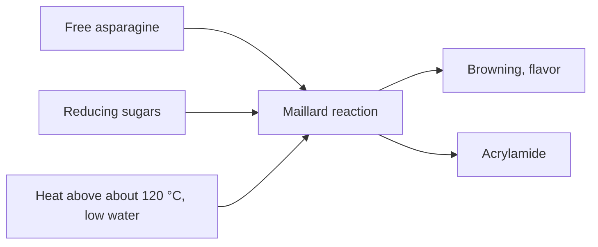

# Asparagine

## Summary

L-asparagine is a non-essential polar amino acid, the amide of aspartic acid. It was the first amino acid isolated, from asparagus juice in 1806. In food chemistry it matters because free asparagine reacts with sugars at high temperatures to form acrylamide, a probable human carcinogen found in fries, chips and toast.

*This note is educational. It is not medical advice and does not replace a doctor, dietitian or pharmacist, especially during pregnancy, illness or when taking medicines.*

## Prerequisites

- [Amino acids overview](amino-acids-overview.md)

## Core concepts

### Definition

*Asparagine* (Asn, N) is made from aspartic acid by asparagine synthetase. In proteins, its side chain is the attachment point for sugar chains in N-glycosylation. Free asparagine is abundant in potatoes and cereals.

### Analogy

Free asparagine in a potato is like dry tinder in a fireplace. On its own it is harmless, but when it meets a spark (reducing sugars at above about 120 °C) it takes part in the browning reactions that also produce acrylamide. Less tinder or a cooler fire means less acrylamide. The analogy breaks because browning is also what makes fried and baked foods taste good, so the aim is control, not avoidance.

### Mechanism

1. Asparagine synthetase makes asparagine from aspartate, using glutamine as nitrogen donor and ATP.
2. In proteins, sugar chains are attached to asparagine in the sequence Asn-X-Ser/Thr.
3. In foods heated above about 120 °C with little water, free asparagine reacts with reducing sugars (glucose, fructose) in the Maillard reaction, and part of it is converted to acrylamide.
4. In medicine, the enzyme asparaginase is used to treat acute lymphoblastic leukemia, because these cancer cells cannot make enough asparagine.

The diagram shows acrylamide formation.

## Worked example

The EU benchmark level for acrylamide in French fries is 500 µg/kg (Commission Regulation (EU) 2017/2158). Soaking cut potatoes in water, cooking to a golden yellow rather than dark brown and storing potatoes above 6 °C (cold storage raises sugars) all lower acrylamide. See [Acrylamide](../../../../applied-sciences/medicine-and-health/nutrition/food-additives/acrylamide.md).

## Trade offs and when to use it

Asparagine itself is not a nutritional concern. Its relevance is in food processing.

## Common mistakes

- **Thinking acrylamide is an additive.** It forms during cooking from natural asparagine and sugars.

## Practice

1. Which two components react to form acrylamide?
2. Why is asparaginase used in leukemia?

### Answers

1. Free asparagine and reducing sugars, under high heat.
2. Some leukemia cells cannot make enough asparagine, so removing it from the blood starves them.

## Further reading

- Berg, J. M., Tymoczko, J. L., Stryer, L. (2002). *Biochemistry (5th ed.)*. W. H. Freeman, free on NCBI Bookshelf. [Link](https://www.ncbi.nlm.nih.gov/books/NBK21154/). Biosynthesis and roles of the non-essential amino acids.
