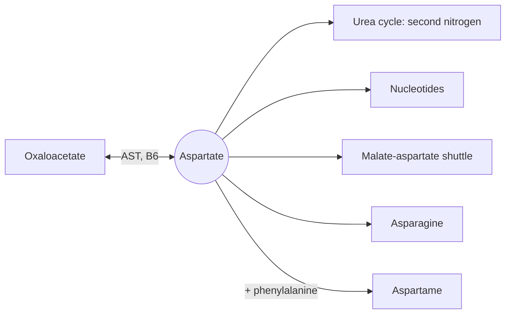

# Aspartic acid

## Summary

L-aspartic acid (aspartate) is a non-essential acidic amino acid. It donates one of the two nitrogen atoms of urea, feeds the Krebs cycle as oxaloacetate, is an excitatory neurotransmitter and is half of the sweetener aspartame. D-aspartic acid, its mirror form, is sold as a testosterone booster with weak evidence.

*This note is educational. It is not medical advice and does not replace a doctor, dietitian or pharmacist, especially during pregnancy, illness or when taking medicines.*

## Prerequisites

- [Amino acids overview](amino-acids-overview.md)

## Core concepts

### Definition

*Aspartic acid* (Asp, D) has a carboxyl group on its side chain, which is negatively charged at body pH; the charged form is called aspartate. It is made by transamination of oxaloacetate. Found in all protein foods.

### Analogy

Aspartate is like a busy transfer station between two rail lines. On one line, it swaps with oxaloacetate and moves carbon in and out of the Krebs cycle. On the other line, it hands nitrogen to the urea cycle. The malate-aspartate shuttle also uses it to move electrons from NADH into the mitochondria. The analogy breaks because a station stays put, while aspartate itself crosses membranes.

### Mechanism

- **Transamination.** Aspartate aminotransferase (AST, needs vitamin B6) interconverts aspartate and oxaloacetate. AST in the blood is a marker of liver and muscle damage.
- **Urea cycle.** Aspartate supplies the second nitrogen of urea (see [Urea cycle](../urea-cycle.md)).
- **Malate-aspartate shuttle.** Moves the electrons of cytoplasmic NADH into the mitochondria.
- **Nucleotides.** Aspartate contributes atoms to purines and pyrimidines.
- **Neurotransmission.** It activates NMDA receptors in the brain.

The diagram shows these links.

### Proposed effects and evidence

Each entry states the proposed effect and how strong the human evidence is, using the grades defined in the [Evidence grades](../../../../applied-sciences/medicine-and-health/nutrition/evidence-grades.md) note.

- **D-aspartic acid and testosterone.** D-aspartic acid is involved in hormone release in animals. One small 2009 study reported higher testosterone in men; later trials in trained men found no change or a decrease at higher doses. Evidence: not supported.

## Worked example

The AST to ALT ratio is used in liver diagnostics. A ratio above about 2 is suggestive of alcohol-related liver disease, while in fatty liver disease ALT is usually higher than AST. A high AST with normal ALT after a hard workout may simply reflect muscle, since AST is also abundant in muscle; creatine kinase confirms this (see [Creatine kinase](../../../../applied-sciences/medicine-and-health/diagnostics/creatine-kinase.md)).

## Trade offs and when to use it

Aspartate supplements (as magnesium or potassium aspartate) are mostly used as mineral carriers. D-aspartic acid supplements have weak evidence.

## Common mistakes

- **Reading high AST after training as liver damage without checking muscle markers.** AST is also in muscle; check creatine kinase and ALT.

## Practice

1. Which compound does aspartate interconvert with by transamination?
2. Name the sweetener that contains aspartic acid.

### Answers

1. Oxaloacetate.
2. Aspartame (with phenylalanine).

## Further reading

- Berg, J. M., Tymoczko, J. L., Stryer, L. (2002). *Biochemistry (5th ed.)*. W. H. Freeman, free on NCBI Bookshelf. [Link](https://www.ncbi.nlm.nih.gov/books/NBK21154/). Biosynthesis and roles of the non-essential amino acids.
