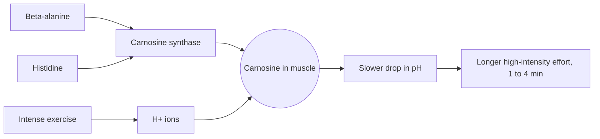

# Beta-alanine

## Summary

Beta-alanine is a non-protein amino acid and the limiting precursor of carnosine, a buffer stored in muscle. Taking 4 to 6 g a day for several weeks raises muscle carnosine, which helps neutralize hydrogen ions during intense exercise. The best evidence is for efforts lasting about one to four minutes. The common side effect is a harmless tingling of the skin.

*This note is educational. It is not medical advice and does not replace a doctor, dietitian or pharmacist, especially during pregnancy, illness or when taking medicines.*

## Prerequisites

- [Amino acids overview](amino-acids-overview.md)

## Core concepts

### Definition

*Beta-alanine* is an amino acid in which the amino group sits on the beta carbon (the third carbon) instead of the alpha carbon. Because of this, it is not built into proteins. In muscle it joins with histidine to form *carnosine* (beta-alanyl-L-histidine), a dipeptide stored in high amounts in fast-twitch fibers. The body makes small amounts of beta-alanine in the liver, and food supplies it as carnosine and anserine in meat and fish. It is a common supplement in endurance and strength sports, usually as powder or capsules.

### Analogy

Carnosine is like a sponge for acid in a muscle cell. During a hard effort, hydrogen ions pour into the cell like water from a leaking pipe. A bigger sponge (more carnosine) soaks up more before the floor is flooded (pH drops and fatigue sets in). Beta-alanine supplements make the sponge bigger. The analogy breaks because the sponge does not dry out by itself during the effort, so in very long efforts other systems (blood buffers, oxidative metabolism) take over and the advantage fades.

### Mechanism

1. Carnosine synthase joins beta-alanine and histidine to form carnosine. Muscle has plenty of histidine but little beta-alanine, so beta-alanine sets the rate.
2. Carnosine has an imidazole ring whose pKa (about 6.8) is close to the pH of muscle, which makes it an effective buffer in the range where muscle pH falls during exercise.
3. During intense exercise, hydrogen ions from ATP hydrolysis and glycolysis lower muscle pH (see [Lactate and fermentation](../lactate-and-fermentation.md)). More carnosine binds more of them, which delays the drop in pH and the related fatigue.
4. Muscle carnosine rises gradually. The ISSN position stand reports increases of up to about 64 percent after four weeks at 4 to 6 g per day and up to about 80 percent after ten weeks.

The diagram shows the route from supplement to buffering.

### Food sources

Beef, pork, chicken breast and fish (especially tuna) contain carnosine and anserine, which release beta-alanine. Vegetarians have lower muscle carnosine. Diet alone gives well under 1 g of beta-alanine a day, far below supplement doses.

### Proposed effects and evidence

Each entry states the proposed effect and how strong the human evidence is, using the grades defined in the [Evidence grades](../../../../applied-sciences/medicine-and-health/nutrition/evidence-grades.md) note.

- **Muscular endurance.** Higher carnosine delays fatigue during intense, short efforts lasting about 1 to 4 minutes, such as sprints, strength training sets and endurance sports with hard surges. This is the best supported effect: the ISSN position stand and meta-analyses find a small to moderate improvement in this time window. Evidence: strong for 1 to 4 minute efforts.
- **Delayed fatigue.** Beta-alanine delays the onset of fatigue so that high intensity can be kept longer, which benefits sports with repeated short intense efforts. Evidence: moderate.
- **Physical performance.** Beta-alanine may improve performance in endurance sports such as middle distance running, rowing, swimming and high-intensity interval training (HIIT). Benefits are clearer in events lasting minutes than in events lasting hours. Evidence: moderate.
- **Strength.** By reducing muscle acidity, beta-alanine may support the development of strength. Effects on maximal strength are small or absent; effects on training volume (more repetitions) are more consistent. Evidence: limited.
- **Recovery.** Less acidity might support faster recovery after exercise and allow more frequent training. Direct evidence is weak. Evidence: limited.
- **Antioxidant action.** Carnosine has antioxidant properties and may help neutralize free radicals, protecting muscle cells from oxidative stress. Shown in laboratory studies. Evidence: very limited in humans.
- **Nervous system.** Carnosine shows neuroprotective effects that may protect nerve cells from oxidative damage. Evidence is from animal and laboratory work. Evidence: very limited.
- **Body composition.** Beta-alanine may help increase muscle mass and reduce fat, especially with strength training. A few trials report small changes in lean mass; many show none. Evidence: limited.
- **Team sports.** Beta-alanine may help athletes in team sports with short intense efforts, such as soccer, basketball or hockey. Data on match performance are mixed. Evidence: limited.
- **Synergy with creatine.** Beta-alanine may work together with creatine to increase the ability to perform intense efforts and to support gains in strength and muscle mass. Some trials show added benefit, but the evidence is not consistent. Evidence: limited.

## Worked example

A 400 m runner (event about 55 seconds) and a marathon runner both consider beta-alanine. The ISSN dosing is 4 to 6 g per day, split into doses of 2 g or less to limit tingling, for at least two to four weeks. The 400 m event falls near the window of best evidence, so a benefit is plausible. The marathon is limited by oxidative capacity and fuel, not by acid, so little benefit is expected. Over four weeks the 400 m runner would take about 112 to 168 g in total, and the effect builds up over that time rather than from a single dose before a race.

## Trade offs and when to use it

- **Paresthesia.** A tingling or prickling of the skin, often on the face, neck and hands, starts 10 to 20 minutes after doses above about 800 mg and lasts up to an hour. It is harmless. Smaller split doses or sustained-release tablets reduce it.
- **Loading time.** It works through stores, so it must be taken daily for weeks.
- **Taurine.** High doses may lower muscle taurine, because the two share a transporter. The importance of this is unknown.

## Common mistakes

- **Taking beta-alanine only before a workout.** The effect depends on raising muscle carnosine over weeks of daily intake.
- **Using it for long endurance events.** Benefits are clearest for efforts of about 1 to 4 minutes.
- **Mistaking the tingling for an allergic reaction.** Paresthesia is expected and harmless, but swelling or breathing problems are not and need medical help.

## Practice

1. Why is beta-alanine, not histidine, the limiting precursor of carnosine?
2. Which exercise duration benefits most?
3. How can paresthesia be reduced?

### Answers

1. Muscle has plenty of histidine but little beta-alanine, so beta-alanine sets the rate of carnosine synthesis.
2. Efforts lasting about 1 to 4 minutes.
3. Split the daily dose into portions of 2 g or less, or use sustained-release forms.

## Further reading

- Trexler, E. T., Smith-Ryan, A. E., Stout, J. R. et al. (2015). International society of sports nutrition position stand: Beta-Alanine. Journal of the International Society of Sports Nutrition, 12, 30. [DOI](https://doi.org/10.1186/s12970-015-0090-y). ISSN position stand with doses, carnosine increases and the effect window.
- NIH Office of Dietary Supplements. Dietary Supplements for Exercise and Athletic Performance: Fact Sheet for Health Professionals. [Link](https://ods.od.nih.gov/factsheets/ExerciseAndAthleticPerformance-HealthProfessional/). Independent summary of beta-alanine trials.
