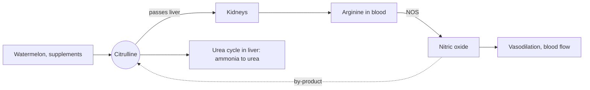

# Citrulline

## Summary

L-citrulline is a non-protein amino acid and an intermediate of the urea cycle, which removes ammonia from the body. In the kidneys it is turned into arginine, so oral citrulline raises blood arginine and nitric oxide more reliably than arginine itself. It is popular in pre-workout products, often as citrulline malate. The best supported use is a small improvement in repeated high-intensity exercise and possibly reduced soreness, while other claims rest on little human evidence.

*This note is educational. It is not medical advice and does not replace a doctor, dietitian or pharmacist, especially during pregnancy, illness or when taking medicines.*

## Prerequisites

- [Amino acids overview](amino-acids-overview.md)

## Core concepts

### Definition

*Citrulline* is an amino acid that is not built into proteins during translation. It is made in the intestine from glutamine and ornithine, it is an intermediate of the [Urea cycle](../urea-cycle.md), and it is also the by-product when nitric oxide synthase makes NO from arginine. Its name comes from *Citrullus*, the Latin name of the watermelon, from which it was first isolated. Food sources are watermelon (especially the white rind), melons and cucumbers. Supplements come as powder, capsules and in pre-workout blends, either as L-citrulline or as citrulline malate (citrulline bound to malic acid, often in a 2:1 ratio by weight).

### Analogy

Citrulline is like a delivery that takes the side road. Arginine sent by the main road (gut and liver) is mostly stopped at a checkpoint (arginase). Citrulline drives around it and is converted into arginine at the destination (the kidneys). More of the cargo arrives. The analogy breaks because the conversion still depends on the kidneys, so in kidney disease the side road is partly closed.

### Mechanism

1. Oral citrulline is absorbed and passes the liver largely unchanged, because the liver takes up little citrulline.
2. The kidneys convert it into arginine (argininosuccinate synthetase and lyase).
3. The higher arginine supply supports nitric oxide synthesis in the vessel walls, which relaxes the vessels.
4. In the liver, citrulline is part of the urea cycle that turns toxic ammonia into urea. Proposed benefits for fatigue rely partly on faster ammonia removal during hard exercise.

The malate in citrulline malate is an intermediate of the Krebs cycle. Whether it adds any effect of its own is not established.

The diagram shows how oral citrulline raises arginine and nitric oxide.

### Proposed effects and evidence

Each entry states the proposed effect and how strong the human evidence is, using the grades defined in the [Evidence grades](../../../../applied-sciences/medicine-and-health/nutrition/evidence-grades.md) note.

- **Exercise performance.** Higher NO improves blood flow and oxygen delivery to muscles during exercise, which may improve endurance, delay fatigue and increase work capacity in endurance and strength training. A 2020 meta-analysis (Gonzalez and Trexler) found a small benefit for resistance and high-intensity performance, with the strongest data for citrulline malate at about 8 g taken an hour before exercise. Results for endurance are mixed. Evidence: moderate for a small effect in high-intensity exercise.
- **Less muscle fatigue.** Citrulline may reduce fatigue by lowering lactate and ammonia during intense exercise, improving training output and recovery. Some trials report more repetitions to failure; the mechanism is not confirmed. Evidence: limited.
- **Cardiovascular support.** By raising NO, citrulline may improve vessel elasticity and lower blood pressure, supporting heart and circulatory health in people with hypertension. Small trials show modest drops in blood pressure. Evidence: limited.
- **Erectile function.** Like arginine, citrulline may improve erectile function through more blood flow to the genitals and is used as a natural option in erectile dysfunction. One small trial in mild erectile dysfunction reported improvement. Evidence: very limited.
- **Faster recovery.** Citrulline may support recovery after exercise by improving blood flow and reducing delayed onset muscle soreness (DOMS), and may increase protein synthesis. Some trials show less soreness at 24 to 48 hours. Evidence: limited.
- **Ammonia detoxification.** Citrulline is part of the urea cycle, which removes ammonia, a toxic by-product of protein metabolism, and so supports detoxification. This is established physiology; whether extra citrulline speeds ammonia removal in healthy people is unclear. Citrulline is used medically in some urea cycle disorders. Evidence: established physiology, limited for supplements.
- **Kidney health.** Citrulline may improve blood flow through the kidneys and protect them from damage linked to excess ammonia. Human evidence is lacking. Evidence: very limited.
- **Immune function.** Citrulline may support the production and activity of immune cells. Evidence is mostly from laboratory and animal studies. Evidence: very limited.
- **Metabolic health.** Citrulline may help regulate blood glucose and insulin sensitivity. A few small trials only. Evidence: very limited.
- **Skin health.** Through better circulation and detoxification, citrulline might improve skin elasticity and appearance. No good human data. Evidence: not supported by human trials.

## Worked example

A pre-workout product lists "citrulline malate 2:1, 6 g". The 2:1 ratio means 4 g of L-citrulline and 2 g of malate. Trials that found performance effects mostly used 8 g of citrulline malate (about 5.3 g of citrulline) or 3 to 6 g of pure L-citrulline. The product therefore sits at the lower end of the studied range. A slice of watermelon of 300 g gives roughly 0.5 to 1 g of citrulline, depending on variety and how much rind is eaten, so food alone rarely reaches the studied doses.

## Trade offs and when to use it

- **Better than arginine for raising arginine,** with fewer gut side effects.
- **Small effects.** The benefit for performance is small and not present in every trial. Dietary nitrate has stronger evidence for endurance.
- **Interactions.** Effects on blood pressure can add to those of blood pressure drugs, nitrates and erectile dysfunction drugs.

## Common mistakes

- **Comparing doses of citrulline malate with pure citrulline.** Convert using the ratio on the label.
- **Expecting a large effect on endurance.** The evidence is clearest for repeated high-intensity sets.

## Practice

1. Why does citrulline avoid the first-pass breakdown that limits arginine?
2. How much L-citrulline is in 9 g of citrulline malate 2:1?

### Answers

1. The liver takes up little citrulline and gut arginase does not act on it; it is converted to arginine in the kidneys.
2. About 6 g.

## Further reading

- NIH Office of Dietary Supplements. Dietary Supplements for Exercise and Athletic Performance: Fact Sheet for Health Professionals. [Link](https://ods.od.nih.gov/factsheets/ExerciseAndAthleticPerformance-HealthProfessional/). Summary of citrulline trials for exercise.
- Gonzalez, A. M., Trexler, E. T. (2020). Effects of citrulline supplementation on exercise performance in humans: a review of the current literature. Journal of Strength and Conditioning Research, 34(5), 1480-1495. [DOI](https://doi.org/10.1519/JSC.0000000000003426). Review of citrulline and exercise performance cited in the effects list.
- Berg, J. M., Tymoczko, J. L., Stryer, L. (2002). *Biochemistry (5th ed.)*. W. H. Freeman, free on NCBI Bookshelf. [Link](https://www.ncbi.nlm.nih.gov/books/NBK21154/). The urea cycle and nitric oxide synthase.
