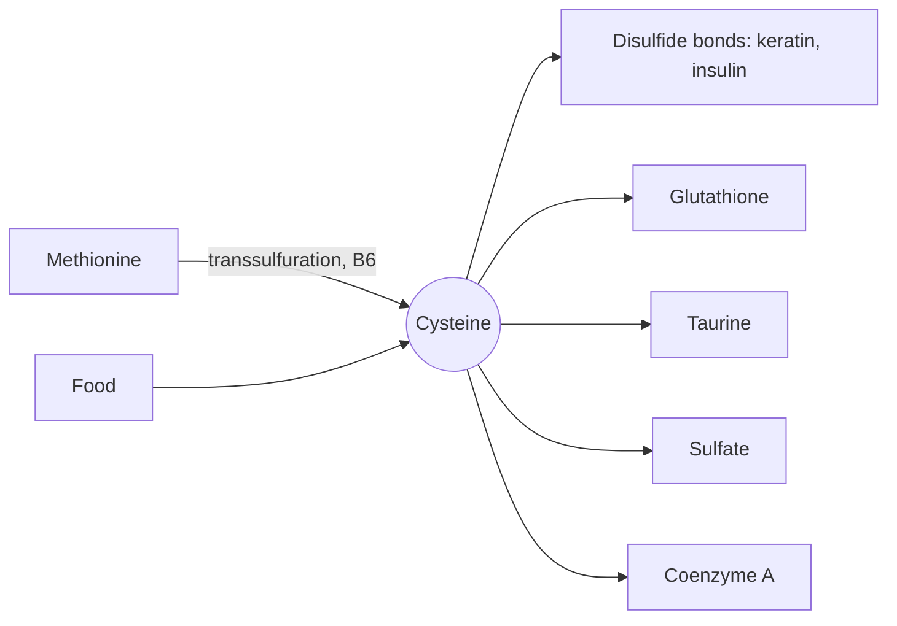

# Cysteine

## Summary

L-cysteine is a sulfur-containing amino acid whose thiol group (-SH) can link to another cysteine through a disulfide bond. These bonds stabilize proteins such as keratin in hair and insulin. Cysteine is also the limiting building block of glutathione. The body makes it from methionine, so it is conditionally essential.

*This note is educational. It is not medical advice and does not replace a doctor, dietitian or pharmacist, especially during pregnancy, illness or when taking medicines.*

## Prerequisites

- [Amino acids overview](amino-acids-overview.md)

## Core concepts

### Definition

*Cysteine* (Cys, C) is a polar amino acid with a reactive thiol group. Two cysteines can be oxidized to form *cystine*, joined by a disulfide bridge. Cysteine is made from methionine and serine through transsulfuration (see [Methionine](methionine.md)). It is conditionally essential: premature infants and people with liver disease may not make enough. Sources include eggs, meat, poultry, fish, dairy, garlic, onions, broccoli and oats. The supplement form is usually [N-acetylcysteine](n-acetylcysteine.md).

### Analogy

Disulfide bonds are like rivets in a folded metal structure. Once a protein has folded, cysteine rivets fix the fold so it holds its shape even outside the cell. Hair holds its shape for the same reason, and a permanent wave works by breaking the rivets, reshaping the hair on curlers and forming new rivets. The analogy breaks because rivets are permanent, while disulfide bonds inside cells can be opened and closed as a regulatory switch.

### Mechanism

- **Disulfide bonds** stabilize secreted and structural proteins: keratin (hair, nails), insulin, antibodies.
- **Glutathione.** Cysteine joins glutamate and glycine to form glutathione; its supply limits the rate.
- **Taurine and sulfate.** Cysteine is oxidized to taurine (used in bile salts) and to sulfate.
- **Coenzyme A** and iron-sulfur clusters in enzymes also take their sulfur from cysteine.

The diagram shows the main products.

## Worked example

Hair keratin is about 14 percent cysteine by weight, far more than most proteins. The cosmetic ingredient "hydrolyzed keratin" and the food additive L-cysteine (E920, used to soften bread dough) are made from hair or feathers or, increasingly, by fermentation.

## Trade offs and when to use it

Cysteine itself is rarely taken as a supplement because it oxidizes easily. N-acetylcysteine is the stable form used in medicine.

## Common mistakes

- **Confusing cysteine and cystine.** Cystine is two cysteines joined by a disulfide bond.

## Practice

1. What bond do two cysteines form?
2. Which antioxidant tripeptide is limited by cysteine supply?

### Answers

1. A disulfide bond, forming cystine.
2. Glutathione.

## Further reading

- World Health Organization (2007). *Protein and amino acid requirements in human nutrition: report of a joint WHO/FAO/UNU expert consultation (WHO Technical Report Series 935)*. WHO. Requirements for essential amino acids.
- Berg, J. M., Tymoczko, J. L., Stryer, L. (2002). *Biochemistry (5th ed.)*. W. H. Freeman, free on NCBI Bookshelf. [Link](https://www.ncbi.nlm.nih.gov/books/NBK21154/). Structure and metabolism of the amino acids.
