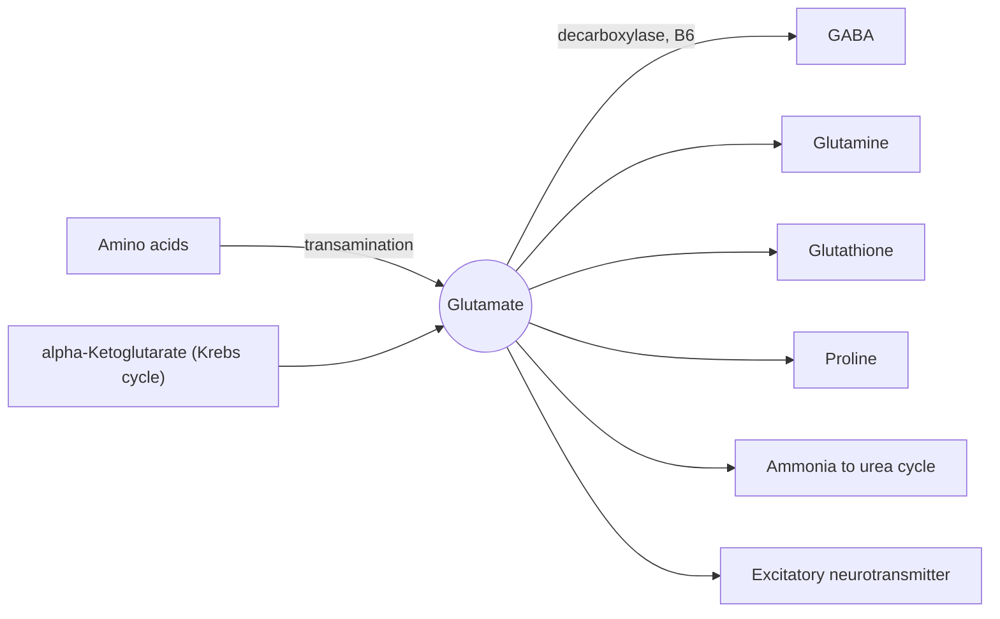

# Glutamic acid

## Summary

L-glutamic acid (glutamate) is the most common excitatory neurotransmitter in the brain and a hub of amino acid metabolism, collecting and distributing amino groups. It is the precursor of GABA, the main inhibitory neurotransmitter, and of glutathione. Its salt, monosodium glutamate (MSG, E621), gives the umami taste. Food glutamate does not cross into the brain in meaningful amounts.

*This note is educational. It is not medical advice and does not replace a doctor, dietitian or pharmacist, especially during pregnancy, illness or when taking medicines.*

## Prerequisites

- [Amino acids overview](amino-acids-overview.md)

## Core concepts

### Definition

*Glutamic acid* (Glu, E) has a carboxyl group on its side chain, negatively charged at body pH (glutamate). It is made from alpha-ketoglutarate, an intermediate of the Krebs cycle. Free glutamate occurs naturally in tomatoes, aged cheese (Parmesan), mushrooms, soy sauce, fish sauce and breast milk.

### Analogy

Glutamate in metabolism is like a central sorting office for nitrogen. Most amino acids drop their amino groups here (transamination to alpha-ketoglutarate makes glutamate), and the office then sends nitrogen where it is needed: into new amino acids, into glutamine, or to the urea cycle. The analogy breaks because the same molecule also works as a messenger in the brain, a role with no parallel in a sorting office.

### Mechanism

- **Transamination hub.** Amino acids pass their amino groups to alpha-ketoglutarate, forming glutamate. Glutamate dehydrogenase releases the nitrogen as ammonia for the urea cycle.
- **Neurotransmitter.** Glutamate activates AMPA, NMDA and other receptors. It is essential for learning and memory. Excessive release, as in stroke, damages neurons (excitotoxicity).
- **GABA.** Glutamate decarboxylase, which needs vitamin B6, converts glutamate into GABA.
- **Glutathione and glutamine.** Glutamate is the first building block of glutathione and the precursor of glutamine and proline.
- **Taste.** Free glutamate activates umami taste receptors on the tongue.

The diagram shows the hub role.

### Proposed effects and evidence

Each entry states the proposed effect and how strong the human evidence is, using the grades defined in the [Evidence grades](../../../../applied-sciences/medicine-and-health/nutrition/evidence-grades.md) note.

- **MSG and "Chinese restaurant syndrome".** Symptoms such as headache and flushing were attributed to MSG since 1968. Double-blind trials have not shown a consistent reaction to MSG taken with food at usual intakes. A small number of people may react to large doses (3 g or more) on an empty stomach. EFSA set an acceptable daily intake for glutamates added as additives of 30 mg per kg body weight in 2017. Evidence: not supported for usual intakes.

## Worked example

A tablespoon (15 ml) of soy sauce contains roughly 0.4 to 1 g of free glutamate, and 30 g of Parmesan about 0.4 g. A typical portion of a dish seasoned with MSG contains about 0.5 g. Daily intake of free glutamate from all sources in European diets is roughly 1 g, small compared with the 10 to 20 g of bound glutamate from dietary protein.

## Trade offs and when to use it

Glutamate in food is safe for nearly everyone. The gut uses most dietary glutamate as fuel, and the blood-brain barrier tightly limits entry into the brain.

## Common mistakes

- **Believing food glutamate excites the brain.** The gut uses most of it, and the blood-brain barrier keeps blood glutamate out of the brain.

## Practice

1. Which inhibitory neurotransmitter is made from glutamate?
2. What is MSG?

### Answers

1. GABA.
2. Monosodium glutamate, the sodium salt of glutamic acid, used as a flavor enhancer (E621).

## Further reading

- Berg, J. M., Tymoczko, J. L., Stryer, L. (2002). *Biochemistry (5th ed.)*. W. H. Freeman, free on NCBI Bookshelf. [Link](https://www.ncbi.nlm.nih.gov/books/NBK21154/). Biosynthesis and roles of the non-essential amino acids.
