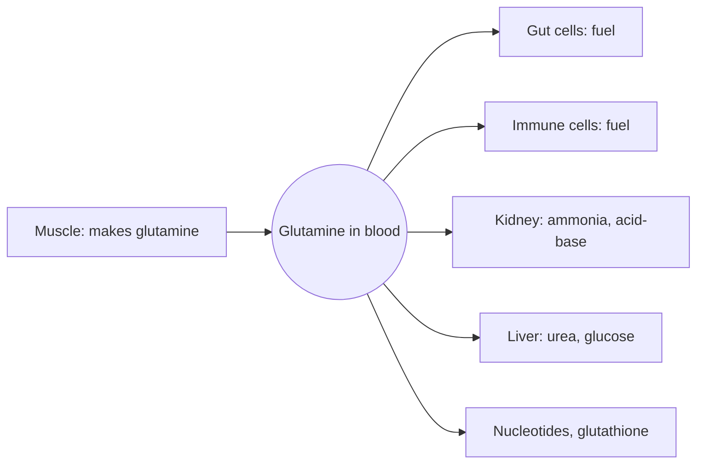

# Glutamine

## Summary

L-glutamine is the most abundant free amino acid in blood and muscle. It carries nitrogen between tissues and is a main fuel for gut lining cells and immune cells. Healthy people make plenty, so it is conditionally essential: in severe illness, burns or major surgery, levels fall. Glutamine supplements are popular in sport, but trials do not show benefits for muscle growth or recovery in healthy athletes.

*This note is educational. It is not medical advice and does not replace a doctor, dietitian or pharmacist, especially during pregnancy, illness or when taking medicines.*

## Prerequisites

- [Amino acids overview](amino-acids-overview.md)

## Core concepts

### Definition

*Glutamine* (Gln, Q) is a polar amino acid with an amide group on its side chain. Skeletal muscle makes most of the body's glutamine from glutamate and ammonia (glutamine synthetase). Sources include meat, fish, dairy, eggs, beans, cabbage and spinach.

### Analogy

Glutamine is like a delivery truck that carries both packages and fuel. It picks up nitrogen in muscle and drops it at the liver and kidneys, and the gut and immune cells burn it as fuel on the way. In major illness, demand for trucks rises sharply while the depot (muscle) shrinks. The analogy breaks because adding more trucks (supplements) to a healthy system that already has plenty does not deliver more.

### Mechanism

- **Nitrogen transport.** Glutamine carries two nitrogen atoms in a non-toxic form from muscle to the liver (urea synthesis) and the kidney (ammonia excretion, which helps regulate acid-base balance).
- **Fuel.** Cells lining the small intestine and rapidly dividing immune cells use glutamine as a major fuel.
- **Precursor.** Glutamine supplies nitrogen for nucleotides (DNA and RNA bases), amino sugars and glutathione (through glutamate).

The diagram shows glutamine traffic between organs.

### Proposed effects and evidence

Each entry states the proposed effect and how strong the human evidence is, using the grades defined in the [Evidence grades](../../../../applied-sciences/medicine-and-health/nutrition/evidence-grades.md) note.

- **Muscle growth and recovery.** Marketed for muscle building and recovery. Controlled trials in healthy resistance-trained people show no benefit for muscle mass or strength compared with placebo. Evidence: not supported.
- **Immune function after endurance exercise.** Plasma glutamine falls after very long exercise, which led to the idea that supplements reduce infections. Trials have not shown a consistent benefit. Evidence: not supported.
- **Critical illness.** Glutamine was given to critically ill patients to support gut and immune function. A large trial (REDOXS, 2013) found higher mortality with high-dose glutamine in critically ill patients with organ failure, and guidelines no longer recommend it routinely. Burn patients are a possible exception. Evidence: not supported, with a safety signal.
- **Gut barrier.** Glutamine is studied for "leaky gut" and irritable bowel syndrome. One trial in post-infection IBS reported benefit; evidence is limited. Evidence: limited.

## Worked example

Muscle holds about 60 percent of the free amino acid pool as glutamine, roughly 20 mmol per liter of intracellular water. A typical supplement dose is 5 g, about 34 mmol. Since healthy adults produce an estimated 40 to 80 g of glutamine a day, a 5 g dose is small compared with natural turnover, which helps explain why supplements change little in healthy people.

## Trade offs and when to use it

Glutamine is safe at usual supplement doses in healthy people. It should not be given to critically ill patients with organ failure outside medical protocols.

## Common mistakes

- **Buying glutamine to build muscle.** Trials do not support this; total protein matters.

## Practice

1. Which tissue makes most of the body's glutamine?
2. Name two cell types that use glutamine as fuel.

### Answers

1. Skeletal muscle.
2. Intestinal lining cells and immune cells.

## Further reading

- Berg, J. M., Tymoczko, J. L., Stryer, L. (2002). *Biochemistry (5th ed.)*. W. H. Freeman, free on NCBI Bookshelf. [Link](https://www.ncbi.nlm.nih.gov/books/NBK21154/). Biosynthesis and roles of the non-essential amino acids.
- NIH Office of Dietary Supplements. Dietary Supplements for Exercise and Athletic Performance: Fact Sheet for Health Professionals. [Link](https://ods.od.nih.gov/factsheets/ExerciseAndAthleticPerformance-HealthProfessional/). Summarizes the lack of performance benefit of glutamine.
