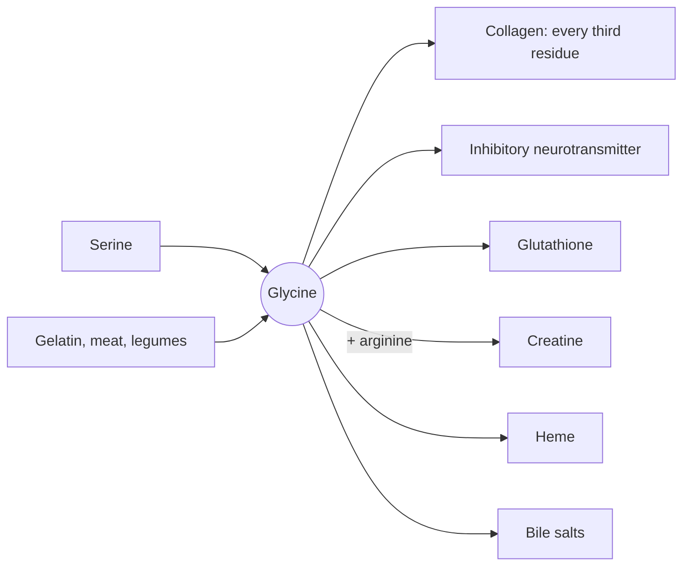

# Glycine

## Summary

Glycine is the smallest amino acid, with only a hydrogen atom as its side chain. It makes up about a third of the amino acids in collagen, where its small size lets three chains pack into a tight triple helix. It is also an inhibitory neurotransmitter in the spinal cord, part of glutathione, creatine and heme, and is studied as a sleep aid.

*This note is educational. It is not medical advice and does not replace a doctor, dietitian or pharmacist, especially during pregnancy, illness or when taking medicines.*

## Prerequisites

- [Amino acids overview](amino-acids-overview.md)

## Core concepts

### Definition

*Glycine* (Gly, G) is the simplest amino acid and the only one without a chiral center. The body makes it from serine, threonine and choline, but synthesis may not cover the need for collagen turnover, so some researchers consider it conditionally essential. Sources are gelatin, bone broth, skin and connective tissue of meat, fish, legumes and dairy.

### Analogy

Glycine in collagen is like the narrow side of a zipper tooth. Three collagen chains twist around each other so tightly that every third position faces the center, where there is room only for the smallest amino acid. Any larger amino acid there would jam the zipper. Some forms of brittle bone disease (osteogenesis imperfecta) are caused exactly by such a jam. The analogy breaks because glycine has many other roles outside collagen.

### Mechanism

- **Collagen.** The repeating pattern of collagen is Gly-X-Y, where X is often proline and Y often hydroxyproline (see [Collagen](../proteins/collagen.md)).
- **Neurotransmitter.** In the spinal cord and brainstem, glycine opens chloride channels and inhibits neurons. It is also a required co-agonist at NMDA glutamate receptors.
- **Building block** of glutathione, creatine (with arginine), heme (with succinyl-CoA) and purines.
- **Bile.** Glycine is conjugated to bile acids, helping fat digestion.

The diagram shows these roles.

### Proposed effects and evidence

Each entry states the proposed effect and how strong the human evidence is, using the grades defined in the [Evidence grades](../../../../applied-sciences/medicine-and-health/nutrition/evidence-grades.md) note.

- **Sleep quality.** Small Japanese trials found that 3 g of glycine before bed improved subjective sleep quality and next-day alertness, possibly by lowering core body temperature. Evidence: limited.
- **Collagen synthesis.** Collagen and gelatin supplements supply glycine; whether extra glycine raises collagen synthesis in healthy people is not established. Evidence: very limited.

## Worked example

Gelatin is about 27 percent glycine by weight. A 10 g serving of gelatin powder therefore supplies about 2.7 g of glycine, close to the 3 g used in the sleep studies.

## Trade offs and when to use it

Glycine is safe at doses of a few grams. It tastes sweet (the name comes from Greek *glykys*, sweet). Strong evidence for health effects of supplements is lacking.

## Common mistakes

- **Assuming collagen supplements work only through glycine.** Their effects, if any, are debated and may involve specific peptides.

## Practice

1. Why must every third amino acid in collagen be glycine?
2. Name two molecules besides proteins that contain glycine.

### Answers

1. Only glycine is small enough to fit into the center of the tight triple helix.
2. Glutathione and creatine (also heme and bile salts).

## Further reading

- Berg, J. M., Tymoczko, J. L., Stryer, L. (2002). *Biochemistry (5th ed.)*. W. H. Freeman, free on NCBI Bookshelf. [Link](https://www.ncbi.nlm.nih.gov/books/NBK21154/). Biosynthesis and roles of the non-essential amino acids.
