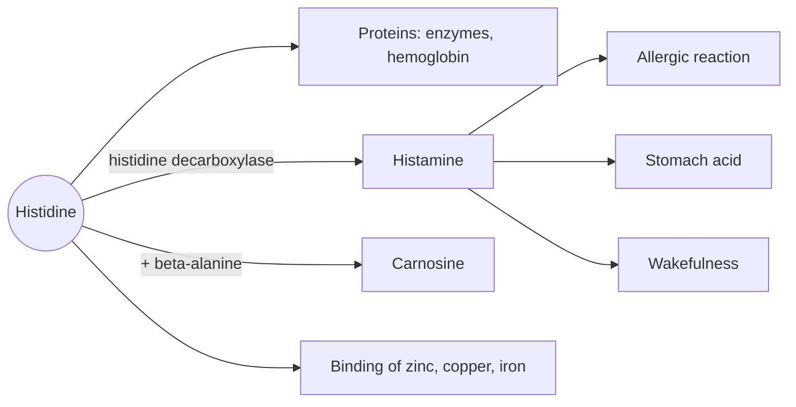

# Histidine

## Summary

L-histidine is an essential amino acid with an imidazole ring that can gain or lose a proton near body pH. This makes it a key part of enzyme active sites and of hemoglobin's buffering. It is the precursor of histamine, the signal behind allergy and stomach acid, and together with beta-alanine it forms carnosine, the acid buffer in muscle.

*This note is educational. It is not medical advice and does not replace a doctor, dietitian or pharmacist, especially during pregnancy, illness or when taking medicines.*

## Prerequisites

- [Amino acids overview](amino-acids-overview.md)

## Core concepts

### Definition

*Histidine* (His, H) is an essential amino acid. Its side chain, the imidazole ring, has a pKa of about 6.0 in free histidine and 6 to 7 in proteins, so at body pH it can act as either an acid or a base. Adults were long thought to make enough, but nitrogen balance studies show it is essential for adults too. Food sources are meat, fish, poultry, dairy, eggs, legumes and whole grains.

### Analogy

Histidine is like a switch that flips at room temperature. Most switches in a building are clearly on or off, but histidine sits right at the point where a small change in pH flips it between charged and uncharged. That makes it ideal wherever a protein needs to pass a proton back and forth, as in enzymes or in buffering. The analogy breaks because the "flip point" changes with the protein around it.

### Mechanism

- **Enzymes.** Histidine residues pass protons in the active sites of many enzymes, for example the serine proteases that digest proteins.
- **Hemoglobin.** Histidine residues bind the iron-containing heme and buffer hydrogen ions in red blood cells, which helps release oxygen in active tissues (the Bohr effect).
- **Histamine.** Histidine decarboxylase converts histidine into histamine, released by mast cells in allergic reactions, by stomach cells to stimulate acid secretion and by neurons as a wakefulness signal (see [Allergy](../../../../applied-sciences/medicine-and-health/conditions/allergy.md)).
- **Carnosine.** With beta-alanine it forms carnosine in muscle (see [Beta-alanine](beta-alanine.md)).
- **Metal binding.** Histidine binds zinc, copper and iron in many proteins.

The diagram shows the main products of histidine.

## Worked example

The WHO/FAO/UNU 2007 requirement is 10 mg per kg per day, 700 mg for a 70 kg adult. One egg supplies about 150 mg and 100 g of chicken about 900 mg, so a normal diet covers the need easily. Antihistamines used for hay fever act on histamine receptors, not on histidine, and do not change histidine needs.

## Trade offs and when to use it

Histidine supplements are rarely used. Very high doses may change zinc and copper balance because histidine binds these metals. Histamine intolerance is a separate topic: it concerns histamine from food (aged cheese, wine, fermented foods), not dietary histidine.

## Common mistakes

- **Confusing histidine with histamine.** Histamine is made from histidine but has its own receptors and effects.

## Practice

1. Why is histidine well suited to pass protons in enzymes?
2. Which molecule involved in allergy is made from histidine?

### Answers

1. Its imidazole ring has a pKa close to body pH, so it can easily gain or lose a proton.
2. Histamine.

## Further reading

- World Health Organization (2007). *Protein and amino acid requirements in human nutrition: report of a joint WHO/FAO/UNU expert consultation (WHO Technical Report Series 935)*. WHO. Requirements for essential amino acids.
- Berg, J. M., Tymoczko, J. L., Stryer, L. (2002). *Biochemistry (5th ed.)*. W. H. Freeman, free on NCBI Bookshelf. [Link](https://www.ncbi.nlm.nih.gov/books/NBK21154/). Structure and metabolism of the amino acids.
