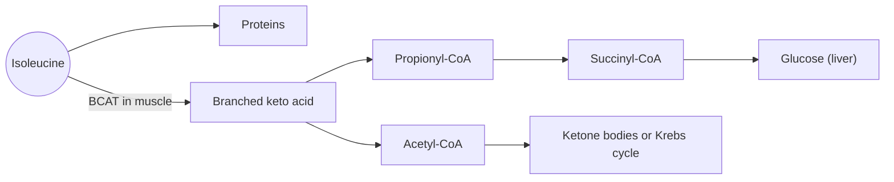

# Isoleucine

## Summary

L-isoleucine is an essential branched-chain amino acid. It is used for protein synthesis, as a fuel in muscle and as a precursor of both glucose and ketone bodies. In animal and cell studies it increases glucose uptake into muscle. It is usually taken as part of protein or of a BCAA mix rather than alone.

*This note is educational. It is not medical advice and does not replace a doctor, dietitian or pharmacist, especially during pregnancy, illness or when taking medicines.*

## Prerequisites

- [Amino acids overview](amino-acids-overview.md)

## Core concepts

### Definition

*Isoleucine* (Ile, I) is an essential amino acid with a branched nonpolar side chain. It is an isomer of leucine: both have the formula C6H13NO2 but a different arrangement of atoms. It has two chiral centers. Sources are meat, fish, eggs, dairy, soy and legumes.

### Analogy

Isoleucine and leucine are like two keys cut from the same blank. They weigh the same and look alike, but the teeth differ, so they open different locks: leucine strongly opens the mTORC1 lock, while isoleucine fits better into locks related to glucose uptake. The analogy breaks because both are also ordinary bricks in proteins, where they can often replace each other without much change.

### Mechanism

- Branched-chain aminotransferase in muscle removes the amino group, starting breakdown in muscle rather than liver.
- The carbon skeleton gives acetyl-CoA (ketogenic) and propionyl-CoA, which can become succinyl-CoA and then glucose (glucogenic). Isoleucine is therefore both glucogenic and ketogenic.
- In animal studies, isoleucine increased glucose uptake into muscle independently of insulin.

The diagram shows the breakdown products.

## Worked example

The WHO/FAO/UNU 2007 requirement is 20 mg per kg per day, 1.4 g for a 70 kg adult. 100 g of beef supplies about 1.3 g, one cup of cooked lentils about 0.8 g. In maple syrup urine disease, a rare inherited defect of BCAA breakdown, isoleucine and the other BCAAs build up, and the urine smells sweet; affected people follow a lifelong special diet.

## Trade offs and when to use it

No reason to supplement isoleucine alone in healthy people. In BCAA products the ratio of leucine to isoleucine to valine is commonly 2:1:1.

## Common mistakes

- **Treating leucine and isoleucine as interchangeable in function.** Their signaling roles differ even though they are isomers.

## Practice

1. Is isoleucine glucogenic, ketogenic or both?
2. Where are branched-chain amino acids mainly broken down?

### Answers

1. Both.
2. In muscle.

## Further reading

- World Health Organization (2007). *Protein and amino acid requirements in human nutrition: report of a joint WHO/FAO/UNU expert consultation (WHO Technical Report Series 935)*. WHO. Requirements for essential amino acids.
- Berg, J. M., Tymoczko, J. L., Stryer, L. (2002). *Biochemistry (5th ed.)*. W. H. Freeman, free on NCBI Bookshelf. [Link](https://www.ncbi.nlm.nih.gov/books/NBK21154/). Structure and metabolism of the amino acids.
