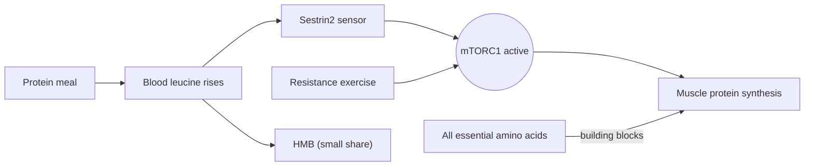

# Leucine

## Summary

L-leucine is an essential branched-chain amino acid (BCAA). Besides being a building block, it is a signal: a rise in blood leucine after a meal activates mTORC1, the switch that starts muscle protein synthesis. This is why protein sources rich in leucine, such as whey, stimulate muscle building strongly per gram. Leucine alone or BCAAs alone cannot sustain muscle growth, because synthesis needs all essential amino acids.

*This note is educational. It is not medical advice and does not replace a doctor, dietitian or pharmacist, especially during pregnancy, illness or when taking medicines.*

## Prerequisites

- [Amino acids overview](amino-acids-overview.md)

## Core concepts

### Definition

*Leucine* (Leu, L) is an essential amino acid with a branched, nonpolar side chain. With isoleucine and valine it forms the branched-chain amino acids, which, unlike most amino acids, are broken down mainly in muscle rather than the liver. Rich sources are dairy (especially whey), meat, fish, eggs, soy and legumes.

### Analogy

Leucine is like the key in the ignition of a car. Turning the key (a rise in leucine) starts the engine (muscle protein synthesis), but the car only drives if there is fuel in the tank (all the other essential amino acids). Turning the key with an empty tank, as with BCAAs alone, makes the engine cough briefly and stop. The analogy breaks because leucine is also part of the fuel: it is built into the new proteins.

### Mechanism

1. After a protein meal, blood leucine rises within about 30 to 60 minutes.
2. Leucine is sensed inside the muscle cell by the protein Sestrin2, which releases a brake on the *mTORC1* complex.
3. Active mTORC1 phosphorylates proteins that start translation on the ribosomes, so the rate of muscle protein synthesis rises for about 2 to 3 hours.
4. Resistance exercise activates mTORC1 by a separate mechanical route, so exercise and leucine-rich protein add together.
5. Leucine is broken down to acetyl-CoA and acetoacetate (it is purely *ketogenic*). One of its metabolites, beta-hydroxy-beta-methylbutyrate (HMB), is sold separately as a supplement.

The diagram shows the leucine signal and why other amino acids are still needed.

### Leucine threshold

Studies on young adults suggest that about 2 to 3 g of leucine per meal, contained in roughly 20 to 40 g of high quality protein, gives a near maximal stimulus of muscle protein synthesis. Older adults appear to need more per meal ("anabolic resistance"). These thresholds are estimates from short-term studies, not fixed rules.

### Proposed effects and evidence

Each entry states the proposed effect and how strong the human evidence is, using the grades defined in the [Evidence grades](../../../../applied-sciences/medicine-and-health/nutrition/evidence-grades.md) note.

- **Muscle protein synthesis.** Leucine triggers the start of muscle protein synthesis through mTORC1. As part of complete protein this is well established; leucine or BCAAs alone produce a smaller, short-lived response. Evidence: strong as part of complete protein, limited for leucine alone.
- **Older adults and sarcopenia.** Leucine-enriched protein may help preserve muscle in older adults. Results of trials are mixed and depend on total protein intake. Evidence: limited.

## Worked example

Which gives more leucine: 25 g of whey protein or 25 g of pea protein? Whey protein is about 10 to 11 percent leucine (about 2.7 g in 25 g), pea protein about 8 percent (about 2.0 g). To reach the same 2.7 g of leucine from pea protein, about 33 g would be needed. This is one reason plant protein doses in studies are often higher.

## Trade offs and when to use it

Leucine-rich foods are an efficient way to support muscle protein synthesis. Isolated leucine or BCAA products add little when total daily protein is adequate. High BCAA intake in observational studies is associated with insulin resistance, although cause and effect are unclear.

## Common mistakes

- **Buying BCAAs instead of protein.** Complete protein supplies leucine plus the other essential amino acids.
- **Thinking leucine has to be taken at an exact time.** Total daily protein spread over meals matters most.

## Practice

1. Which signaling complex does leucine activate?
2. Why do BCAAs alone give only a short rise in muscle protein synthesis?

### Answers

1. mTORC1.
2. Synthesis needs all essential amino acids, and BCAAs supply only three.

## Further reading

- World Health Organization (2007). *Protein and amino acid requirements in human nutrition: report of a joint WHO/FAO/UNU expert consultation (WHO Technical Report Series 935)*. WHO. Requirements for essential amino acids.
- Berg, J. M., Tymoczko, J. L., Stryer, L. (2002). *Biochemistry (5th ed.)*. W. H. Freeman, free on NCBI Bookshelf. [Link](https://www.ncbi.nlm.nih.gov/books/NBK21154/). Structure and metabolism of the amino acids.
- Jäger, R., Kerksick, C. M., Campbell, B. I. et al. (2017). International Society of Sports Nutrition position stand: protein and exercise. Journal of the International Society of Sports Nutrition, 14, 20. [DOI](https://doi.org/10.1186/s12970-017-0177-8). ISSN position stand on protein, with the leucine threshold.
- Morton, R. W., Murphy, K. T., McKellar, S. R. et al. (2018). A systematic review, meta-analysis and meta-regression of the effect of protein supplementation on resistance training-induced gains in muscle mass and strength in healthy adults. British Journal of Sports Medicine, 52(6), 376-384. [DOI](https://doi.org/10.1136/bjsports-2017-097608). Meta-analysis of protein supplements and muscle gains.
