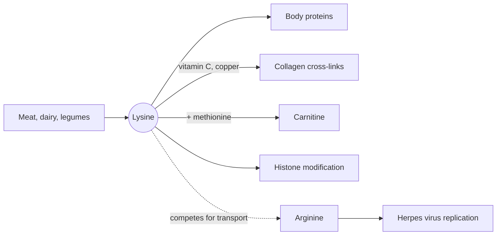

# Lysine

## Summary

L-lysine is an essential amino acid with a positively charged side chain. It is the limiting amino acid in most cereals, a precursor of carnitine and essential for collagen cross-links. Lysine supplements are used to reduce outbreaks of cold sores caused by herpes simplex virus, on the theory that lysine competes with arginine, which the virus needs. The evidence for this is weak and mixed.

*This note is educational. It is not medical advice and does not replace a doctor, dietitian or pharmacist, especially during pregnancy, illness or when taking medicines.*

## Prerequisites

- [Amino acids overview](amino-acids-overview.md)

## Core concepts

### Definition

*Lysine* (Lys, K) is an essential amino acid with a side chain ending in an amino group, which is positively charged at body pH. Cereals such as wheat, rice and corn contain little lysine, while meat, fish, eggs, dairy and legumes contain plenty.

### Analogy

Lysine against herpes is like crowding a parking lot. The herpes virus needs parking spaces (arginine) to build its new copies. Flooding the lot with other cars (lysine) that use the same entrance gates (shared transporters) and compete in some enzymes leaves fewer spaces for the virus. The analogy breaks because in the body the "lot" is never fully blocked, and the virus can still find enough arginine, which may be why trials disagree.

### Mechanism

1. **Protein synthesis.** Lysine is part of all body proteins. In collagen, lysine residues are hydroxylated (with vitamin C as cofactor) and then cross-linked by lysyl oxidase (a copper enzyme), which gives collagen its strength.
2. **Carnitine.** Lysine and methionine are the precursors of carnitine, which carries fatty acids into the mitochondria for [Beta-oxidation](../beta-oxidation.md).
3. **Histone modification.** Lysine residues in histones are acetylated and methylated, which helps control which genes are active.
4. **Proposed antiviral action.** Herpes simplex virus (HSV) needs arginine to make its proteins. Lysine and arginine share transporters into cells, and lysine may increase arginase activity, so a high ratio of lysine to arginine is thought to slow viral replication.

The diagram shows the main roles and the proposed antiviral action.

### Requirement and food sources

The WHO/FAO/UNU 2007 requirement for adults is 30 mg per kg per day, about 2.1 g for a 70 kg adult. A 100 g portion of chicken provides about 2.5 g, a cup of cooked lentils (about 200 g) about 1.2 g, and 100 g of wheat bread only about 0.3 g. Lysine deficiency is rare in people who eat legumes or animal foods but can occur in diets based mainly on cereals.

### Proposed effects and evidence

Each entry states the proposed effect and how strong the human evidence is, using the grades defined in the [Evidence grades](../../../../applied-sciences/medicine-and-health/nutrition/evidence-grades.md) note.

- **Herpes simplex (cold sores).** Lysine is an amino acid that some studies show may inhibit the replication of herpes simplex virus, which may reduce the frequency and severity of outbreaks. It competes with arginine, an amino acid the virus needs to replicate, which limits its ability to multiply. It is taken as tablets or capsules, available in pharmacies and health food stores. Trials are old and small, with mixed results; benefits appeared mainly at doses above 1 g per day for prevention, and lysine does not appear to help treat an active sore. Evidence: limited.
- **Calcium absorption and bone.** Lysine may increase intestinal calcium absorption and reduce urinary calcium loss, which has been proposed for bone health. Evidence is from small short-term studies. Evidence: very limited.
- **Anxiety.** Some small trials of lysine combined with arginine reported lower stress hormone responses. Evidence is too thin for conclusions. Evidence: very limited.

## Worked example

A person with frequent cold sores reads that lysine helps. The diet already supplies about 5 g of lysine and 4 g of arginine a day (a ratio of about 1.25). Taking 1 g of lysine three times a day raises lysine to about 8 g and the ratio to about 2. Whether this ratio is enough to slow the virus is not proven. Antiviral drugs such as aciclovir and valaciclovir have strong evidence both for treating outbreaks and for suppressive prevention, so a person with frequent outbreaks should discuss them with a doctor.

## Trade offs and when to use it

- **Safety.** Doses up to about 3 g per day are generally well tolerated. Gut upset can occur. People with kidney disease should avoid high doses.
- **Alternatives.** Prescription antivirals for herpes have much stronger evidence. Sun protection on the lips helps prevent outbreaks triggered by ultraviolet light.

## Common mistakes

- **Relying on lysine instead of antiviral treatment for frequent or severe outbreaks.** Discuss antiviral therapy with a doctor.
- **Ignoring lysine on a cereal-based diet.** Add legumes or animal foods to cover the requirement.

## Practice

1. Which amino acid does lysine compete with in the proposed antiviral mechanism?
2. Which two cofactors are needed to form collagen cross-links involving lysine?
3. Name a food group low in lysine.

### Answers

1. Arginine.
2. Vitamin C (for hydroxylation) and copper (for lysyl oxidase).
3. Cereals such as wheat, rice and corn.

## Further reading

- World Health Organization (2007). *Protein and amino acid requirements in human nutrition: report of a joint WHO/FAO/UNU expert consultation (WHO Technical Report Series 935)*. WHO. Requirement of 30 mg/kg per day.
- Berg, J. M., Tymoczko, J. L., Stryer, L. (2002). *Biochemistry (5th ed.)*. W. H. Freeman, free on NCBI Bookshelf. [Link](https://www.ncbi.nlm.nih.gov/books/NBK21154/). Collagen cross-linking and carnitine synthesis.
