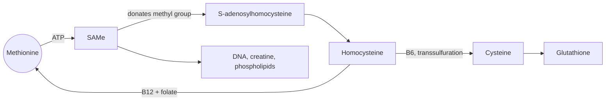

# Methionine

## Summary

L-methionine is an essential sulfur-containing amino acid. Every human protein starts with methionine, because its codon (AUG) is the start signal of translation. Through S-adenosylmethionine (SAMe) it donates methyl groups to DNA, proteins and many other molecules, and its breakdown produces homocysteine and cysteine. Folate, vitamin B12 and vitamin B6 keep this cycle running.

*This note is educational. It is not medical advice and does not replace a doctor, dietitian or pharmacist, especially during pregnancy, illness or when taking medicines.*

## Prerequisites

- [Amino acids overview](amino-acids-overview.md)

## Core concepts

### Definition

*Methionine* (Met, M) is an essential amino acid whose side chain contains a sulfur atom in a thioether. It is the starting amino acid of protein synthesis. Methionine and cysteine together are called the *sulfur amino acids*. Rich sources are eggs, fish, meat, Brazil nuts, sesame seeds and dairy. Legumes contain relatively little, which makes methionine the limiting amino acid in many beans.

### Analogy

The methionine cycle is like a stamp pad. Methionine is loaded with ink (ATP turns it into SAMe), stamps a methyl group onto a target (DNA, a hormone, a phospholipid), and is left as an empty stamp (homocysteine). The empty stamp is re-inked using folate and vitamin B12, or thrown away by turning it into cysteine with vitamin B6. The analogy breaks because the stamp pad also feeds a separate production line: the cysteine that leaves the cycle builds glutathione.

### Mechanism

1. Methionine + ATP → S-adenosylmethionine (SAMe), the main methyl donor of the body.
2. SAMe transfers its methyl group in more than 100 reactions, for example the methylation of DNA, the synthesis of creatine and of phosphatidylcholine. The product is S-adenosylhomocysteine, then homocysteine.
3. Homocysteine is either remethylated back to methionine by methionine synthase (needs vitamin B12 and 5-methyltetrahydrofolate) or by betaine, or converted to cysteine through cystathionine (needs vitamin B6). This route is called *transsulfuration*.
4. High blood homocysteine, often from low folate, B12 or B6, is a marker associated with cardiovascular disease, although lowering it with vitamins did not reduce events in large trials.

The diagram shows the methionine cycle and the vitamins it depends on.

## Worked example

The WHO/FAO/UNU 2007 requirement for methionine plus cysteine is 15 mg per kg per day, about 1 g for a 70 kg adult. Two eggs supply about 0.4 g of methionine and 0.3 g of cysteine. A plant-based diet with cereals (rich in methionine) and legumes (poor in methionine, rich in lysine) covers both limiting amino acids.

## Trade offs and when to use it

SAMe is sold as a supplement for mood and joint pain, with some evidence in small trials, and is a prescription drug in some European countries. Excess methionine intake raises homocysteine. Methionine supplements have no established use in healthy people.

## Common mistakes

- **Treating homocysteine as a cause that vitamins fix.** Lowering homocysteine with B vitamins did not lower cardiovascular events in large trials, so it is mainly a marker.

## Practice

1. Why does every protein start with methionine?
2. Which vitamins are needed to recycle homocysteine to methionine?

### Answers

1. Its codon AUG is the start codon of translation.
2. Vitamin B12 and folate.

## Further reading

- World Health Organization (2007). *Protein and amino acid requirements in human nutrition: report of a joint WHO/FAO/UNU expert consultation (WHO Technical Report Series 935)*. WHO. Requirements for essential amino acids.
- Berg, J. M., Tymoczko, J. L., Stryer, L. (2002). *Biochemistry (5th ed.)*. W. H. Freeman, free on NCBI Bookshelf. [Link](https://www.ncbi.nlm.nih.gov/books/NBK21154/). Structure and metabolism of the amino acids.
- NIH Office of Dietary Supplements. Vitamin B12: Fact Sheet for Health Professionals. [Link](https://ods.od.nih.gov/factsheets/VitaminB12-HealthProfessional/). Explains the B12 and folate dependent methionine synthase reaction and homocysteine.
