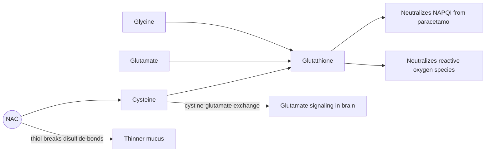

# N-acetylcysteine

## Summary

N-acetylcysteine (NAC) is a derivative of the amino acid cysteine. It supplies cysteine for the synthesis of glutathione, the main antioxidant inside cells. It is an established medicine: the antidote for paracetamol (acetaminophen) poisoning and a mucolytic that thins mucus. As a supplement it is studied for psychiatric conditions, fertility and metabolic health, with mixed or early evidence.

*This note is educational. It is not medical advice and does not replace a doctor, dietitian or pharmacist, especially during pregnancy, illness or when taking medicines.*

## Prerequisites

- [Amino acids overview](amino-acids-overview.md)

## Core concepts

### Definition

*N-acetylcysteine* is cysteine with an acetyl group attached to its nitrogen. The acetyl group makes the molecule more stable and better absorbed than cysteine itself. In the body it is deacetylated to cysteine, which is the amino acid that limits the synthesis of *glutathione* (a tripeptide of glutamate, cysteine and glycine). NAC is used in medicine as a drug (tablets, effervescent tablets, inhaled solutions and intravenous infusion) and sold in many countries as a dietary supplement.

### Analogy

NAC is like a delivery of the scarcest part to a factory. A factory that builds glutathione has plenty of glutamate and glycine on the shelves but often runs short of cysteine. NAC delivers cysteine, so production picks up. If the factory already has enough cysteine, more deliveries change little. The analogy breaks because NAC also acts directly: its free thiol group breaks bonds in mucus and binds some toxic compounds.

### Mechanism

1. **Glutathione supply.** NAC is converted into cysteine, which feeds glutathione synthesis. This is how it protects the liver after paracetamol overdose: the toxic paracetamol metabolite NAPQI is normally neutralized by glutathione, and in an overdose glutathione runs out.
2. **Mucolytic action.** The free thiol (-SH) group of NAC breaks the disulfide bonds that link mucus proteins, making mucus thinner and easier to cough up.
3. **Glutamate modulation.** In the brain, cysteine from NAC is exchanged for glutamate by the cystine-glutamate antiporter, which changes glutamate signaling. This is the proposed basis for studies in addiction, obsessive-compulsive disorder and other conditions.
4. **Antioxidant and anti-inflammatory effects** follow from higher glutathione and the direct reducing action of the thiol group.

The diagram shows the three main mechanisms.

### Proposed effects and evidence

Each entry states the proposed effect and how strong the human evidence is, using the grades defined in the [Evidence grades](../../../../applied-sciences/medicine-and-health/nutrition/evidence-grades.md) note.

- **Liver detoxification and paracetamol poisoning.** NAC is effective in treating paracetamol poisoning, supporting the liver in detoxification and preventing liver damage by raising glutathione, which neutralizes the toxic metabolite. This is standard emergency treatment, most effective within 8 to 10 hours of the overdose (Smilkstein et al., 1988). Evidence: strong (established medical use).
- **Antioxidant action.** NAC raises glutathione, which protects cells from oxidative stress and free radical damage and may help prevent chronic disease. Raised glutathione is shown in people with low levels; disease prevention in healthy people is not shown. Evidence: moderate for raising glutathione, not supported for prevention.
- **Respiratory health.** NAC thins mucus in the airways and makes it easier to cough up. It is used in chronic obstructive pulmonary disease (COPD), cystic fibrosis, bronchitis and respiratory infections. In COPD, meta-analyses found fewer flare-ups at higher doses (about 1,200 mg a day). Evidence: moderate.
- **Mental health.** NAC shows potential in depression, obsessive-compulsive disorder (OCD) and addiction. Its antioxidant action and regulation of glutamate in the brain may support cognition and mental health. Trials are small and results mixed, with some positive findings in trichotillomania and cannabis use disorder in adolescents. Evidence: limited.
- **Cardiovascular health.** NAC may support heart health by reducing oxidative stress and inflammation and improving blood flow. It may lower homocysteine, which is linked to atherosclerosis. Effects on hard outcomes such as heart attacks are not shown. Evidence: very limited.
- **Immune function.** By raising glutathione, which is important for fighting infection, NAC may support the immune system and protect it from oxidative stress that weakens immune responses. One older trial found fewer flu symptoms in older adults. Evidence: limited.
- **Reproductive health.** NAC may improve fertility, especially in men, by improving sperm quality, reducing oxidative stress and protecting against DNA damage. It is also studied in polycystic ovary syndrome (PCOS), where small trials suggest improved ovulation. Evidence: limited.
- **Metabolic disorders.** NAC may help control blood glucose and improve insulin sensitivity in type 2 diabetes or metabolic syndrome. Evidence is from small studies. Evidence: very limited.
- **Brain health.** NAC may protect brain cells from damage by oxidative stress and inflammation, which matters in the prevention of neurodegenerative diseases such as Alzheimer and Parkinson disease. Evidence is early. Evidence: very limited.
- **Surgical complications.** NAC may reduce the risk of complications after surgery, especially heart surgery, by reducing oxidative stress and inflammation. Trials of NAC to prevent kidney injury from contrast media or after heart surgery have mostly been negative in larger studies. Evidence: not supported by larger trials.

## Worked example

In the emergency treatment of paracetamol overdose, the decision to give NAC is based on the blood paracetamol level plotted against the time since ingestion (the Rumack-Matthew nomogram). A patient seen 4 hours after the overdose with a level above the treatment line receives intravenous NAC in a protocol of about 300 mg per kg over roughly 20 to 21 hours, with regimens differing by country. This shows NAC working as a drug at doses about 20 times larger than a typical supplement dose of 600 mg. The case is described for understanding only; poisoning needs emergency care.

## Trade offs and when to use it

- **Side effects** at supplement doses (600 to 1,800 mg a day) are mostly mild: nausea, diarrhea and a sulfur smell. Intravenous NAC can cause allergic-type reactions.
- **Interactions.** NAC may add to the effect of nitroglycerin (headache, low blood pressure) and of anticoagulants.
- **Status.** NAC is a medicine in many countries. Supplement use for psychiatric conditions should be discussed with the treating doctor.

## Common mistakes

- **Using NAC at home after a paracetamol overdose.** Overdose needs emergency care with blood levels and intravenous dosing.
- **Assuming more glutathione is always better.** Raising glutathione helps when it is depleted; in healthy people the benefit is not shown.

## Practice

1. Why does NAC protect the liver in paracetamol overdose?
2. How does NAC thin mucus?
3. Which amino acid limits glutathione synthesis?

### Answers

1. It supplies cysteine for glutathione, which neutralizes the toxic metabolite NAPQI.
2. Its thiol group breaks disulfide bonds between mucus proteins.
3. Cysteine.

## Further reading

- Smilkstein, M. J., Knapp, G. L., Kulig, K. W. et al. (1988). Efficacy of oral N-acetylcysteine in the treatment of acetaminophen overdose. Analysis of the national multicenter study (1976 to 1985). New England Journal of Medicine, 319(24), 1557-1562. [DOI](https://doi.org/10.1056/NEJM198812153192401). National multicenter study of oral NAC for paracetamol overdose.
- Berg, J. M., Tymoczko, J. L., Stryer, L. (2002). *Biochemistry (5th ed.)*. W. H. Freeman, free on NCBI Bookshelf. [Link](https://www.ncbi.nlm.nih.gov/books/NBK21154/). Glutathione and thiol chemistry.
