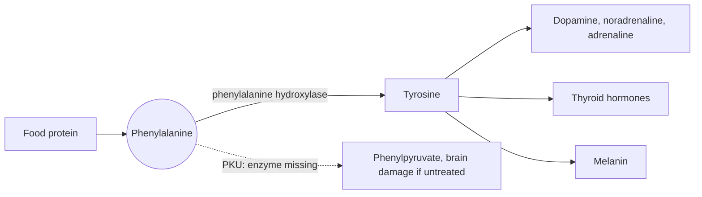

# Phenylalanine

## Summary

L-phenylalanine is an essential aromatic amino acid and the precursor of tyrosine, and through it of dopamine, noradrenaline, adrenaline, thyroid hormones and melanin. In the inherited disease phenylketonuria (PKU), the enzyme that converts it is missing, phenylalanine builds up and damages the brain unless a special diet is followed from birth. This is why products with aspartame carry a phenylalanine warning.

*This note is educational. It is not medical advice and does not replace a doctor, dietitian or pharmacist, especially during pregnancy, illness or when taking medicines.*

## Prerequisites

- [Amino acids overview](amino-acids-overview.md)

## Core concepts

### Definition

*Phenylalanine* (Phe, F) is an essential amino acid with a benzene ring in its side chain. Most of it is used for protein synthesis or converted to tyrosine in the liver. It is found in all protein foods: meat, fish, eggs, dairy, soy, legumes and nuts. The sweetener aspartame is a compound of phenylalanine and aspartic acid.

### Analogy

The conversion of phenylalanine to tyrosine is like a single bridge out of a valley. Normally traffic (phenylalanine) crosses the bridge (phenylalanine hydroxylase) and continues to many towns (tyrosine and its products). In PKU the bridge is out, so traffic piles up in the valley and spills onto side roads that lead to harmful places (phenylpyruvate and other byproducts). The only fix is to send less traffic into the valley: a low phenylalanine diet. The analogy breaks because modern therapy can partly repair the bridge in some patients (sapropterin, which boosts residual enzyme activity).

### Mechanism

1. Phenylalanine hydroxylase in the liver converts phenylalanine into tyrosine, using tetrahydrobiopterin and oxygen.
2. Tyrosine leads to the catecholamines, thyroid hormones and melanin (see [Tyrosine](tyrosine.md)).
3. In PKU, phenylalanine accumulates and is partly converted to phenylpyruvate, which appears in the urine (hence "phenylketonuria"). High phenylalanine competes with other large neutral amino acids for entry into the brain and harms brain development.
4. Newborn screening (the heel prick test, introduced in the 1960s by Robert Guthrie) detects PKU in the first days of life.

The diagram shows the normal path and the blocked path in PKU.

## Worked example

PKU occurs in roughly 1 in 10,000 to 15,000 births in Europe, with large regional differences. A child with PKU on a diet that keeps blood phenylalanine in the target range develops normally. A 330 ml can of diet soda sweetened with aspartame contains roughly 100 to 200 mg of aspartame, of which about half by weight is phenylalanine. For most people this is trivial compared with the 3 to 5 g of phenylalanine in a normal daily diet, but for a person with PKU it counts against a daily allowance of only a few hundred milligrams.

## Trade offs and when to use it

Phenylalanine supplements (including D,L-phenylalanine) have been tried for pain and depression with little evidence. People with PKU must avoid aspartame. People taking MAO inhibitors should avoid supplements.

## Common mistakes

- **Thinking the aspartame warning is for everyone.** It is for people with PKU.

## Practice

1. Which enzyme is missing in classic phenylketonuria?
2. Why do aspartame products carry a phenylalanine warning?

### Answers

1. Phenylalanine hydroxylase.
2. Aspartame releases phenylalanine, which people with PKU must restrict.

## Further reading

- World Health Organization (2007). *Protein and amino acid requirements in human nutrition: report of a joint WHO/FAO/UNU expert consultation (WHO Technical Report Series 935)*. WHO. Requirements for essential amino acids.
- Berg, J. M., Tymoczko, J. L., Stryer, L. (2002). *Biochemistry (5th ed.)*. W. H. Freeman, free on NCBI Bookshelf. [Link](https://www.ncbi.nlm.nih.gov/books/NBK21154/). Structure and metabolism of the amino acids.
