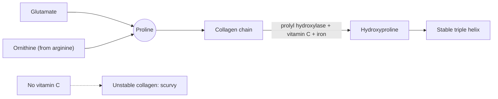

# Proline

## Summary

L-proline is an amino acid whose side chain loops back to its own amino group, making a rigid ring. This rigidity creates kinks in protein chains and makes proline, together with its modified form hydroxyproline, a key part of collagen. Hydroxylation of proline needs vitamin C, which is why vitamin C deficiency (scurvy) weakens connective tissue.

*This note is educational. It is not medical advice and does not replace a doctor, dietitian or pharmacist, especially during pregnancy, illness or when taking medicines.*

## Prerequisites

- [Amino acids overview](amino-acids-overview.md)

## Core concepts

### Definition

*Proline* (Pro, P) is technically an imino acid, because its nitrogen is part of a ring. The body makes it from glutamate and from ornithine, so it is conditionally essential (possibly limited in wound healing and burns). Sources are gelatin, meat, dairy, eggs and wheat gluten.

### Analogy

Proline is like a fixed elbow joint in a flexible hose. Most of the protein chain can twist freely, but at proline the chain must bend in a set direction. In collagen, many prolines in a row force each chain into a tight left-handed spiral that then winds with two others. The analogy breaks because proline is not always a bend: in collagen it is part of a regular, stiff structure.

### Mechanism

1. Proline is made from glutamate or from ornithine (which comes from arginine).
2. In collagen, after the chain is made, prolyl hydroxylase converts many proline residues to hydroxyproline. The enzyme needs vitamin C and iron.
3. Hydroxyproline forms hydrogen bonds that stabilize the triple helix at body temperature.
4. Without vitamin C, collagen is unstable and is broken down, which causes bleeding gums, poor wound healing and fragile vessels in scurvy.

The diagram shows proline's path into collagen.

## Worked example

Collagen is about 12 percent proline and 10 percent hydroxyproline. Because hydroxyproline occurs almost only in collagen, its amount in food or tissue is used to estimate collagen content, for example in quality control of meat products.

## Trade offs and when to use it

Proline is not commonly supplemented alone. Adequate vitamin C matters more for collagen formation than extra proline.

## Common mistakes

- **Taking collagen without enough vitamin C.** Hydroxylation of proline depends on vitamin C.

## Practice

1. Which vitamin is needed to make hydroxyproline?
2. Why is proline sometimes called an imino acid?

### Answers

1. Vitamin C.
2. Its nitrogen is part of a ring bonded to the side chain.

## Further reading

- Berg, J. M., Tymoczko, J. L., Stryer, L. (2002). *Biochemistry (5th ed.)*. W. H. Freeman, free on NCBI Bookshelf. [Link](https://www.ncbi.nlm.nih.gov/books/NBK21154/). Biosynthesis and roles of the non-essential amino acids.
- NIH Office of Dietary Supplements. Vitamin C: Fact Sheet for Health Professionals. [Link](https://ods.od.nih.gov/factsheets/VitaminC-HealthProfessional/). Vitamin C as cofactor of collagen hydroxylation and scurvy.
