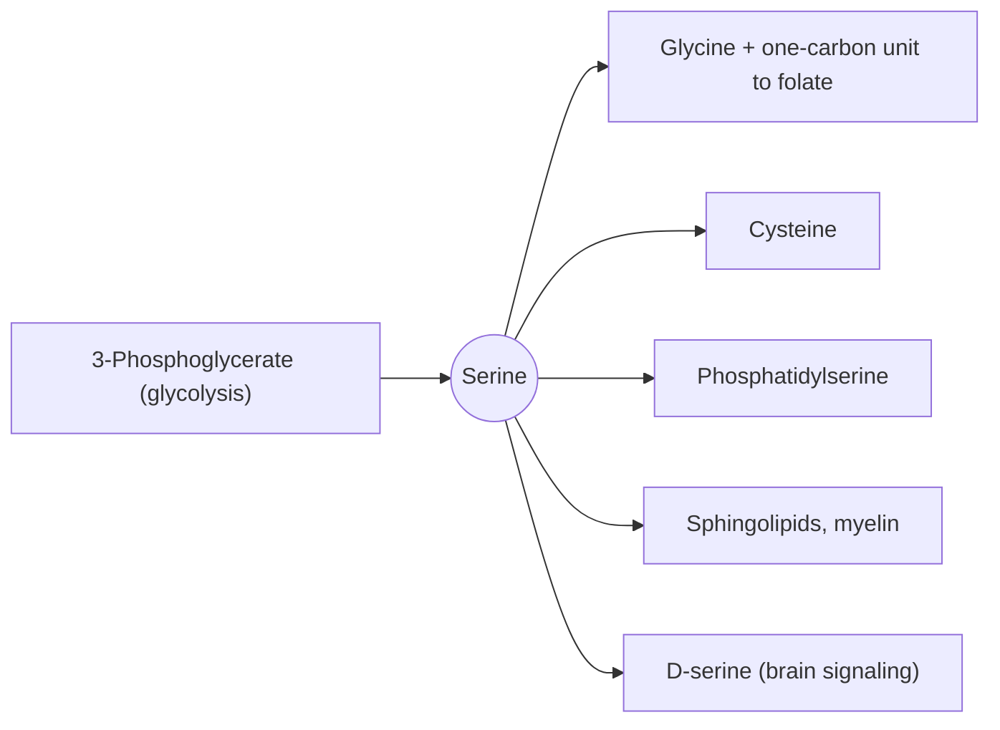

# Serine

## Summary

L-serine is a non-essential amino acid with a hydroxyl group. It is made from an intermediate of glycolysis and is the precursor of glycine, cysteine, phospholipids and sphingolipids, which form cell membranes and myelin. Serine supplies one-carbon units to the folate cycle, which is needed for DNA synthesis. D-serine, its mirror form, is a signaling molecule in the brain.

*This note is educational. It is not medical advice and does not replace a doctor, dietitian or pharmacist, especially during pregnancy, illness or when taking medicines.*

## Prerequisites

- [Amino acids overview](amino-acids-overview.md)

## Core concepts

### Definition

*Serine* (Ser, S) is a polar amino acid with a -CH2OH side chain. It is made from 3-phosphoglycerate, an intermediate of [Glycolysis](../glycolysis.md). Sources include eggs, soy, dairy, meat and nuts.

### Analogy

Serine is like a junction box in a building's wiring. From one input (glycolysis), wires lead to many rooms: glycine, cysteine, membrane lipids, the folate system and signaling. When one room needs more current, the box can divert it. The analogy breaks because the "current" here is atoms, which are incorporated into new molecules rather than flowing back.

### Mechanism

- **Glycine and one-carbon units.** Serine hydroxymethyltransferase converts serine into glycine and passes a one-carbon unit to tetrahydrofolate. This feeds DNA base synthesis.
- **Cysteine.** Serine provides the carbon skeleton of cysteine in transsulfuration (see [Methionine](methionine.md)).
- **Lipids.** Phosphatidylserine is a membrane phospholipid, and serine is the starting point of sphingolipids such as ceramide and the myelin lipids.
- **Protein switches.** Serine residues are the most common phosphorylation sites, and serine sits in the active site of serine proteases.

The diagram shows the products of serine.

## Worked example

Phosphatidylserine is sold as a supplement for memory in older adults. The US FDA allows only a qualified health claim stating that evidence is very limited. The amount of serine in a 100 mg capsule of phosphatidylserine is small compared with the 2 to 4 g of serine in a normal daily diet.

## Trade offs and when to use it

Serine supplements are studied in rare disorders of serine synthesis and in a few neurological conditions, but have no established use in healthy people.

## Common mistakes

- **Confusing serine with serotonin.** They are unrelated; serotonin comes from tryptophan.

## Practice

1. From which glycolysis intermediate is serine made?
2. What does serine pass to tetrahydrofolate when it becomes glycine?

### Answers

1. 3-Phosphoglycerate.
2. A one-carbon unit.

## Further reading

- Berg, J. M., Tymoczko, J. L., Stryer, L. (2002). *Biochemistry (5th ed.)*. W. H. Freeman, free on NCBI Bookshelf. [Link](https://www.ncbi.nlm.nih.gov/books/NBK21154/). Biosynthesis and roles of the non-essential amino acids.
