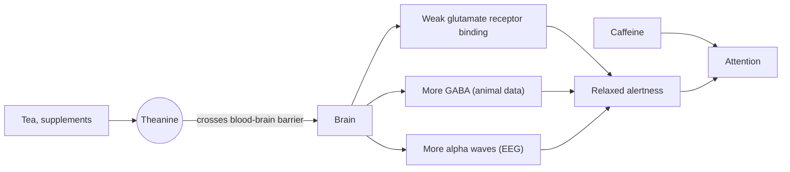

# Theanine

## Summary

L-theanine is a non-protein amino acid found almost only in the tea plant (*Camellia sinensis*) and a few mushrooms. It is known for a calming effect without drowsiness. Small trials suggest it reduces stress responses and, taken with caffeine, improves attention more than caffeine alone. Effects on sleep, anxiety and mood are promising but rest on small studies.

*This note is educational. It is not medical advice and does not replace a doctor, dietitian or pharmacist, especially during pregnancy, illness or when taking medicines.*

## Prerequisites

- [Amino acids overview](amino-acids-overview.md)

## Core concepts

### Definition

*Theanine* (gamma-glutamylethylamide) is an amino acid related to glutamate that is not built into proteins. It is made in the roots of the tea plant and stored in the leaves, mostly in young shoots, and it gives green tea part of its savory (umami) taste. Shading tea plants before harvest, as for matcha and gyokuro, raises the theanine content. It is widely sold as a supplement, usually as L-theanine in doses of 100 to 400 mg.

### Analogy

Theanine works like a sound engineer who turns down background noise without turning off the music. Caffeine turns the volume up (alertness), and theanine reduces the hiss and distortion (jitteriness) so the signal sounds clearer. The analogy breaks because the "engineer" in the brain is not fully understood: the exact targets of theanine are still debated.

### Mechanism

Theanine crosses the blood-brain barrier within about 30 to 60 minutes of an oral dose. Proposed actions, mostly from animal studies, are:

1. It is structurally similar to glutamate and binds weakly to glutamate receptors, possibly damping excitatory signaling.
2. It may raise levels of GABA, the main inhibitory neurotransmitter, and change dopamine and serotonin in some brain regions.
3. In human EEG studies, it increases *alpha waves*, which are associated with relaxed but awake attention.
4. It may blunt the rise in heart rate and cortisol during a stressful task.

The diagram shows the proposed path from intake to effect.

### Food sources

Green, white, oolong and black tea contain theanine. A cup of tea supplies roughly 10 to 30 mg depending on the leaf, the brewing time and the temperature, so supplement doses of 100 to 200 mg equal several cups. Shaded teas such as matcha and gyokuro contain the most.

### Proposed effects and evidence

Each entry states the proposed effect and how strong the human evidence is, using the grades defined in the [Evidence grades](../../../../applied-sciences/medicine-and-health/nutrition/evidence-grades.md) note.

- **Stress reduction and relaxation.** Theanine has a calming effect that does not cause sleepiness. Studies show it may reduce stress and support relaxation by changing alpha waves in the brain, which are linked to relaxation and wakefulness. Several small randomized trials found lower subjective stress and lower heart rate or cortisol responses to a stress task at 200 mg. Evidence: limited to moderate.
- **Sleep quality.** Theanine is not a sleeping drug, but studies suggest it may improve sleep quality, especially under stress, and help with falling asleep and calm sleep by reducing stress and anxiety. Hidese and colleagues (2019) found improved sleep scores with 200 mg per day for four weeks in healthy adults. Evidence: limited.
- **Cognitive function.** Theanine may improve attention, concentration and memory, especially under stress, through its effects on neurotransmitters and brain waves. Effects of theanine alone are small and inconsistent. Evidence: limited.
- **Enhancing the effects of caffeine.** Theanine is often combined with caffeine because it may soften side effects such as nervousness and tremor while strengthening the effect on focus and alertness. The combination improved mental performance more than caffeine alone in several trials, for example 100 mg theanine with 50 mg caffeine (Owen et al., 2008). Evidence: moderate for the combination.
- **Anxiety.** Theanine may reduce anxiety through GABA, the main inhibitory neurotransmitter. Trials report less anxiety in healthy people and in people with anxiety disorders, but the trials are small and a 2020 review called the evidence preliminary. Evidence: limited.
- **Protection against oxidative stress.** Theanine shows antioxidant properties and may protect cells from free radical damage. In animal studies it protected nerve cells from oxidative stress, which may matter for neurodegenerative diseases. Evidence: very limited (animal studies).
- **Immune support.** Some studies suggest theanine may increase the activity of certain immune cells such as T lymphocytes. The effect on immunity needs further clinical research. Evidence: very limited.
- **Mood.** Through effects on dopamine and serotonin, theanine may improve mood and reduce depressive symptoms, possibly in mild depression. Human data are few and small. Evidence: very limited.

## Worked example

A person who gets jittery from a 100 mg caffeine coffee wants to try theanine. Studies of the combination often used a ratio of about 2:1 (theanine to caffeine), for example 100 mg theanine with 50 mg caffeine, or 200 mg with 100 mg. Taking 200 mg theanine with the coffee matches the studied ratio. To get the same 200 mg from tea alone, the person would need about seven to twenty cups, which shows why supplement doses exceed what tea provides.

## Trade offs and when to use it

- **Safety.** Theanine is well tolerated at doses up to several hundred milligrams a day in trials. It has the US status "generally recognized as safe" as a food ingredient.
- **Interactions.** It may add to the effect of sedatives and blood pressure drugs. Data in pregnancy are lacking.
- **Alternatives.** For sleep problems, cognitive behavioral therapy for insomnia has far stronger evidence. For stress, breathing and relaxation techniques ([Relaxation techniques](../../../../applied-sciences/medicine-and-health/physiotherapy/relaxation-techniques.md)) are free and well studied.

## Common mistakes

- **Expecting theanine to work like a sleeping pill.** It reduces arousal, which may help sleep under stress, but it does not induce sleep.
- **Assuming tea gives a supplement-sized dose.** One cup has roughly a tenth of a typical supplement dose.

## Practice

1. Which plant is the main natural source of theanine?
2. Which brain wave pattern does theanine increase in EEG studies?
3. What ratio of theanine to caffeine was common in studies of the combination?

### Answers

1. The tea plant, Camellia sinensis.
2. Alpha waves, linked to relaxed wakefulness.
3. About 2 to 1.

## Further reading

- Owen, G. N., Parnell, H., De Bruin, E. A. et al. (2008). The combined effects of L-theanine and caffeine on cognitive performance and mood. Nutritional Neuroscience, 11(4), 193-198. [DOI](https://doi.org/10.1179/147683008X301513). Randomized trial of theanine plus caffeine on attention.
- Hidese, S., Ogawa, S., Ota, M. et al. (2019). Effects of L-theanine administration on stress-related symptoms and cognitive functions in healthy adults: a randomized controlled trial. Nutrients, 11(10), 2362. [DOI](https://doi.org/10.3390/nu11102362). Four-week trial of 200 mg theanine on stress, sleep and cognition.
