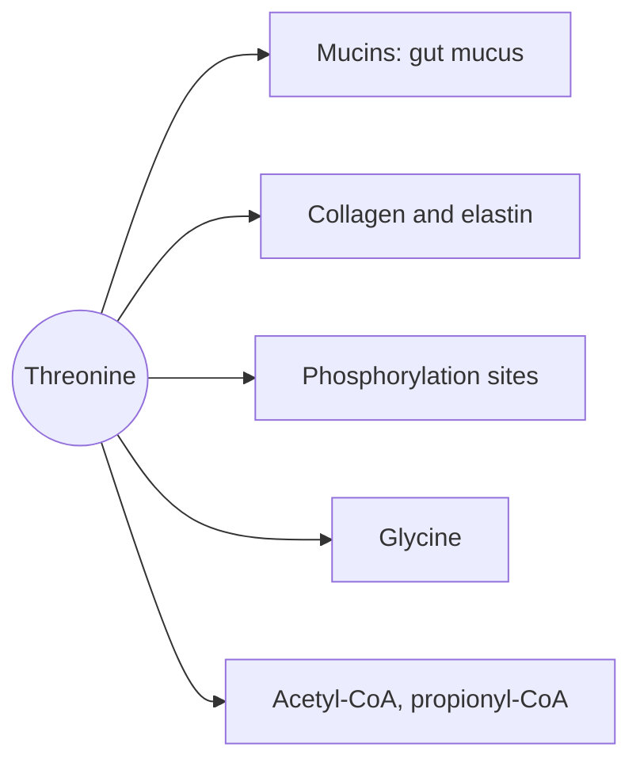

# Threonine

## Summary

L-threonine is an essential amino acid with a hydroxyl group. It is abundant in mucins, the proteins of the protective mucus layer in the gut, and in collagen and elastin. Its hydroxyl group is a common site where cells attach phosphate or sugar groups to proteins.

*This note is educational. It is not medical advice and does not replace a doctor, dietitian or pharmacist, especially during pregnancy, illness or when taking medicines.*

## Prerequisites

- [Amino acids overview](amino-acids-overview.md)

## Core concepts

### Definition

*Threonine* (Thr, T) is an essential polar amino acid with a hydroxyl (-OH) group on its side chain and two chiral centers. Sources are dairy, meat, fish, eggs, lentils and other legumes.

### Analogy

The hydroxyl group of threonine is like a hook on a coat rack. Cells hang different "coats" on it: phosphate groups that switch a protein on or off, or long sugar chains that make mucus slippery and protective. The analogy breaks because hooks on a rack are passive, while the choice of which threonine is used is controlled by specific enzymes.

### Mechanism

- **Mucins.** Mucin proteins in the gut contain long regions rich in threonine and serine, whose hydroxyl groups carry sugar chains (O-glycosylation). A large share of dietary threonine is used by the gut for mucin production.
- **Phosphorylation.** Kinases attach phosphate to threonine (and serine and tyrosine) residues, a main way of switching proteins on and off.
- **Breakdown.** Threonine is converted to glycine and acetyl-CoA or to propionyl-CoA.

The diagram shows these roles.

## Worked example

The WHO/FAO/UNU 2007 requirement is 15 mg per kg per day, about 1.05 g for a 70 kg adult. 100 g of cottage cheese supplies about 0.5 g and 100 g of salmon about 0.9 g.

## Trade offs and when to use it

Threonine is not used as a supplement in humans. It is added to animal feed because it is often limiting for pigs and poultry fed cereals.

## Common mistakes

- **Assuming only the liver uses dietary threonine.** The gut uses a large share for mucin synthesis.

## Practice

1. Which gut component is rich in threonine?
2. Name a way cells modify threonine residues.

### Answers

1. Mucins, the proteins of the mucus layer.
2. Phosphorylation or O-glycosylation.

## Further reading

- World Health Organization (2007). *Protein and amino acid requirements in human nutrition: report of a joint WHO/FAO/UNU expert consultation (WHO Technical Report Series 935)*. WHO. Requirements for essential amino acids.
- Berg, J. M., Tymoczko, J. L., Stryer, L. (2002). *Biochemistry (5th ed.)*. W. H. Freeman, free on NCBI Bookshelf. [Link](https://www.ncbi.nlm.nih.gov/books/NBK21154/). Structure and metabolism of the amino acids.
