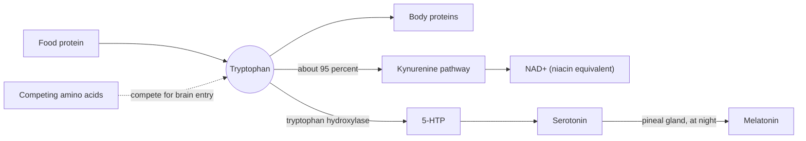

# Tryptophan

## Summary

L-tryptophan is an essential amino acid with an aromatic indole ring. Beyond protein synthesis, it is the precursor of serotonin, melatonin and niacin (vitamin B3). Supplements are studied for mood, sleep and appetite, with small trials and modest effects. Tryptophan supplements were linked to an outbreak of eosinophilia-myalgia syndrome in 1989, traced to contamination from one manufacturer, and they can interact with antidepressants.

*This note is educational. It is not medical advice and does not replace a doctor, dietitian or pharmacist, especially during pregnancy, illness or when taking medicines.*

## Prerequisites

- [Amino acids overview](amino-acids-overview.md)

## Core concepts

### Definition

*Tryptophan* (Trp, W) is an essential amino acid: humans cannot make it, so it must come from food. It has the largest side chain of all amino acids, an indole ring, and is the least abundant amino acid in most proteins. Food sources include poultry, fish, eggs, dairy, nuts, seeds, soy and whole grains.

### Analogy

Tryptophan is like flour delivered to a bakery that makes three products. Most of it goes into ordinary bread (proteins and the kynurenine pathway, which also makes niacin). A small portion goes into a specialty cake (serotonin), and some of that cake is later decorated into a night-time pastry (melatonin) in the pineal gland. More flour leads to more cake only when the cake line is waiting for flour. The analogy breaks because tryptophan must first compete with other amino acids to get into the bakery (the brain).

### Mechanism

1. **Transport into the brain.** Tryptophan crosses the blood-brain barrier on the large neutral amino acid transporter, which it shares with tyrosine, phenylalanine, leucine, isoleucine and valine. The ratio of tryptophan to these competitors decides how much enters. A carbohydrate meal raises insulin, which moves the branched-chain amino acids into muscle and so increases the ratio.
2. **Serotonin.** In the brain and the gut, tryptophan hydroxylase makes 5-hydroxytryptophan (5-HTP), which becomes serotonin (5-HT). This enzyme is not saturated, so tryptophan supply can change serotonin synthesis. About 90 percent of the body's serotonin is in the gut.
3. **Melatonin.** In the pineal gland, serotonin is converted into melatonin at night (see [Melatonin](../../../../applied-sciences/medicine-and-health/physiology/endocrine/melatonin.md)).
4. **Kynurenine pathway and niacin.** About 95 percent of tryptophan is broken down through kynurenine. Part of this flow produces NAD+, which is why about 60 mg of tryptophan count as 1 mg of niacin in dietary reference values.

The diagram shows the main pathways.

### Food sources and requirement

The WHO/FAO/UNU 2007 requirement for adults is 4 mg per kg body weight per day, about 280 mg for a 70 kg adult. Typical diets supply 0.9 to 1.5 g a day. A 100 g portion of chicken breast has about 300 to 400 mg, an egg about 80 to 90 mg, 100 g of pumpkin seeds about 500 mg. The myth that turkey makes people sleepy because of tryptophan is not supported: turkey has about as much as other poultry, and the sleepiness after a holiday meal is better explained by the size of the meal and alcohol.

### Proposed effects and evidence

Each entry states the proposed effect and how strong the human evidence is, using the grades defined in the [Evidence grades](../../../../applied-sciences/medicine-and-health/nutrition/evidence-grades.md) note.

- **Mood and depression.** Tryptophan is needed for serotonin, which directly affects mood and well-being. A diet rich in tryptophan or supplements may help reduce symptoms of depression, especially in people with low serotonin. Experimental tryptophan depletion lowers mood in vulnerable people, which supports the link; treatment trials of tryptophan are small and old. Evidence: limited.
- **Sleep.** Tryptophan contributes to melatonin, the hormone that regulates sleep. Studies show supplements may improve sleep quality, especially in insomnia, shorten the time to fall asleep and lengthen sleep. A 2021 meta-analysis found improved sleep at 1 g or more per day. Evidence: limited.
- **Anxiety.** Tryptophan may reduce anxiety through its effect on serotonin. Higher serotonin may lower anxiety and improve emotional state. Evidence is from small trials. Evidence: limited.
- **Appetite.** Tryptophan may influence appetite and food intake through serotonin. Some studies suggest it may help control cravings, especially for carbohydrates, which could support weight loss. Results are inconsistent. Evidence: very limited.
- **Chronic pain.** There is some evidence that tryptophan may reduce chronic pain, especially when pain is linked to stress or mood disorders, possibly through serotonin, which helps modulate pain. Evidence: very limited.
- **Premenstrual syndrome (PMS).** Studies suggest tryptophan may ease PMS symptoms such as mood swings, irritability and low mood, probably by raising serotonin. One controlled trial in premenstrual dysphoric disorder found benefit at 6 g per day. Evidence: limited.
- **Cognitive function.** Early studies suggest tryptophan may support memory and concentration through serotonin and melatonin, especially under stress, which impairs cognition. Evidence: very limited.
- **Addiction treatment.** Some evidence suggests tryptophan may help in addiction treatment, especially alcohol: raising serotonin may reduce craving for alcohol and ease withdrawal symptoms. Evidence: very limited.

## Worked example

How much tryptophan gets into the brain depends on competition. Suppose a meal contains 0.3 g of tryptophan and 6 g of the competing large neutral amino acids, a ratio of 0.05. A second meal has the same 0.3 g of tryptophan but mostly carbohydrate, so it supplies only 2 g of competitors and raises insulin, which lowers the blood branched-chain amino acids further. The ratio rises to 0.15 or more. The same tryptophan intake gives more brain tryptophan after the carbohydrate meal. This is why the protein content of a meal does not predict brain serotonin in a simple way.

## Trade offs and when to use it

- **Serotonin syndrome.** Combining tryptophan or 5-HTP with antidepressants (SSRIs, MAO inhibitors), triptans or tramadol can cause dangerous excess serotonin activity: agitation, fever, sweating, tremor and fast heart rate.
- **History.** In 1989 more than 1,500 cases of eosinophilia-myalgia syndrome, including deaths, were linked to tryptophan from a single Japanese manufacturer, traced to contaminants from a changed production process (Slutsker et al., 1990). Products were withdrawn in the US for years. Current products from controlled production are not linked to new outbreaks, but quality control matters.
- **Alternatives.** For insomnia, cognitive behavioral therapy for insomnia. For depression, established treatments with medical supervision.

## Common mistakes

- **Combining tryptophan with antidepressants without medical advice.** This can cause serotonin syndrome.
- **Blaming turkey for post-meal sleepiness.** Meal size and alcohol explain it better.
- **Thinking more dietary protein raises brain serotonin.** Protein also supplies competing amino acids.

## Practice

1. Which two hormones or neurotransmitters are made from tryptophan?
2. How many milligrams of tryptophan count as 1 mg of niacin?
3. Why can a carbohydrate meal increase tryptophan entry into the brain?

### Answers

1. Serotonin and melatonin (and NAD+ via the kynurenine pathway).
2. About 60 mg.
3. Insulin moves the competing branched-chain amino acids into muscle, so tryptophan faces less competition at the transporter.

## Further reading

- Richard, D. M., Dawes, M. A., Mathias, C. W. et al. (2009). L-Tryptophan: basic metabolic functions, behavioral research and therapeutic indications. International Journal of Tryptophan Research, 2, 45-60. [DOI](https://doi.org/10.4137/ijtr.s2129). Review of tryptophan metabolism, behavior research and uses.
- Slutsker, L., Hoesly, F. C., Miller, L. et al. (1990). Eosinophilia-myalgia syndrome associated with exposure to tryptophan from a single manufacturer. JAMA, 264(2), 213-217. [DOI](https://doi.org/10.1001/jama.1990.03450020065029). Investigation of the 1989 eosinophilia-myalgia outbreak.
- World Health Organization (2007). *Protein and amino acid requirements in human nutrition: report of a joint WHO/FAO/UNU expert consultation (WHO Technical Report Series 935)*. WHO. Requirement of 4 mg/kg per day.
