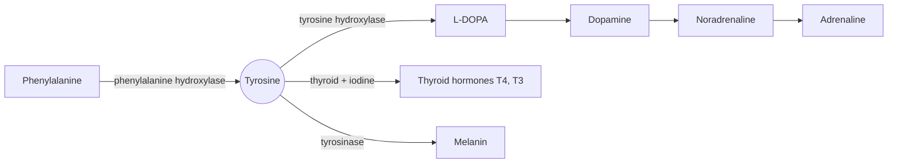

# Tyrosine

## Summary

L-tyrosine is an aromatic amino acid that the body makes from phenylalanine. It is the precursor of the catecholamines (dopamine, noradrenaline and adrenaline), of thyroid hormones and of the skin pigment melanin. The best supported use of tyrosine supplements is to protect working memory and attention during acute stress such as cold, noise or sleep loss. Effects on mood, ADHD and Parkinson disease are not established.

*This note is educational. It is not medical advice and does not replace a doctor, dietitian or pharmacist, especially during pregnancy, illness or when taking medicines.*

## Prerequisites

- [Amino acids overview](amino-acids-overview.md)

## Core concepts

### Definition

*Tyrosine* (Tyr, Y) is a non-essential amino acid, made in the liver by hydroxylation of the essential amino acid phenylalanine. It becomes conditionally essential when phenylalanine cannot be converted, as in phenylketonuria (see [Phenylalanine](phenylalanine.md)). It is part of proteins. Food sources include meat, fish, eggs, dairy, nuts, seeds, soy products and some whole grains.

### Analogy

Tyrosine is like the raw material in a warehouse that supplies several emergency services. In calm times the warehouse is full and the services rarely need more. During a crisis (acute stress) the services use up their stock of dopamine and noradrenaline quickly, and a fresh delivery of raw material helps them keep going. The analogy breaks because the bottleneck is usually not the raw material but the first enzyme (tyrosine hydroxylase), which is why extra tyrosine helps mainly when stores are depleted.

### Mechanism

1. Phenylalanine hydroxylase makes tyrosine from phenylalanine, with tetrahydrobiopterin as a coenzyme.
2. **Catecholamines.** Tyrosine hydroxylase converts tyrosine into L-DOPA, the rate-limiting step. L-DOPA becomes dopamine, dopamine becomes noradrenaline, and in the adrenal medulla noradrenaline becomes adrenaline. These neurotransmitters and hormones regulate mood, motivation, attention and the response to stress.
3. **Thyroid hormones.** In the thyroid gland, tyrosine residues in thyroglobulin are iodinated to form thyroxine (T4) and triiodothyronine (T3).
4. **Melanin.** In skin and hair cells, tyrosinase converts tyrosine into melanin pigments.
5. Under acute stress, catecholamine neurons fire fast and may run short of precursor. This is the rationale for using tyrosine under stress.

The diagram shows the products of tyrosine.

### Proposed effects and evidence

Each entry states the proposed effect and how strong the human evidence is, using the grades defined in the [Evidence grades](../../../../applied-sciences/medicine-and-health/nutrition/evidence-grades.md) note.

- **Cognition under stress.** Studies show tyrosine may improve attention, working memory and problem solving under stress such as cold, noise, sleep loss or mental load, by making more of the neurotransmitters available that are depleted during stress. Jongkees and colleagues (2015) concluded that tyrosine helps in short-term, demanding situations when catecholamines are depleted, usually at 100 to 300 mg per kg. Evidence: moderate for acute stress, not for chronic use.
- **Stress resilience.** Tyrosine may support resilience to physical and mental stress by helping keep neurotransmitter balance in stressful situations, improving coping and reducing fatigue and stress symptoms. Evidence: limited.
- **Mood and depression.** Tyrosine is the precursor of dopamine, which regulates mood and motivation. Studies suggest it may help improve mood and reduce depressive symptoms, especially in people with low dopamine or seasonal depression. Older trials in depression did not show clear benefit. Evidence: very limited.
- **Physical performance.** Tyrosine may support performance under physical stress such as intense training, improving endurance and reducing perceived fatigue through catecholamines. Most trials in temperate conditions show no benefit; some in heat show small effects. Evidence: limited.
- **Attention deficit hyperactivity disorder (ADHD).** Tyrosine is studied as support for ADHD because of its role in dopamine and noradrenaline synthesis. Results are mixed and further research is needed. Evidence: not supported.
- **Fatigue.** Clinical studies showed tyrosine may reduce fatigue, especially under sleep deprivation. This may help people working in suboptimal conditions such as shift work, travel or emergencies. Evidence: limited.
- **Thyroid and metabolism.** Tyrosine is used to make thyroid hormones (thyroxine and triiodothyronine), which are important for metabolism. Supplements are not a standard treatment of thyroid disorders, but adequate dietary intake matters. In practice iodine, not tyrosine, is the nutrient usually limiting thyroid hormone production. Evidence: established physiology, supplement benefit not shown.
- **Neurodegenerative disease.** Early studies suggest possible protective use in Parkinson disease, which involves dopamine deficiency. Further research is needed. Parkinson disease is treated with L-DOPA, not tyrosine, because tyrosine hydroxylase is the step that fails. Evidence: not supported.

## Worked example

In military studies of cold stress, tyrosine was often given at about 100 to 150 mg per kg body weight. For a 70 kg person that is 7 to 10.5 g, taken about an hour before the stressful task. This is far more than a typical supplement capsule of 500 mg. The example shows that the studied doses are high and the situations specific (short, severe stress), so results do not transfer to taking 500 mg every morning for general focus.

## Trade offs and when to use it

- **Safety.** Single doses up to 150 mg per kg were tolerated in studies. Side effects include nausea, headache and heartburn.
- **Interactions.** Tyrosine should be avoided with MAO inhibitors (risk of a dangerous rise in blood pressure) and used carefully with thyroid hormone medication and L-DOPA.
- **Not for chronic use.** Evidence supports acute use before short, stressful demands.

## Common mistakes

- **Using tyrosine as a daily focus aid without stress.** The benefit appears when catecholamines are depleted by acute stress.
- **Expecting tyrosine to treat thyroid problems.** Iodine and medical treatment matter, not extra tyrosine.

## Practice

1. Which step is rate-limiting in catecholamine synthesis?
2. From which amino acid does the body make tyrosine?
3. Why is Parkinson disease treated with L-DOPA rather than tyrosine?

### Answers

1. Tyrosine hydroxylase, which converts tyrosine to L-DOPA.
2. Phenylalanine.
3. The neurons that make dopamine are lost, and L-DOPA bypasses tyrosine hydroxylase.

## Further reading

- Jongkees, B. J., Hommel, B., Kühn, S. et al. (2015). Effect of tyrosine supplementation on clinical and healthy populations under stress or cognitive demands: a review. Journal of Psychiatric Research, 70, 50-57. [DOI](https://doi.org/10.1016/j.jpsychires.2015.08.014). Review of tyrosine under stress and cognitive demand.
- Berg, J. M., Tymoczko, J. L., Stryer, L. (2002). *Biochemistry (5th ed.)*. W. H. Freeman, free on NCBI Bookshelf. [Link](https://www.ncbi.nlm.nih.gov/books/NBK21154/). Catecholamine and thyroid hormone synthesis.
