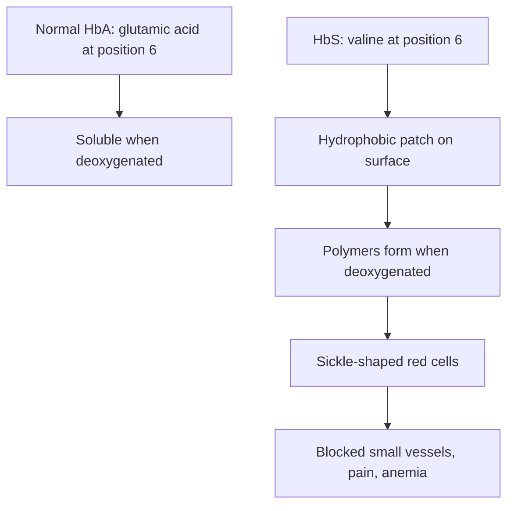

# Valine

## Summary

L-valine is the third essential branched-chain amino acid. It is built into proteins, broken down in muscle, and its carbon skeleton can be turned into glucose. A single change of glutamic acid to valine in hemoglobin causes sickle cell disease, a classic example of how one amino acid can change a protein's behavior.

*This note is educational. It is not medical advice and does not replace a doctor, dietitian or pharmacist, especially during pregnancy, illness or when taking medicines.*

## Prerequisites

- [Amino acids overview](amino-acids-overview.md)

## Core concepts

### Definition

*Valine* (Val, V) is an essential amino acid with a short branched nonpolar side chain (an isopropyl group). It is glucogenic: its breakdown gives succinyl-CoA, which can become glucose. Sources are dairy, meat, fish, soy, legumes and grains.

### Analogy

Valine is like a piece of masking tape stuck on a surface that should be smooth. In hemoglobin of sickle cell disease, a water-loving glutamic acid on the surface is replaced by water-avoiding valine. This "sticky tape" makes hemoglobin molecules stick together when they release oxygen, forming long fibers that bend red cells into a sickle shape. The analogy breaks because in normal proteins valine is not a defect: it belongs in the water-avoiding core.

### Mechanism

- In proteins, valine sits mostly in the hydrophobic core, where it helps the chain fold.
- In muscle, valine is transaminated and broken down to propionyl-CoA and then succinyl-CoA, which enters the Krebs cycle or becomes glucose in the liver.
- In sickle cell disease, the mutation in the beta-globin gene changes position 6 from glutamic acid to valine (HbS).

The diagram contrasts normal and sickle hemoglobin.

## Worked example

The WHO/FAO/UNU 2007 requirement is 26 mg per kg per day, about 1.8 g for a 70 kg adult. A glass of milk (250 ml) supplies about 0.6 g, 100 g of chicken about 1.3 g.

## Trade offs and when to use it

No reason to supplement valine alone. It is included in BCAA mixes and in complete protein.

## Common mistakes

- **Thinking a single amino acid change cannot matter.** Sickle cell disease shows that one change can alter a protein enough to cause disease.

## Practice

1. Which amino acid replaces glutamic acid in sickle hemoglobin?
2. Is valine glucogenic or ketogenic?

### Answers

1. Valine.
2. Glucogenic.

## Further reading

- World Health Organization (2007). *Protein and amino acid requirements in human nutrition: report of a joint WHO/FAO/UNU expert consultation (WHO Technical Report Series 935)*. WHO. Requirements for essential amino acids.
- Berg, J. M., Tymoczko, J. L., Stryer, L. (2002). *Biochemistry (5th ed.)*. W. H. Freeman, free on NCBI Bookshelf. [Link](https://www.ncbi.nlm.nih.gov/books/NBK21154/). Structure and metabolism of the amino acids.
