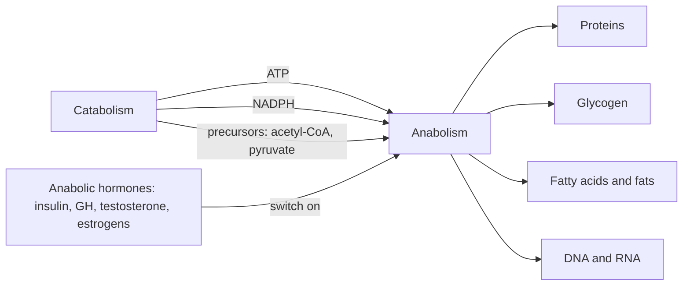

# Anabolism

## Summary

Anabolism is the half of metabolism that builds complex molecules from simple ones, such as proteins from amino acids or glycogen from glucose. It needs a constant input of energy, usually from ATP, and the products store part of that energy in their chemical bonds. Anabolism dominates when nutrients are plentiful compared with the energy the body needs, and it is driven by anabolic hormones such as insulin, growth hormone, testosterone and estrogens.

## Prerequisites

- [Metabolism](metabolism.md)

## Core concepts

### Definition

*Anabolism* is the set of metabolic reactions that synthesize complex compounds from simpler substrates. The name comes from the Greek *anabole*, "a raising up", which describes what happens to energy: the products sit at a higher energy level than the substrates. Anabolic reactions are *endergonic*: they need energy from outside, and part of that energy is kept in the new chemical bonds.

### Analogy

Anabolism is like building a wall from bricks. The bricks (amino acids, sugars, fatty acids) are cheap, but lifting each brick into place costs effort (ATP), and the finished wall holds that effort as stored potential energy. The analogy breaks because a wall stays put, while body proteins are broken down and rebuilt all the time. A muscle protein lasts days to weeks, not years.

### Mechanism

Anabolic pathways start from a few shared building blocks and use three resources supplied by catabolism:

1. **Energy** in the form of ATP (and GTP for protein synthesis).
2. **Reducing power** in the form of NADPH, which supplies the electrons needed to build fatty acids and cholesterol.
3. **Small precursors** such as acetyl-CoA, pyruvate and intermediates of the Krebs cycle.

Hormones decide when anabolism runs. They bind to receptors on the cell surface (insulin, growth hormone) or inside the cell (testosterone, estrogens), and the signal switches enzymes and genes into "build" mode. Insulin, for example, activates glycogen synthase and the uptake of glucose and amino acids into muscle.

The diagram shows the resources that flow from catabolism into anabolism.

### Examples of anabolic processes

| Process | What is made | From what | Where (in humans) |
| --- | --- | --- | --- |
| Protein biosynthesis | Proteins | Amino acids | Ribosomes in every cell |
| Glycogenesis | Glycogen | Glucose | Liver and muscle |
| Gluconeogenesis | Glucose | Lactate, glycerol, amino acids | Mainly liver, also kidney |
| Fatty acid synthesis | Fatty acids | Acetyl-CoA, added two carbons at a time | Liver, adipose tissue |
| Glycerol and triglyceride synthesis | Fats | Glycerol phosphate and fatty acids | Liver, adipose tissue |
| DNA replication | DNA | Deoxynucleotides | Nucleus |
| Transcription | RNA | Ribonucleotides | Nucleus |
| Synthesis of nitrogen compounds | Nucleotides, creatine, heme | Amino acids and other precursors | Many tissues |

Outside humans, anabolism also includes photosynthesis and chemosynthesis, in which plants and some bacteria fix carbon dioxide into sugars, the synthesis of cellulose from glucose in plants, and the fixation of atmospheric nitrogen by bacteria. Fat synthesis is closely tied to cellular respiration, because the intermediates of respiration (acetyl-CoA and dihydroxyacetone phosphate) are the raw materials for fatty acids and glycerol.

### Anabolic hormones

| Hormone | Main anabolic effect |
| --- | --- |
| Insulin | Uptake of glucose and amino acids, glycogen and fat synthesis, less protein breakdown |
| Growth hormone (GH, also called HGH) | Growth of bone and soft tissue, mostly through IGF-1 made in the liver |
| Testosterone | Muscle protein synthesis, bone density, red blood cell production |
| Estrogens | Bone formation and maintenance, growth of reproductive tissues |
| IGF-1 | Growth and protein synthesis in muscle and other tissues |

More on these hormones and their opponent cortisol is in [Anabolic and catabolic hormones](../../../applied-sciences/medicine-and-health/physiology/endocrine/anabolic-and-catabolic-hormones.md).

### What increases anabolism

Factors that shift the balance towards anabolism include hormonal status, genetic predisposition, training that loads the muscles, a diet that matches individual energy and protein needs, and supplements where a real deficit exists. The practical side for muscle tissue, including protein intake and the so called anabolic window, is covered in [Muscle protein balance](../../../applied-sciences/medicine-and-health/physiology/muscle/muscle-protein-balance.md).

## Worked example

Building one peptide bond in a protein costs about four high-energy phosphate bonds: two to attach the amino acid to its transfer RNA (ATP to AMP) and two GTP during delivery and movement on the ribosome. A muscle protein of 500 amino acids therefore costs about 2,000 phosphate bonds (499 bonds × 4). This is why protein synthesis is one of the largest energy costs of a resting cell, and why cells reduce it during energy shortage.

## Trade offs and when to use it

- Anabolism is not good or bad in itself. Fat storage is as anabolic as muscle growth. The useful question is which tissue is in a net building state.
- The phrase "anabolic" in sports marketing usually refers to muscle protein synthesis only.
- Anabolic hormones have effects beyond muscle. Insulin also drives fat storage, and supraphysiological testosterone has well documented cardiovascular and endocrine risks.

## Common mistakes

- **Thinking anabolism makes energy.** It consumes energy. It stores part of it in the products, which catabolism can release later.
- **Believing anabolism and catabolism alternate.** Both run all the time. Net gain of tissue happens when synthesis exceeds breakdown over days and weeks.
- **Equating anabolism with muscle growth.** Glycogen storage, fat storage, bone formation and DNA replication are all anabolism.

## Practice

1. Which three resources does anabolism take from catabolism?
2. Why is the synthesis of fatty acids linked to cellular respiration?
3. Estimate the phosphate bond cost of synthesizing a protein of 300 amino acids.

### Answers

1. ATP for energy, NADPH for reducing power, and small precursor molecules.
2. Its starting material, acetyl-CoA, and the glycerol backbone both come from intermediates of glucose breakdown and respiration.
3. About 1,196 bonds (299 peptide bonds × 4).

## Further reading

- Berg, J. M., Tymoczko, J. L., Stryer, L. (2002). *Biochemistry (5th ed.)*. W. H. Freeman, free on NCBI Bookshelf. [Link](https://www.ncbi.nlm.nih.gov/books/NBK21154/). Chapters on protein synthesis and fatty acid synthesis give the energy costs used here.
- Clark, M. A., Douglas, M., Choi, J. (2018). *Biology 2e*. OpenStax, Rice University. [Link](https://openstax.org/details/books/biology-2e). Introductory treatment of anabolic and catabolic pathways.
