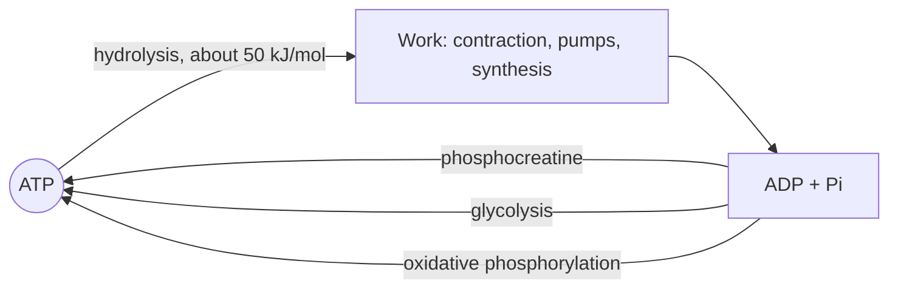

# ATP

## Summary

Adenosine triphosphate (ATP) is the molecule cells use to pay for almost all work. Splitting off its last phosphate group releases about 50 kJ/mol under cell conditions, which drives muscle contraction, ion pumps and synthesis. The body holds only about 100 g of ATP at any moment, yet it turns over roughly its own body weight of ATP per day, so ATP must be regenerated constantly by three systems: phosphocreatine, glycolysis and oxidative phosphorylation.

## Prerequisites

- [Metabolism](metabolism.md)
- [Catabolism](catabolism.md)

## Core concepts

### Definition

*ATP* is a nucleotide made of three parts: the base adenine, the sugar ribose and a chain of three phosphate groups. The bonds between the phosphates are often called "high-energy bonds". The phrase is a shorthand: the bonds are not unusually strong, but their hydrolysis releases a lot of free energy because the products (ADP and phosphate) are more stable than ATP.

ATP + H2O → ADP + Pi, ΔG°' = -30.5 kJ/mol (about -50 kJ/mol under cell conditions)

### Analogy

ATP works like a rechargeable battery. A charged battery (ATP) powers a device (a myosin head, a pump) and comes back flat (ADP). The charger (catabolism) recharges it. The analogy is close, with one limit: a household battery stores a lot of energy and is recharged rarely, while each ATP molecule carries a tiny amount and is recharged about 1,000 times a day.

### Mechanism

The cell keeps the ratio of ATP to ADP far from equilibrium, about 10 to 1 or higher. This is what makes ATP hydrolysis so favorable. Enzymes couple the hydrolysis to work in two main ways:

1. **Phosphoryl transfer.** The phosphate is moved onto a substrate or protein, which changes its shape or activates it. Hexokinase, for example, puts a phosphate on glucose.
2. **Conformational coupling.** Binding and splitting ATP changes the shape of a motor or pump protein. Myosin uses this cycle to pull on actin, and the sodium-potassium pump uses it to move three sodium ions out and two potassium ions in per ATP.

The diagram shows the ATP cycle: catabolism recharges ADP, and work discharges ATP.

### Systems that regenerate ATP

| System | Fuel | Where | Speed | Capacity |
| --- | --- | --- | --- | --- |
| Phosphocreatine (phosphagen) | Phosphocreatine | Cytoplasm | Fastest | Lasts seconds at maximal effort |
| Glycolysis | Glucose and glycogen | Cytoplasm | Fast | Limited, 2 to 3 ATP per glucose unit |
| Oxidative phosphorylation | Carbohydrate, fat, some protein | Mitochondria | Slowest | Practically unlimited while oxygen and fuel last |

The phosphocreatine reaction is catalyzed by creatine kinase: phosphocreatine + ADP → creatine + ATP. This is why creatine supplements, which raise muscle phosphocreatine stores, help short repeated sprints. Creatine kinase in the blood is also used as a marker of muscle damage ([Creatine kinase](../../../applied-sciences/medicine-and-health/diagnostics/creatine-kinase.md)). The physiology of the three systems during exercise is in [Energy systems](../../../applied-sciences/medicine-and-health/physiology/energy-systems.md).

Adenylate kinase provides a fourth, emergency route: 2 ADP → ATP + AMP. The rise of AMP that follows is itself a signal of low energy, sensed by the enzyme AMPK, which switches on catabolism and switches off synthesis.

### Other forms of cellular energy

ATP is the main but not the only energy carrier. GTP powers protein synthesis and some signaling, UTP is used for glycogen synthesis, NADH and FADH2 carry electrons to the respiratory chain, and the proton gradient across the inner mitochondrial membrane is itself a store of energy.

## Worked example

How much ATP does a resting adult turn over? Resting energy use is about 1,600 kcal per day, about 6.7 MJ. If roughly 50 kJ is released per mole of ATP under cell conditions:

6,700,000 J ÷ 50,000 J/mol ≈ 134 mol ATP per day

ATP has a molar mass of about 507 g/mol, so 134 mol is about 68 kg of ATP per day, even though the body contains only about 100 g at any moment. Each molecule is therefore recycled roughly 680 times a day at rest, and much more during exercise.

## Trade offs and when to use it

- ATP is ideal as a currency (fast, universal), but poor as a store, because it is heavy for the energy it holds. That is why the body stores energy as glycogen and fat instead.
- Phosphocreatine is a fast buffer but runs out within about 10 seconds of maximal effort. Glycolysis is faster than oxidation but limited. Oxidation is slow but large.

## Common mistakes

- **"The energy is stored in the phosphate bond."** The energy comes from the difference in stability between ATP and its products in water, not from a single strong bond.
- **"Creatine is an energy source."** Creatine is a recharging aid. It stores phosphate groups that regenerate ATP quickly, but it does not supply calories in any meaningful amount.
- **Thinking ATP stores can be built up.** ATP levels are kept nearly constant. Training increases the capacity to regenerate ATP, not the amount of ATP.

## Practice

1. What are the three components of ATP?
2. Which enzyme transfers phosphate from phosphocreatine to ADP?
3. Why does the cell store energy as fat rather than as ATP?

### Answers

1. Adenine, ribose and three phosphate groups.
2. Creatine kinase.
3. Fat holds about 37 kJ per gram while ATP releases about 0.1 kJ per gram, so storing energy as ATP would need hundreds of times more mass.

## Further reading

- Berg, J. M., Tymoczko, J. L., Stryer, L. (2002). *Biochemistry (5th ed.)*. W. H. Freeman, free on NCBI Bookshelf. [Link](https://www.ncbi.nlm.nih.gov/books/NBK21154/). Chapter 14 explains ATP as the energy currency with the free energy values used here.
- Kreider, R. B., Kalman, D. S., Antonio, J. et al. (2017). International Society of Sports Nutrition position stand: safety and efficacy of creatine supplementation in exercise, sport, and medicine. Journal of the International Society of Sports Nutrition, 14, 18. [DOI](https://doi.org/10.1186/s12970-017-0173-z). Position stand on creatine and the phosphocreatine system.
- Betts, J. G., Young, K. A., Wise, J. A. et al. (2022). *Anatomy and Physiology 2e*. OpenStax, Rice University. [Link](https://openstax.org/details/books/anatomy-and-physiology-2e). Section 24.1 on ATP in the context of whole-body metabolism.
