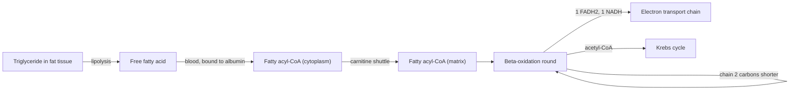

# Beta-oxidation

## Summary

Beta-oxidation is the pathway in the mitochondria that breaks fatty acids into two-carbon acetyl-CoA units, producing NADH and FADH2 along the way. Fats hold more than twice as much energy per gram as carbohydrates, and one molecule of palmitic acid (16 carbons) yields about 106 ATP. Fat oxidation dominates at rest and during long, moderate exercise, but it is too slow to supply energy for maximal efforts.

## Prerequisites

- [Krebs cycle](krebs-cycle.md)
- [Fatty acids](lipids/fatty-acids.md)

## Core concepts

### Definition

*Beta-oxidation* is the repeated four-step sequence that removes two carbons at a time from the carboxyl end of a fatty acid. Its name comes from the beta carbon (the third carbon), which is oxidized in each round.

### Analogy

Beta-oxidation is like slicing a long sausage. Each pass of the knife cuts off one slice of equal size (acetyl-CoA) and leaves a shorter sausage for the next pass. A 16-carbon fatty acid gives eight slices in seven cuts. The analogy breaks because each cut also produces energy carriers (one NADH and one FADH2), so cutting is itself productive.

### Mechanism

1. **Mobilization.** In fat tissue, lipases split triglycerides into glycerol and free fatty acids (lipolysis). Adrenaline and low insulin switch this on. The fatty acids travel in the blood bound to albumin.
2. **Activation.** In the cytoplasm of the muscle or liver cell, the fatty acid is attached to coenzyme A, which costs the equivalent of 2 ATP.
3. **Transport into mitochondria.** Long fatty acids cannot cross the inner membrane alone. The *carnitine shuttle* moves them: the acyl group is passed to carnitine, carried across and passed back to coenzyme A. This step is the main control point, inhibited by malonyl-CoA when carbohydrate is plentiful.
4. **Four-step cycle.** Oxidation (forms FADH2), hydration, oxidation (forms NADH) and cleavage (releases acetyl-CoA). The cycle repeats until the chain is used up.
5. **Further oxidation.** Acetyl-CoA enters the [Krebs cycle](krebs-cycle.md), and NADH and FADH2 feed the electron transport chain.

The diagram follows a fatty acid from fat tissue to the Krebs cycle.

### Ketone bodies

When fatty acid breakdown in the liver is high and carbohydrate is low (fasting, very low carbohydrate diets, uncontrolled type 1 diabetes), acetyl-CoA is converted into ketone bodies (acetoacetate and beta-hydroxybutyrate). Other tissues, including the brain after a few days of fasting, use them as fuel. In type 1 diabetes without insulin, ketone production can become uncontrolled and acidify the blood (ketoacidosis), which is a medical emergency.

## Worked example

ATP yield from one palmitic acid (C16):

| Item | Count | ATP each | ATP |
| --- | --- | --- | --- |
| Beta-oxidation rounds | 7 | | |
| FADH2 from rounds | 7 | 1.5 | 10.5 |
| NADH from rounds | 7 | 2.5 | 17.5 |
| Acetyl-CoA to Krebs cycle | 8 | 10 | 80 |
| Activation cost | | | -2 |
| Net | | | 106 |

Palmitic acid has a molar mass of 256 g/mol and glucose 180 g/mol. One mole of palmitate gives 106 mol ATP, which is 106 ÷ 256 ≈ 0.41 mol ATP per gram. Glucose gives about 32 ÷ 180 ≈ 0.18 mol ATP per gram. Fat therefore yields about 2.3 times more ATP per gram. This matches the energy values of about 9 kcal per gram for fat and 4 kcal per gram for carbohydrate.

## Trade offs and when to use it

- **Energy density versus speed.** Fat is the most compact store (a lean adult carries over 50,000 kcal of fat), but its maximal rate of ATP supply is lower than that of carbohydrate. That is why intensity above roughly 60 to 65 percent of VO2 max shifts fuel use towards carbohydrate.
- **More oxygen per ATP.** Fat oxidation needs about 10 percent more oxygen per ATP than carbohydrate oxidation, a small disadvantage when oxygen delivery is the limit.

## Common mistakes

- **Believing the "fat burning zone" burns more fat overall.** Low intensity burns a higher percentage of fat, but higher intensity burns more total calories. Fat loss depends on the energy balance over days.
- **Thinking carnitine supplements raise fat burning.** Muscle carnitine is hard to raise by supplements, and trials in healthy people show little effect on fat oxidation.
- **Assuming fatty acids can become glucose.** Even-numbered fatty acids cannot give net glucose (see [Krebs cycle](krebs-cycle.md)). Only the glycerol part of a triglyceride can.

## Practice

1. Which step controls the rate of beta-oxidation, and what inhibits it?
2. How many rounds of beta-oxidation does stearic acid (C18) go through, and how many acetyl-CoA does it yield?
3. Why do ketone bodies appear during fasting?

### Answers

1. Transport into the mitochondria through the carnitine shuttle (carnitine palmitoyltransferase 1), inhibited by malonyl-CoA.
2. Eight rounds and nine acetyl-CoA.
3. Low insulin raises fatty acid release, and the liver makes more acetyl-CoA than its Krebs cycle can handle with little oxaloacetate, so it turns the excess into ketone bodies.

## Further reading

- Berg, J. M., Tymoczko, J. L., Stryer, L. (2002). *Biochemistry (5th ed.)*. W. H. Freeman, free on NCBI Bookshelf. [Link](https://www.ncbi.nlm.nih.gov/books/NBK21154/). Chapter 22 on fatty acid metabolism and ketone bodies.
- Kenney, W. L., Wilmore, J. H., Costill, D. L. (2020). *Physiology of Sport and Exercise (7th ed.)*. Human Kinetics. Fuel use at different exercise intensities.
