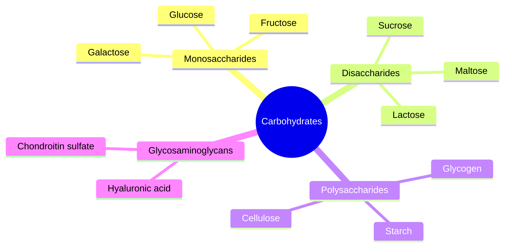

# Carbohydrates

Carbohydrates are sugars and their polymers. They are the body's fastest fuel, the storage form of energy in plants (starch) and animals (glycogen), and structural parts of cartilage, mucus and cell surfaces. Dietary fiber, resistant starch and prebiotics are covered in [Nutrition](../../../../applied-sciences/medicine-and-health/nutrition/README.md).

## Map of the subfield

## Reading order

1. [Carbohydrates](carbohydrates.md): classes of carbohydrates and how they are digested.
2. [Glycosaminoglycans](glycosaminoglycans.md): the long sugar chains of cartilage and connective tissue, and the basis of glucosamine and chondroitin supplements.
