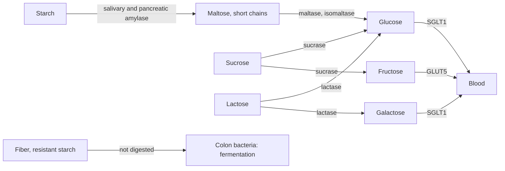

# Carbohydrates

## Summary

Carbohydrates are molecules of carbon, hydrogen and oxygen, built from simple sugar units. Monosaccharides such as glucose are single units, disaccharides such as sucrose and lactose are pairs, and polysaccharides such as starch, glycogen and cellulose are long chains. The gut absorbs only monosaccharides, so starch and sugars are digested first. Fiber is the part that human enzymes cannot digest, which is fermented by gut bacteria instead.

## Prerequisites

- [Metabolism](../metabolism.md)

## Core concepts

### Definition

A *carbohydrate* is a polyhydroxy aldehyde or ketone, or a polymer of such units, with the general formula (CH2O)n for simple sugars. *Monosaccharides* have 3 to 7 carbons (glucose, fructose and galactose have 6). *Disaccharides* are two monosaccharides joined by a glycosidic bond. *Oligosaccharides* have about 3 to 10 units, and *polysaccharides* more.

### Analogy

Carbohydrates are like money in different forms. Glucose is cash, usable everywhere immediately. Glycogen is money in a current account, quickly withdrawn. Starch is the same money in a plant's account, which we can access only after digestion. Cellulose and other fiber are like a currency our enzymes cannot exchange, although gut bacteria can, paying us back in short-chain fatty acids. The analogy breaks because different sugars are not equivalent: fructose is processed mainly by the liver, not used directly by most cells.

### Mechanism

| Carbohydrate | Units | Bond | Digested by | Sources |
| --- | --- | --- | --- | --- |
| Glucose | 1 | - | Absorbed directly | Fruit, honey, made from starch |
| Fructose | 1 | - | Absorbed directly (slower) | Fruit, honey, sucrose |
| Sucrose | Glucose + fructose | alpha-1,2 | Sucrase | Table sugar |
| Lactose | Glucose + galactose | beta-1,4 | Lactase | Milk |
| Maltose | Glucose + glucose | alpha-1,4 | Maltase | Digested starch, malt |
| Starch (amylose, amylopectin) | Glucose chains | alpha-1,4 and alpha-1,6 | Amylase | Grains, potatoes, legumes |
| Glycogen | Branched glucose chains | alpha-1,4 and alpha-1,6 | Amylase | Liver and muscle of animals |
| Cellulose | Glucose chains | beta-1,4 | Not digested by humans | Plant cell walls |

Digestion starts with salivary amylase, continues with pancreatic amylase in the small intestine, and ends with enzymes on the gut lining (brush border) that split disaccharides. Glucose and galactose enter cells by sodium-coupled transport (SGLT1) and fructose by GLUT5. In lactose intolerance, low lactase lets lactose reach the colon, where bacteria ferment it and cause gas and diarrhea.

The diagram shows digestion from starch and sugars to absorbed monosaccharides.

### Fate in the body

Absorbed glucose raises blood glucose and insulin. It is used for energy ([Glycolysis](../glycolysis.md)), stored as glycogen ([Glycogen metabolism](../glycogen-metabolism.md)) or, in excess over time, converted into fat. Fructose is taken up mostly by the liver and enters glycolysis below its main control point, which is why large amounts of fructose promote fat synthesis in the liver. How fast a food raises blood glucose is described by the glycemic index ([Glycemic index](../../../../applied-sciences/medicine-and-health/nutrition/foundations/glycemic-index.md)).

## Worked example

A food label lists per 100 g: carbohydrates 60 g, of which sugars 5 g, and fiber 10 g. In the EU, the carbohydrate figure excludes fiber, so the 60 g are digestible carbohydrate. In the US, "total carbohydrate" includes fiber, and "net carbs" are calculated by subtracting it: a US label showing 70 g total carbohydrate and 10 g fiber would give 60 g net. Knowing which convention a label uses avoids counting fiber twice or not at all.

## Trade offs and when to use it

- Carbohydrates are the preferred fuel for high-intensity exercise and the brain. Their health effect depends on the source: whole grains, legumes, fruit and vegetables are associated with lower disease risk, while large amounts of added sugar are associated with higher risk.
- Low-carbohydrate diets can help some people manage weight or blood sugar, but are not necessary for health.

## Common mistakes

- **Calling all carbohydrates "sugar".** Starch and fiber behave very differently from added sugar.
- **Subtracting fiber from carbohydrates on an EU label.** EU labels already exclude fiber.

## Practice

1. Which two monosaccharides make up sucrose?
2. Why can humans not digest cellulose?
3. Which enzyme is missing or low in lactose intolerance?

### Answers

1. Glucose and fructose.
2. Humans lack enzymes that break beta-1,4 glycosidic bonds between glucose units.
3. Lactase.

## Further reading

- Berg, J. M., Tymoczko, J. L., Stryer, L. (2002). *Biochemistry (5th ed.)*. W. H. Freeman, free on NCBI Bookshelf. [Link](https://www.ncbi.nlm.nih.gov/books/NBK21154/). Chapter 11 on carbohydrates.
- Betts, J. G., Young, K. A., Wise, J. A. et al. (2022). *Anatomy and Physiology 2e*. OpenStax, Rice University. [Link](https://openstax.org/details/books/anatomy-and-physiology-2e). Chapter 23 on digestion and absorption of carbohydrates.
