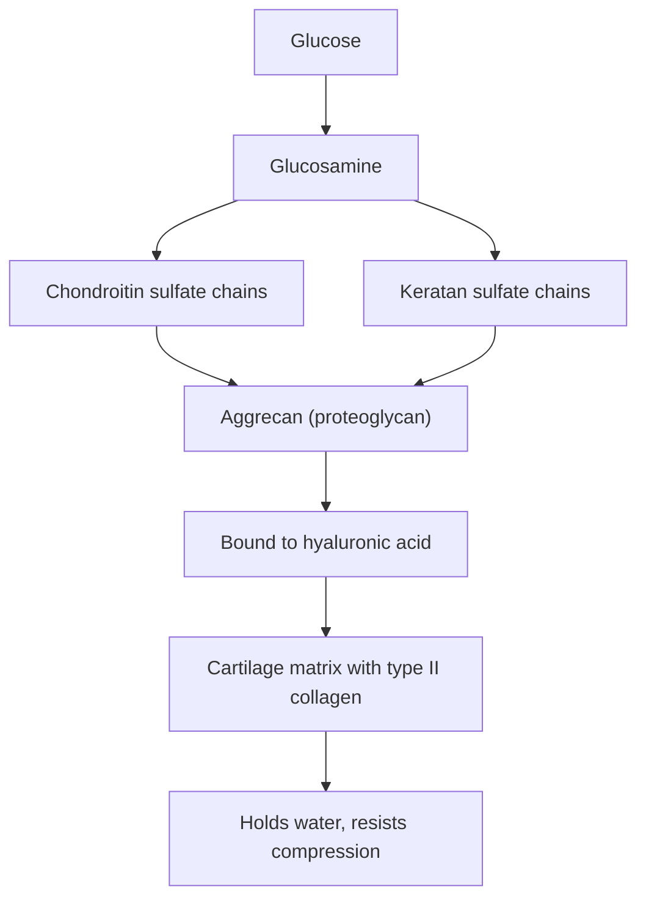

# Glycosaminoglycans

## Summary

Glycosaminoglycans (GAGs) are long, unbranched chains of repeating sugar pairs that carry many negative charges. They bind large amounts of water, which gives cartilage its resistance to compression and makes joint fluid slippery. The main GAGs are hyaluronic acid, chondroitin sulfate, keratan sulfate, dermatan sulfate, heparan sulfate and heparin. Glucosamine and chondroitin supplements are based on this chemistry; their clinical effects are covered in the nutrition notes.

## Prerequisites

- [Carbohydrates](carbohydrates.md)

## Core concepts

### Definition

A *glycosaminoglycan* is a polysaccharide built from repeating disaccharide units, each containing an amino sugar (glucosamine or galactosamine, often with an acetyl group) and usually a uronic acid. Most GAGs carry sulfate groups. Except for hyaluronic acid, GAGs are attached to core proteins, forming *proteoglycans* such as aggrecan in cartilage.

### Analogy

A proteoglycan in cartilage is like a bottle brush made of sponges. The core protein is the wire, and each GAG chain is a bristle that soaks up water and repels its neighbors because of its negative charges. When a joint is loaded, water is pushed out of the brush; when the load is removed, the brush swells again. The analogy breaks because these brushes are themselves attached to a long hyaluronic acid backbone, forming huge aggregates.

### Mechanism

1. Glucosamine is made in cells from glucose and glutamine. Chondrocytes in cartilage use it, and galactosamine, to build GAG chains.
2. Sulfate groups and carboxyl groups give the chains many negative charges that attract sodium ions and water (osmotic swelling pressure).
3. Aggrecan molecules bind to hyaluronic acid, forming aggregates trapped in a mesh of type II collagen.
4. In osteoarthritis, enzymes break down aggrecan and collagen faster than chondrocytes rebuild them, and cartilage thins.

The diagram shows the structure of cartilage matrix.

### Main glycosaminoglycans

| GAG | Where | Note |
| --- | --- | --- |
| Hyaluronic acid | Joint fluid, skin, vitreous of eye | Not sulfated, not bound to protein; very long |
| Chondroitin sulfate | Cartilage, bone, skin | Main GAG of cartilage |
| Keratan sulfate | Cartilage, cornea | |
| Dermatan sulfate | Skin, vessels, heart valves | |
| Heparan sulfate | Cell surfaces, basement membranes | |
| Heparin | Mast cells | Used as an anticoagulant drug |

## Worked example

Hyaluronic acid can hold up to roughly 1,000 times its weight in water. This is why it is used in moisturizers and in injectable dermal fillers, and why injections of hyaluronic acid into knees with osteoarthritis (viscosupplementation) were developed. Large reviews found the benefit of knee injections small and close to placebo in high-quality trials.

## Trade offs and when to use it

- GAG supplements are made from animal cartilage (chondroitin), shellfish or fermentation (glucosamine). Much of an oral dose is broken down or not absorbed intact. Evidence is covered in [Glucosamine](../../../../applied-sciences/medicine-and-health/nutrition/supplements/glucosamine.md) and [Chondroitin](../../../../applied-sciences/medicine-and-health/nutrition/supplements/chondroitin.md).

## Common mistakes

- **Assuming eating cartilage components rebuilds cartilage directly.** The body breaks them down and builds its own GAGs from simple sugars and amino acids.

## Practice

1. What gives GAGs their ability to hold water?
2. Which GAG is not attached to a protein and not sulfated?
3. Which drug is a GAG?

### Answers

1. Their many negative charges attract sodium and water.
2. Hyaluronic acid.
3. Heparin.

## Further reading

- Berg, J. M., Tymoczko, J. L., Stryer, L. (2002). *Biochemistry (5th ed.)*. W. H. Freeman, free on NCBI Bookshelf. [Link](https://www.ncbi.nlm.nih.gov/books/NBK21154/). Glycosaminoglycans and proteoglycans.
- Betts, J. G., Young, K. A., Wise, J. A. et al. (2022). *Anatomy and Physiology 2e*. OpenStax, Rice University. [Link](https://openstax.org/details/books/anatomy-and-physiology-2e). Chapter 4 on connective tissue matrix.
