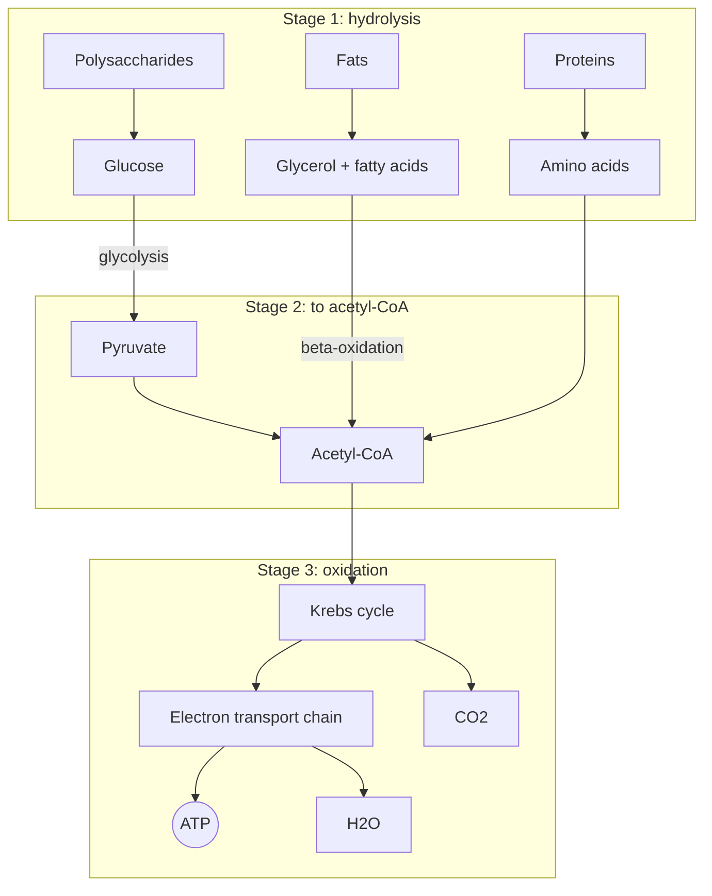

# Catabolism

## Summary

Catabolism is the half of metabolism that breaks complex molecules into simpler ones and releases energy. The most important catabolic process is cellular respiration, which oxidizes sugars and fats to carbon dioxide and water and captures part of the released energy as ATP. Cells spend that ATP on three kinds of work: electrical (nerve impulses), mechanical (muscle contraction) and osmotic (transport against a concentration gradient).

## Prerequisites

- [Metabolism](metabolism.md)

## Core concepts

### Definition

*Catabolism* is the set of metabolic reactions that break complex organic compounds into simpler compounds with less stored energy. The products sit at a lower energy level than the substrates, and the difference is released. Catabolic reactions are *exergonic*. Protein catabolism, for example, breaks proteins into single amino acids, which can be rebuilt into new proteins or broken down further for energy.

### Analogy

Catabolism resembles a hydroelectric dam. Water falling from a high reservoir (energy-rich food molecules) to a low one (carbon dioxide and water) turns turbines (enzymes) that charge batteries (ATP). The fall itself happens in many small steps, not one big drop, so most of the energy can be captured. The analogy breaks in that a dam only captures energy, while catabolism also produces building blocks that anabolism reuses.

### Mechanism

Catabolism of food runs in three stages:

1. **Digestion and hydrolysis.** Large molecules are split into their units: proteins into amino acids by proteolytic enzymes, starch and glycogen into glucose, and fats (triglycerides) into glycerol and free fatty acids. Little energy is captured here.
2. **Conversion to acetyl-CoA.** Glucose goes through [Glycolysis](glycolysis.md) to pyruvate in the cytoplasm, fatty acids go through [Beta-oxidation](beta-oxidation.md), and amino acids lose their nitrogen and enter at several points.
3. **Complete oxidation.** The [Krebs cycle](krebs-cycle.md) oxidizes acetyl-CoA to carbon dioxide, and the electron transport chain ([Oxidative phosphorylation](oxidative-phosphorylation.md)) passes the electrons to oxygen, forming water and most of the ATP.

The diagram follows the three stages from food to ATP.

### Examples of catabolic processes

- **Hydrolysis of fats (lipolysis):** triglycerides to glycerol and free fatty acids.
- **Glycolysis:** glucose to pyruvate in the cytoplasm, with a small net gain of ATP.
- **Protein catabolism:** proteins to amino acids by proteolytic enzymes (proteases), in the gut and inside cells.
- **Fermentation:** pyruvate to lactate (in human muscle) or to ethanol and carbon dioxide (in yeast), which regenerates NAD+ without oxygen. See [Lactate and fermentation](lactate-and-fermentation.md).
- **Krebs cycle (citric acid cycle):** acetyl groups to carbon dioxide.
- **Respiratory chain:** electrons from NADH and FADH2 to oxygen.
- **Photorespiration:** a wasteful side reaction of photosynthesis in plants, listed for completeness.

### Uses of the released energy

| Kind of work | Example | Where ATP is spent |
| --- | --- | --- |
| Electrical | Conducting a nerve impulse | The sodium-potassium pump restores ion gradients after each impulse |
| Mechanical | Muscle contraction | Myosin heads split ATP for each power stroke |
| Osmotic (transport) | Moving glucose or ions against a gradient | Membrane pumps and secondary transporters |
| Chemical | Building molecules | Anabolic pathways |

### Muscle catabolism

In muscle, catabolism means the breakdown of muscle proteins into amino acids. A certain amount is normal and necessary, because damaged proteins are recycled. Net loss of muscle happens when breakdown exceeds synthesis for a long time, for example with very hard training without enough food and rest, with aging, after injury or during disease. The causes, effects and prevention are in [Muscle protein balance](../../../applied-sciences/medicine-and-health/physiology/muscle/muscle-protein-balance.md).

## Worked example

The complete oxidation of one molecule of glucose is the textbook example:

C6H12O6 + 6 O2 → 6 CO2 + 6 H2O, ΔG°' ≈ -2,870 kJ/mol

Current textbooks give a yield of about 30 to 32 ATP per glucose. Each ATP hydrolysis in a cell releases about 50 kJ/mol under cell conditions, so 30 ATP store about 1,500 kJ, which is roughly 50 percent of the total. The rest is released as heat.

## Trade offs and when to use it

- Catabolism is necessary. Without it there is no ATP, and without the recycling of proteins damaged molecules accumulate.
- Speed and efficiency trade off: glycolysis alone is fast but yields 2 ATP per glucose, while full oxidation yields about 15 times more but is slower and needs oxygen. This trade off underlies the energy systems in [Energy systems](../../../applied-sciences/medicine-and-health/physiology/energy-systems.md).

## Common mistakes

- **Treating catabolism as an enemy.** Exercise is catabolic in the short term, and that stress is what triggers adaptation. The problem is chronic net breakdown, not catabolism itself.
- **Assuming fat is burned only during exercise.** Fat oxidation runs all the time. Whether fat mass falls depends on the energy balance over days.
- **Forgetting that catabolism needs oxygen for most of its yield.** Without oxygen, only the 2 ATP from glycolysis are available per glucose.

## Practice

1. List the three stages of food catabolism.
2. Which kind of work does the sodium-potassium pump perform?
3. Why is the oxidation of glucose split into many small steps?

### Answers

1. Hydrolysis into units, conversion to acetyl-CoA, and complete oxidation in the Krebs cycle and respiratory chain.
2. Electrical and osmotic work: it moves ions against their gradients, which restores the membrane potential.
3. Small steps let enzymes capture energy in portions the size of an ATP bond. A single large step would release most of the energy as heat.

## Further reading

- Berg, J. M., Tymoczko, J. L., Stryer, L. (2002). *Biochemistry (5th ed.)*. W. H. Freeman, free on NCBI Bookshelf. [Link](https://www.ncbi.nlm.nih.gov/books/NBK21154/). Gives the free energy values and the stages of catabolism.
- Nelson, D. L., Cox, M. M. (2021). *Lehninger Principles of Biochemistry (8th ed.)*. Macmillan Learning. Current textbook value of about 30 to 32 ATP per glucose with the reasoning.
- Clark, M. A., Douglas, M., Choi, J. (2018). *Biology 2e*. OpenStax, Rice University. [Link](https://openstax.org/details/books/biology-2e). Chapter 7 on cellular respiration.
