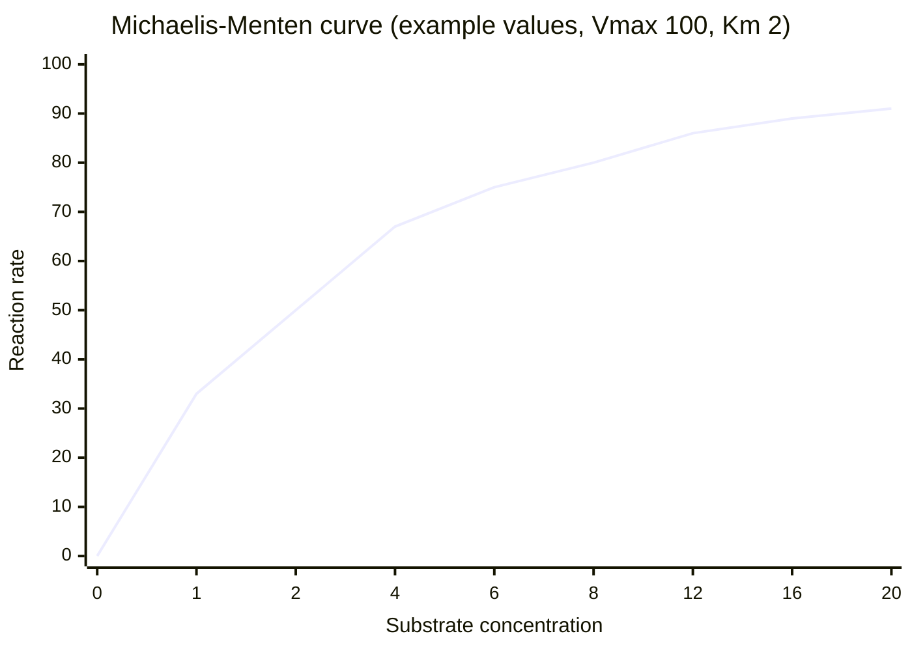

# Enzymes and coenzymes

## Summary

Enzymes are biological catalysts, almost always proteins, that speed up specific reactions by lowering their activation energy without being used up. Many enzymes need helpers: coenzymes (small organic molecules, many made from B vitamins) and metal ions such as magnesium, zinc or iron. Enzyme activity depends on temperature, pH and the amounts of substrate and product, and cells regulate it with inhibitors, activators and hormones.

## Prerequisites

- [Metabolism](metabolism.md)

## Core concepts

### Definition

An *enzyme* is a catalyst made by a living cell, usually a protein, that binds a specific substrate in its *active site* and converts it into a product faster than the uncatalyzed reaction. A *cofactor* is a non-protein component an enzyme needs for activity. Cofactors are either metal ions or *coenzymes*, which are small organic molecules. A coenzyme bound tightly and permanently is called a *prosthetic group*.

### Analogy

An enzyme is like a mountain tunnel. Both the road over the pass and the tunnel lead from the same valley to the same lower valley, so the total drop in height (the energy released) is the same. The tunnel just removes the climb (the activation energy), so far more cars get through per hour. A coenzyme is like a specialized vehicle that carries goods through the tunnel and back. The analogy breaks because a tunnel serves any car, while an enzyme accepts only substrates that fit its active site.

### Mechanism

1. The substrate binds in the active site, held by weak bonds. The fit is specific, and the enzyme often changes shape slightly around the substrate (*induced fit*).
2. The enzyme stabilizes the transition state: it bends bonds, brings reacting groups close together or donates and accepts protons.
3. The product leaves, and the enzyme is free for the next cycle. Fast enzymes complete thousands of cycles per second.

The rate of an enzyme reaction rises with substrate concentration until the enzyme is saturated. The *Michaelis constant* (Km) is the substrate concentration at which the rate is half of its maximum (Vmax). The chart uses invented example values (Vmax = 100, Km = 2) to show the saturation curve.

### Coenzymes and their vitamins

| Coenzyme | Made from | What it carries | Example reaction |
| --- | --- | --- | --- |
| NAD+ and NADP+ | Niacin (B3) | Electrons as hydride | Glycolysis, Krebs cycle, fatty acid synthesis |
| FAD and FMN | Riboflavin (B2) | Electrons | Krebs cycle (succinate dehydrogenase), beta-oxidation |
| Thiamine pyrophosphate | Thiamine (B1) | Two-carbon units | Pyruvate dehydrogenase |
| Coenzyme A | Pantothenic acid (B5) | Acyl groups | Formation of acetyl-CoA |
| Pyridoxal phosphate | Vitamin B6 | Amino groups | Transamination of amino acids |
| Biotin | Biotin (B7) | Carbon dioxide | Carboxylation in gluconeogenesis and fatty acid synthesis |
| Tetrahydrofolate | Folate (B9) | One-carbon units | Synthesis of DNA bases |
| Cobalamin coenzymes | Vitamin B12 | Methyl groups, rearrangements | Methionine synthase |
| Coenzyme Q10 | Made in the body | Electrons | Electron transport chain |

The vitamin notes in [Vitamins](../../../applied-sciences/medicine-and-health/nutrition/vitamins/README.md) explain intake and deficiency.

### Metal ions

Metal ions act either inside the active site or by holding the substrate in shape. Magnesium is bound to almost every ATP molecule in the cell, so every ATP-using enzyme in effect needs magnesium. Zinc is part of more than 300 enzymes, iron sits in the cytochromes of the electron transport chain, and copper is in cytochrome c oxidase. Calcium, sodium and potassium change enzyme activity through signaling, which links metabolism to nerve impulses.

### Factors that change enzyme activity

- **Temperature.** Activity rises with temperature until the protein starts to unfold (denature). Most human enzymes work best near 37 °C.
- **pH.** Each enzyme has an optimum. Pepsin in the stomach works at pH 1.5 to 2, while trypsin in the small intestine works near pH 8.
- **Substrate and product amounts.** See the saturation curve above and feedback inhibition in [Metabolism](metabolism.md#how-metabolism-is-controlled).
- **Inhibitors.** Competitive inhibitors occupy the active site, and non-competitive inhibitors bind elsewhere and change the shape.
- **Covalent modification and hormones.** Adding or removing phosphate groups switches many metabolic enzymes on or off in response to hormones such as insulin and glucagon.

## Worked example

Using the Michaelis-Menten equation v = Vmax × [S] ÷ (Km + [S]) with Vmax = 100 units and Km = 2 mM:

| [S] (mM) | Rate v |
| --- | --- |
| 1 | 100 × 1 ÷ 3 = 33 |
| 2 | 100 × 2 ÷ 4 = 50 |
| 8 | 100 × 8 ÷ 10 = 80 |
| 20 | 100 × 20 ÷ 22 = 91 |

Raising the substrate from 2 to 20 mM, a tenfold increase, does not even double the rate. This is why adding more substrate to a saturated pathway, for example taking extra of a supplement whose enzyme is already saturated, often changes little.

## Trade offs and when to use it

- Enzymes make life possible at body temperature, but their specificity means every reaction needs its own enzyme, and a single missing enzyme can cause a disease (inborn errors of metabolism such as phenylketonuria).
- Coenzymes are reused many times, so the daily need for B vitamins is measured in milligrams or micrograms, not grams.

## Common mistakes

- **Saying enzymes change the equilibrium of a reaction.** They speed up both directions equally and only change how fast equilibrium is reached.
- **Assuming a coenzyme supplement works like the coenzyme.** Most coenzymes are made inside cells from their vitamin. Taking the finished coenzyme by mouth usually means it is digested back into its parts.
- **Assuming "more enzyme activity" is always good.** Many enzymes are deliberately switched off to prevent wasteful cycles.

## Practice

1. What is the difference between a coenzyme and a prosthetic group?
2. Which vitamin is needed for coenzyme A, and what does coenzyme A carry?
3. Why do enzymes stop working at high fever temperatures far above normal?

### Answers

1. Both are organic cofactors. A prosthetic group is bound tightly and permanently, while a coenzyme binds and leaves.
2. Pantothenic acid (vitamin B5). Coenzyme A carries acyl groups such as the acetyl group.
3. The protein unfolds (denatures), so the active site loses its shape.

## Further reading

- Berg, J. M., Tymoczko, J. L., Stryer, L. (2002). *Biochemistry (5th ed.)*. W. H. Freeman, free on NCBI Bookshelf. [Link](https://www.ncbi.nlm.nih.gov/books/NBK21154/). Chapter 8 on enzyme kinetics and chapter on vitamins as coenzymes.
- Nelson, D. L., Cox, M. M. (2021). *Lehninger Principles of Biochemistry (8th ed.)*. Macmillan Learning. Detailed treatment of enzyme mechanisms and regulation.
