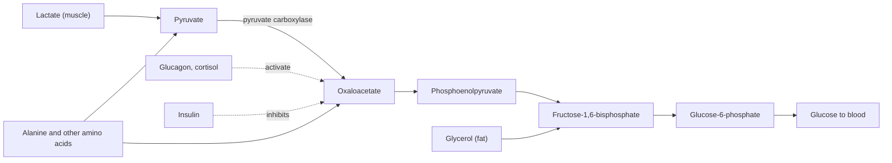

# Gluconeogenesis

## Summary

Gluconeogenesis is the synthesis of new glucose from non-carbohydrate sources: lactate, glycerol and most amino acids. It takes place mainly in the liver, with a smaller share in the kidneys, and it keeps the blood glucose stable during fasting, long exercise and low carbohydrate diets, when glycogen runs low. It costs energy, 6 high-energy phosphate bonds per glucose.

## Prerequisites

- [Glycolysis](glycolysis.md)
- [Anabolism](anabolism.md)

## Core concepts

### Definition

*Gluconeogenesis* ("making new glucose") is the anabolic pathway that builds glucose from pyruvate and other three- or four-carbon precursors. It is not glycolysis in reverse: seven of the ten steps are shared, but three irreversible steps of glycolysis are bypassed by four different enzymes.

### Analogy

Gluconeogenesis is like walking back up a mountain road that you drove down. Most of the road is the same, but three sections are one-way roads downhill (irreversible glycolysis steps), so the climb needs three detours on separate paths, and climbing costs fuel. The analogy breaks because the cell can open and close the two roads independently, so it does not run both at once.

### Mechanism

**Precursors.**

- Lactate from muscle and red blood cells (Cori cycle).
- Glycerol from the breakdown of fats.
- Glucogenic amino acids, especially alanine (glucose-alanine cycle) and glutamine. These come from food protein or from muscle protein breakdown during long fasting.

Even-numbered fatty acids cannot be used, because their acetyl-CoA cannot produce net glucose.

**Bypasses.**

1. Pyruvate → oxaloacetate (pyruvate carboxylase, needs biotin) → phosphoenolpyruvate (PEP carboxykinase).
2. Fructose-1,6-bisphosphate → fructose-6-phosphate (fructose-1,6-bisphosphatase).
3. Glucose-6-phosphate → glucose (glucose-6-phosphatase, liver and kidney only).

**Control.** Glucagon and cortisol switch gluconeogenesis on, and insulin switches it off. Cortisol also increases the release of amino acids from muscle, which is one reason chronic high cortisol is catabolic for muscle.

The diagram shows the precursors and the hormonal control.

## Worked example

During a 24 hour fast, the brain needs about 120 g of glucose. If liver glycogen (about 80 g) is nearly gone, most glucose must come from gluconeogenesis. Glycerol from fat breakdown supplies part of it. If the rest, about 75 g, came from amino acids, and roughly 1.75 g of protein is needed per gram of glucose, about 130 g of protein would be broken down, much of it from muscle. Over longer fasts the brain switches partly to ketone bodies, which reduces this protein loss. These numbers are rounded textbook estimates.

## Trade offs and when to use it

- Gluconeogenesis protects the brain and red blood cells from low blood sugar, but during long fasting or very low energy intake it draws on muscle protein.
- It costs 4 ATP and 2 GTP per glucose, so the Cori cycle (glucose to lactate to glucose) runs at a net loss of energy, paid by the liver.

## Common mistakes

- **"Protein turns into glucose and spikes blood sugar."** Gluconeogenesis is regulated by hormones, not by the amount of protein eaten. A high protein meal raises blood glucose very little in healthy people.
- **"Fat can become glucose."** Only the glycerol part, about 10 percent of the mass of a triglyceride.
- **Calling gluconeogenesis "reverse glycolysis".** Three steps use different enzymes, which is what allows separate control.

## Practice

1. Name three precursors of gluconeogenesis.
2. Which vitamin does pyruvate carboxylase need?
3. Why does prolonged high cortisol cause muscle loss?

### Answers

1. Lactate, glycerol and glucogenic amino acids such as alanine.
2. Biotin (vitamin B7).
3. Cortisol activates gluconeogenesis and increases the release of amino acids from muscle protein to supply it.

## Further reading

- Berg, J. M., Tymoczko, J. L., Stryer, L. (2002). *Biochemistry (5th ed.)*. W. H. Freeman, free on NCBI Bookshelf. [Link](https://www.ncbi.nlm.nih.gov/books/NBK21154/). Chapter 16 on gluconeogenesis and its regulation.
- Betts, J. G., Young, K. A., Wise, J. A. et al. (2022). *Anatomy and Physiology 2e*. OpenStax, Rice University. [Link](https://openstax.org/details/books/anatomy-and-physiology-2e). Chapter 24 on fasting metabolism.
