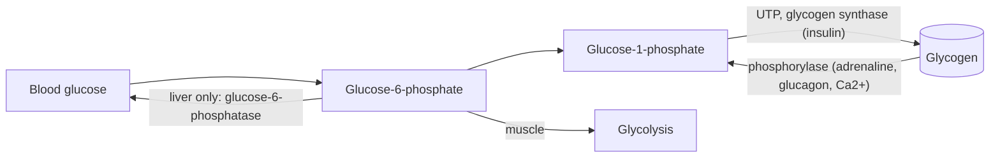

# Glycogen metabolism

## Summary

Glycogen is the storage form of glucose in animals: a large branched polymer kept mainly in the liver and the muscles. Glycogenesis builds it after meals under the influence of insulin, and glycogenolysis breaks it down when adrenaline or glucagon signal a need for energy. Liver glycogen keeps the blood glucose stable, while muscle glycogen fuels the muscle itself during exercise.

## Prerequisites

- [Glycolysis](glycolysis.md)
- [Carbohydrates](carbohydrates/carbohydrates.md)

## Core concepts

### Definition

*Glycogen* is a polysaccharide of glucose units linked by alpha-1,4 bonds in chains, with alpha-1,6 branches about every 8 to 12 units. *Glycogenesis* is its synthesis from glucose, and *glycogenolysis* is its breakdown to glucose-1-phosphate.

### Analogy

Glycogen is like a tree with many branch tips. Enzymes can only add or remove glucose at the tips, so many branches mean many places to work at once, which lets the store be filled or emptied quickly. Fat is more like a sealed warehouse: it holds more but takes longer to unload. The analogy breaks because glycogen is stored with water (about 3 g of water per g of glycogen), which makes it heavy for the energy it holds.

### Mechanism

**Synthesis (glycogenesis).** Glucose is phosphorylated to glucose-6-phosphate, changed to glucose-1-phosphate and activated with UTP to UDP-glucose. Glycogen synthase adds the units to existing chains, and the branching enzyme creates new branches. Insulin activates glycogen synthase.

**Breakdown (glycogenolysis).** Glycogen phosphorylase removes glucose units as glucose-1-phosphate, using phosphate rather than water, which saves one ATP compared with free glucose. A debranching enzyme handles the branch points. Adrenaline (in muscle and liver), glucagon (in liver) and calcium released during contraction activate phosphorylase.

**The key difference between liver and muscle.** The liver has glucose-6-phosphatase and can release free glucose into the blood. Muscle lacks this enzyme, so muscle glycogen can only be used by the muscle that stores it.

The diagram shows both directions and the hormones that control them.

### Stores

| Store | Typical amount (70 kg adult) | Used for |
| --- | --- | --- |
| Liver glycogen | About 80 to 100 g | Keeping blood glucose stable between meals and overnight |
| Muscle glycogen | About 300 to 500 g, more after carbohydrate loading | Fuel for the muscle during exercise |
| Blood glucose | About 4 to 5 g | Immediate supply for the brain and red blood cells |

The values are typical ranges from exercise physiology textbooks and vary with body size, diet and training.

## Worked example

An overnight fast of 12 hours: the brain uses about 120 g of glucose per day, about 5 g per hour, so it needs about 60 g overnight. Part comes from liver glycogen and part from gluconeogenesis. After about 24 hours of fasting, liver glycogen is largely used up, and gluconeogenesis supplies nearly all the glucose. A marathon runner at race pace uses about 2 to 3 g of carbohydrate per minute, so 400 g of muscle glycogen plus liver glycogen lasts roughly two hours. This is the physiology behind "hitting the wall" near the 30 km mark when no carbohydrate is eaten during the race.

## Trade offs and when to use it

- Glycogen can release glucose fast and can feed glycolysis without oxygen, unlike fat. The cost is weight (water) and a small total store.
- Low muscle glycogen reduces performance in long or repeated hard efforts. Training with low glycogen is studied as a way to increase mitochondrial adaptations, with mixed results on performance.

## Common mistakes

- **"Muscle glycogen can raise blood sugar."** Muscle lacks glucose-6-phosphatase.
- **"The quick weight loss on a low carbohydrate diet is fat."** The first few kilograms are largely glycogen and its stored water.
- **Confusing glycogen with glucagon.** Glycogen is the store, glucagon is the hormone that releases liver glycogen.

## Practice

1. Which enzyme does muscle lack that the liver has?
2. Which hormones activate glycogen breakdown, and which activates synthesis?
3. Why does a person lose 1 to 2 kg in the first days of a very low carbohydrate diet?

### Answers

1. Glucose-6-phosphatase.
2. Adrenaline and glucagon (plus calcium in contracting muscle) activate breakdown. Insulin activates synthesis.
3. Glycogen is used up and each gram releases about 3 g of water.

## Further reading

- Berg, J. M., Tymoczko, J. L., Stryer, L. (2002). *Biochemistry (5th ed.)*. W. H. Freeman, free on NCBI Bookshelf. [Link](https://www.ncbi.nlm.nih.gov/books/NBK21154/). Chapter 21 on glycogen metabolism.
- Kenney, W. L., Wilmore, J. H., Costill, D. L. (2020). *Physiology of Sport and Exercise (7th ed.)*. Human Kinetics. Glycogen stores and use during exercise.
