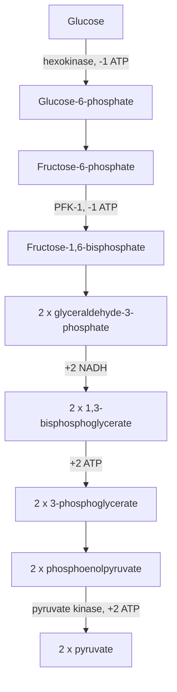

# Glycolysis

## Summary

Glycolysis is the ten-step pathway in the cytoplasm that splits one glucose molecule into two molecules of pyruvate. It produces a net 2 ATP and 2 NADH per glucose and needs no oxygen, so it is the fastest way after phosphocreatine to make ATP. What happens to pyruvate next depends on oxygen and on the demand for energy: it enters the mitochondria to be fully oxidized, or it is turned into lactate.

## Prerequisites

- [ATP](atp.md)
- [Enzymes and coenzymes](enzymes-and-coenzymes.md)

## Core concepts

### Definition

*Glycolysis* (from Greek "sugar splitting") is the catabolic pathway that converts glucose (6 carbons) into two pyruvate molecules (3 carbons each), with a small net gain of ATP. It runs in the cytoplasm of almost every cell and is the oldest energy pathway in evolution.

### Analogy

Glycolysis is like a business that must invest before it earns. In the first half it spends 2 ATP to "prime" glucose, like paying for equipment. In the second half it earns 4 ATP and 2 NADH. The net profit is small but fast. The analogy breaks because a business can choose not to invest, while a cell that wants any glycolytic ATP must always pay the two-ATP entry fee (or one, if the glucose comes from glycogen, which enters already phosphorylated).

### Mechanism

The ten reactions fall into two phases:

**Investment phase (steps 1 to 5).** Hexokinase adds a phosphate to glucose (1 ATP), which traps it in the cell. After rearrangement, phosphofructokinase-1 (PFK-1) adds a second phosphate (1 ATP). The six-carbon sugar is then split into two three-carbon molecules of glyceraldehyde-3-phosphate.

**Payoff phase (steps 6 to 10), happening twice per glucose.** Glyceraldehyde-3-phosphate dehydrogenase oxidizes each three-carbon unit and passes electrons to NAD+, forming NADH. Two later steps transfer phosphate groups directly to ADP (substrate-level phosphorylation), giving 2 ATP per unit, 4 in total. The last enzyme, pyruvate kinase, produces pyruvate.

The diagram shows the two phases and the net balance.

Net equation:

Glucose + 2 NAD+ + 2 ADP + 2 Pi → 2 pyruvate + 2 NADH + 2 H+ + 2 ATP + 2 H2O

### Regulation

PFK-1 is the main control point. It is inhibited by high ATP and citrate (signals that energy is plentiful) and activated by AMP and ADP (signals that energy is short). Insulin raises glycolysis in the liver, and adrenaline speeds it in muscle by releasing glucose from glycogen.

### What happens to pyruvate

- **With enough oxygen and mitochondrial capacity:** pyruvate enters the mitochondria and is converted to acetyl-CoA by pyruvate dehydrogenase, then oxidized in the [Krebs cycle](krebs-cycle.md).
- **When glycolysis runs faster than the mitochondria can accept pyruvate,** or when oxygen is short: lactate dehydrogenase turns pyruvate into lactate and regenerates NAD+, so glycolysis can continue. See [Lactate and fermentation](lactate-and-fermentation.md).
- **For synthesis:** pyruvate can become the amino acid alanine or, in the liver, new glucose ([Gluconeogenesis](gluconeogenesis.md)).

## Worked example

During a 400 m sprint lasting about 50 seconds, glycolysis supplies a large share of the ATP. If the muscle produces 2 ATP per glucose taken from blood, or 3 ATP per glucose unit taken from glycogen (no hexokinase step is needed), then producing 1 mol of ATP needs about 0.33 mol of glucose units from glycogen, which is about 54 g of glycogen (162 g/mol per glucose unit). Full oxidation of the same glycogen would give about 31 ATP per unit, roughly ten times as much. Glycolysis is quick but uses glycogen about ten times faster for the same ATP.

## Trade offs and when to use it

- **Speed versus yield.** Glycolysis makes ATP about twice as fast as oxidation but yields only a small fraction per glucose.
- **No oxygen needed.** This makes glycolysis essential for red blood cells, which have no mitochondria, and for short maximal efforts.
- **NAD+ dependence.** Glycolysis stops if NAD+ is not regenerated, which is the real reason lactate is formed.

## Common mistakes

- **"Glycolysis is anaerobic metabolism."** Glycolysis runs at all times, with or without oxygen. "Anaerobic glycolysis" is a loose term for glycolysis ending in lactate.
- **Thinking glycolysis needs oxygen to produce pyruvate.** No step uses oxygen.
- **Forgetting the investment phase.** The gross yield is 4 ATP but the net yield is 2 from glucose.

## Practice

1. What is the net ATP yield of glycolysis from blood glucose and from glycogen?
2. Which enzyme is the main control point of glycolysis, and what activates it?
3. Why do red blood cells depend entirely on glycolysis?

### Answers

1. 2 ATP from glucose, 3 ATP per glucose unit from glycogen.
2. Phosphofructokinase-1, activated by AMP and ADP (and inhibited by ATP and citrate).
3. They have no mitochondria, so they cannot oxidize pyruvate.

## Further reading

- Berg, J. M., Tymoczko, J. L., Stryer, L. (2002). *Biochemistry (5th ed.)*. W. H. Freeman, free on NCBI Bookshelf. [Link](https://www.ncbi.nlm.nih.gov/books/NBK21154/). Chapter 16 describes each of the ten steps and their regulation.
- Clark, M. A., Douglas, M., Choi, J. (2018). *Biology 2e*. OpenStax, Rice University. [Link](https://openstax.org/details/books/biology-2e). Section 7.2 on glycolysis.
