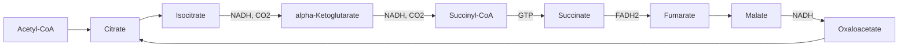

# Krebs cycle

## Summary

The Krebs cycle, also called the citric acid cycle or tricarboxylic acid (TCA) cycle, is the central hub of energy metabolism. In the mitochondrial matrix it oxidizes the acetyl groups from carbohydrates, fats and proteins to carbon dioxide. One turn yields 3 NADH, 1 FADH2 and 1 GTP (or ATP). The NADH and FADH2 carry most of the energy on to the electron transport chain, where it becomes ATP.

## Prerequisites

- [Glycolysis](glycolysis.md)
- [Mitochondria](../../biology/cell-biology/mitochondria.md)

## Core concepts

### Definition

The *Krebs cycle* is a cyclic series of eight enzyme reactions in the mitochondrial matrix in which an acetyl group (two carbons) combines with oxaloacetate (four carbons) to form citrate (six carbons). Citrate is then oxidized step by step back to oxaloacetate, releasing two molecules of carbon dioxide. Hans Krebs described the cycle in 1937 and received the Nobel Prize in 1953.

### Analogy

The cycle is like a roundabout with a shuttle bus. Oxaloacetate is the bus that picks up a passenger (the acetyl group) at the stop, drives around the roundabout dropping off pieces of luggage (electrons on NADH and FADH2, and carbon dioxide), and returns empty to the same stop. The bus is not used up, so a small amount of oxaloacetate can process a large amount of acetyl-CoA. The analogy breaks because the "bus" can be taken out of service: intermediates leave the cycle to build amino acids or glucose, and they must be refilled.

### Mechanism

Before the cycle, pyruvate from glycolysis enters the mitochondria and pyruvate dehydrogenase converts it into acetyl-CoA, releasing one carbon dioxide and forming one NADH. This enzyme needs coenzymes made from thiamine (B1), riboflavin (B2), niacin (B3) and pantothenic acid (B5), plus lipoic acid.

The diagram traces one turn of the cycle with its products.

Products of one turn (one acetyl-CoA): 2 CO2, 3 NADH, 1 FADH2, 1 GTP. Per glucose, the cycle turns twice.

### Regulation

The cycle speeds up when the cell needs energy. Calcium released during muscle contraction and high ADP activate key enzymes (isocitrate dehydrogenase and alpha-ketoglutarate dehydrogenase), and high NADH and ATP slow them. The cycle cannot run without oxygen, even though no step uses oxygen directly, because NAD+ and FAD are only regenerated when the electron transport chain passes electrons to oxygen.

### A hub, not only a furnace

Intermediates of the cycle are also starting points for synthesis. Citrate leaves the mitochondria to build fatty acids, alpha-ketoglutarate and oxaloacetate become amino acids (glutamate, aspartate), and succinyl-CoA is used to make heme. Reactions that refill the cycle, such as the carboxylation of pyruvate to oxaloacetate, are called *anaplerotic*.

## Worked example

Counting the energy carriers from one glucose up to the end of the Krebs cycle:

| Stage | NADH | FADH2 | ATP or GTP | CO2 |
| --- | --- | --- | --- | --- |
| Glycolysis | 2 | 0 | 2 | 0 |
| Pyruvate dehydrogenase (x2) | 2 | 0 | 0 | 2 |
| Krebs cycle (x2) | 6 | 2 | 2 | 4 |
| Total | 10 | 2 | 4 | 6 |

All six carbons of glucose have left as carbon dioxide, but only 4 ATP have been made. The remaining energy is in 10 NADH and 2 FADH2. At about 2.5 ATP per NADH and 1.5 per FADH2, these give about 28 more ATP in [Oxidative phosphorylation](oxidative-phosphorylation.md), for a total of about 30 to 32.

## Trade offs and when to use it

- The cycle is the shared final pathway for all fuels, which lets the body switch between carbohydrate and fat. The cost is dependence on oxygen and on healthy mitochondria.
- Because intermediates are drained for synthesis, the cycle depends on refilling reactions. Low carbohydrate availability limits oxaloacetate in the liver, which pushes acetyl-CoA towards ketone bodies.

## Common mistakes

- **"The Krebs cycle makes most of the ATP."** It makes only 2 ATP (as GTP) per glucose directly. Its main output is NADH and FADH2.
- **"The Krebs cycle is anaerobic because no step uses oxygen."** It stops without oxygen because its electron carriers cannot be regenerated.
- **Forgetting the link reaction.** Pyruvate dehydrogenase is not part of the cycle, but it is where carbohydrate commits to oxidation, and it cannot be reversed in humans. This is why fatty acids cannot be turned into glucose.

## Practice

1. What are the products of one turn of the Krebs cycle?
2. Why can humans not turn fatty acids into glucose?
3. Why does the cycle stop when oxygen runs out?

### Answers

1. 2 CO2, 3 NADH, 1 FADH2 and 1 GTP.
2. Fatty acids are broken down to acetyl-CoA, and the step from pyruvate to acetyl-CoA cannot be reversed. Both carbons of acetyl-CoA are lost as CO2 in the cycle, so there is no net gain of carbon for glucose.
3. Without oxygen the electron transport chain stops, NADH and FADH2 accumulate, and the cycle runs out of NAD+ and FAD.

## Further reading

- Berg, J. M., Tymoczko, J. L., Stryer, L. (2002). *Biochemistry (5th ed.)*. W. H. Freeman, free on NCBI Bookshelf. [Link](https://www.ncbi.nlm.nih.gov/books/NBK21154/). Chapter 17 on the citric acid cycle.
- Nelson, D. L., Cox, M. M. (2021). *Lehninger Principles of Biochemistry (8th ed.)*. Macmillan Learning. Gives the current ATP accounting per NADH and FADH2.
- Clark, M. A., Douglas, M., Choi, J. (2018). *Biology 2e*. OpenStax, Rice University. [Link](https://openstax.org/details/books/biology-2e). Section 7.3 on oxidation of pyruvate and the citric acid cycle.
