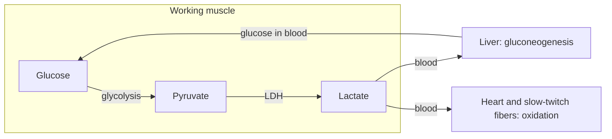
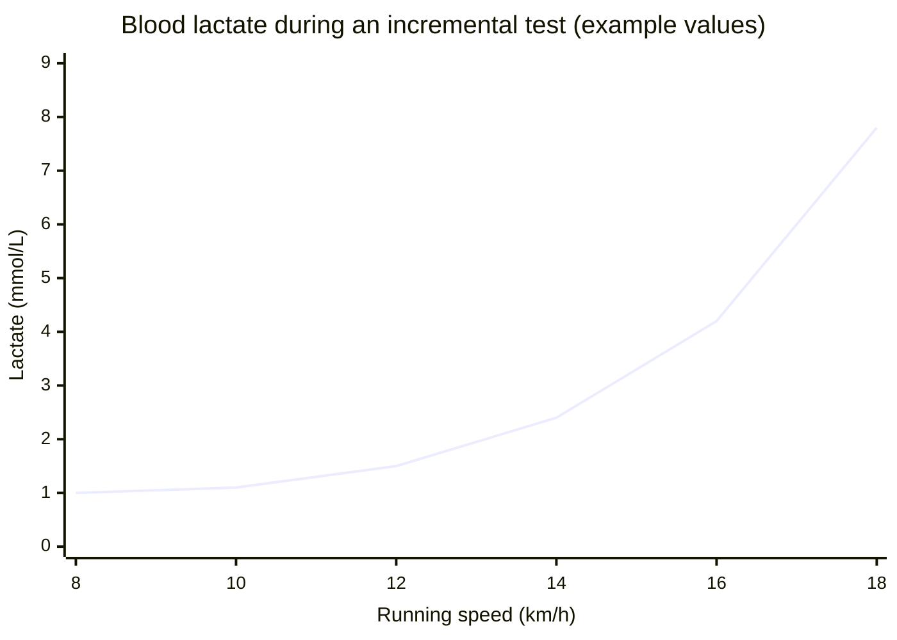

# Lactate and fermentation

## Summary

When glycolysis produces pyruvate faster than the mitochondria can take it up, muscle cells convert pyruvate into lactate. This regenerates NAD+, so glycolysis can keep making ATP. Lactate is not a waste product: it is exported, used as fuel by the heart and other muscles, and turned back into glucose by the liver. The burning sensation and fatigue of hard exercise come mainly from hydrogen ions and other metabolites, not from lactate itself.

## Prerequisites

- [Glycolysis](glycolysis.md)

## Core concepts

### Definition

*Fermentation* is the regeneration of NAD+ by transferring the electrons of NADH to an organic molecule made from pyruvate, without oxygen. In human muscle the product is *lactate*, formed by lactate dehydrogenase. Yeast instead makes ethanol and carbon dioxide (alcoholic fermentation), the basis of bread, beer and wine. Lactic acid bacteria make lactate in fermented foods such as yogurt, kefir and sauerkraut.

### Analogy

Lactate formation is like a restaurant that runs out of clean plates (NAD+). Instead of closing, it puts used plates (NADH) into a fast rinse (lactate dehydrogenase) and keeps serving. The rinse does not clean the plates properly, so later the dishwasher (the mitochondria and the liver) handles the lactate. The analogy breaks because lactate is also a useful fuel, not just dirty dishes.

### Mechanism

Pyruvate + NADH + H+ ⇌ lactate + NAD+

The reaction is reversible. Lactate formed in fast-twitch fibers leaves through monocarboxylate transporters and is used in three ways:

1. Oxidized by nearby slow-twitch fibers and by the heart, which convert it back to pyruvate.
2. Carried to the liver and made into glucose (the *Cori cycle*), which can return to the muscle.
3. Used by the brain as fuel during exercise.

George Brooks named this traffic the *lactate shuttle*.

The diagram shows the Cori cycle and the shuttle between tissues.

### Lactate, acid and fatigue

During intense exercise, ATP hydrolysis and glycolysis release hydrogen ions (H+), and the muscle pH falls from about 7.0 to about 6.5. Lactate production actually consumes a hydrogen ion, so it slightly slows acidification rather than causing it. Lactate and H+ rise together, which is why "lactic acid" was blamed for decades. Current models link fatigue to H+, inorganic phosphate, potassium shifts and other factors. Buffering by carnosine is the reason beta-alanine can help efforts of one to four minutes ([Beta-alanine](amino-acids/beta-alanine.md)).

### Delayed soreness

Lactate returns to resting levels within about 30 to 60 minutes after exercise. It cannot explain soreness felt one or two days later, which comes from microscopic damage and inflammation, see [Delayed onset muscle soreness (DOMS)](../../../applied-sciences/medicine-and-health/exercise-and-fitness/recovery/doms.md).

## Worked example

Blood lactate at rest is about 1 mmol/L. In an incremental running test, it stays near this value at easy speeds, starts rising at the first lactate threshold and rises steeply above about 4 mmol/L. The example values below (illustrative, not from one study) show the typical curve.

| Speed (km/h) | 8 | 10 | 12 | 14 | 16 | 18 |
| --- | --- | --- | --- | --- | --- | --- |
| Blood lactate (mmol/L) | 1.0 | 1.1 | 1.5 | 2.4 | 4.2 | 7.8 |

The bend in the curve is the basis of [Lactate threshold](../../../applied-sciences/medicine-and-health/physiology/respiration/lactate-threshold.md).

## Trade offs and when to use it

- Fermentation keeps ATP flowing during short maximal efforts, at the cost of a low yield (2 ATP per glucose) and fast glycogen use.
- Lactate is an efficient way to move carbohydrate energy between tissues, which is why trained athletes clear lactate faster rather than produce less of it at a given effort.

## Common mistakes

- **"Lactic acid causes muscle soreness the next day."** Lactate is cleared within an hour.
- **"Lactate is produced only without oxygen."** It is produced at rest and whenever glycolysis outpaces mitochondrial uptake of pyruvate, even with plenty of oxygen.
- **"Lactate is a waste product."** It is a fuel and a precursor of glucose.

## Practice

1. What is the main purpose of converting pyruvate to lactate?
2. Describe the Cori cycle.
3. Why does blood lactate fall faster with light activity after a race than with complete rest?

### Answers

1. To regenerate NAD+ so that glycolysis can continue.
2. Lactate from muscle travels to the liver, is turned into glucose by gluconeogenesis, and the glucose returns to the muscle.
3. Working muscles, especially slow-twitch fibers, oxidize lactate as fuel, which speeds its removal.

## Further reading

- Brooks, G. A. (2018). The science and translation of lactate shuttle theory. Cell Metabolism, 27(4), 757-785. [DOI](https://doi.org/10.1016/j.cmet.2018.03.008). Review of the lactate shuttle by the researcher who proposed it.
- Berg, J. M., Tymoczko, J. L., Stryer, L. (2002). *Biochemistry (5th ed.)*. W. H. Freeman, free on NCBI Bookshelf. [Link](https://www.ncbi.nlm.nih.gov/books/NBK21154/). Fermentation and the Cori cycle in the glycolysis and gluconeogenesis chapters.
- Faude, O., Kindermann, W., Meyer, T. (2009). Lactate threshold concepts: how valid are they?. Sports Medicine, 39(6), 469-490. [DOI](https://doi.org/10.2165/00007256-200939060-00003). Explains the lactate curve and threshold concepts.
