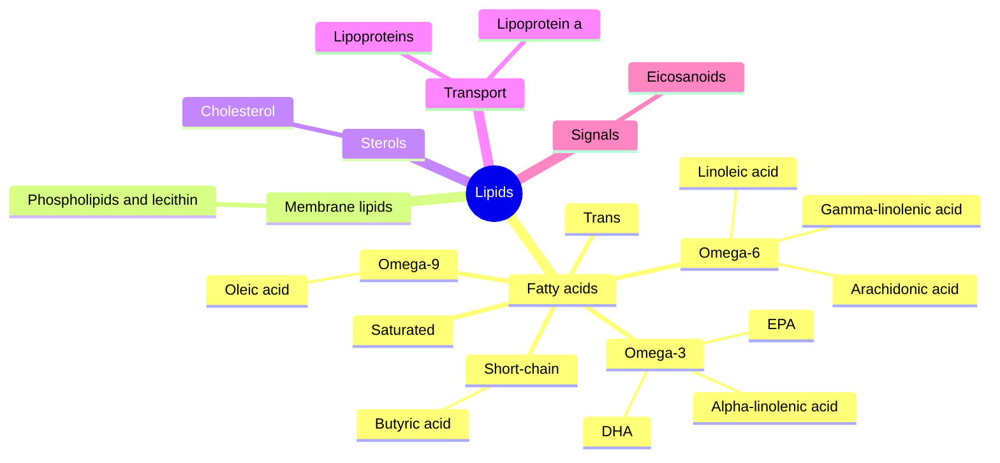

# Lipids

Lipids are the fats and fat-like molecules of living things: fatty acids, triglycerides, phospholipids, sterols such as cholesterol, and the signaling molecules made from them. They store energy, build cell membranes, carry fat-soluble vitamins and act as hormones. This subfield explains each class and has one note per important fatty acid.

## Map of the subfield

The map shows the lipid classes and the fatty acid families.

## Reading order

1. [Lipids overview](lipids-overview.md): the lipid classes and what they do.
2. [Fatty acids](fatty-acids.md): chain length, saturation, naming and food sources.
3. [Saturated fatty acids](saturated-fatty-acids.md): palmitic, stearic, lauric and other saturated fatty acids.
4. [Trans fatty acids](trans-fatty-acids.md): industrial and natural trans fats.
5. [Omega-9 fatty acids](omega-9-fatty-acids.md) and [Oleic acid](oleic-acid.md).
6. [Omega-6 fatty acids](omega-6-fatty-acids.md), then [Linoleic acid](linoleic-acid.md), [Gamma-linolenic acid](gamma-linolenic-acid.md) and [Arachidonic acid](arachidonic-acid.md).
7. [Omega-3 fatty acids](omega-3-fatty-acids.md), then [Alpha-linolenic acid](alpha-linolenic-acid.md), [Eicosapentaenoic acid (EPA)](epa.md) and [Docosahexaenoic acid (DHA)](dha.md).
8. [Eicosanoids](eicosanoids.md): the signals made from omega-6 and omega-3 fatty acids.
9. [Butyric acid and sodium butyrate](butyric-acid.md): the short-chain fatty acid made by gut bacteria.
10. [Phospholipids and lecithin](phospholipids-and-lecithin.md): membrane lipids and the lecithin supplement.
11. [Cholesterol](cholesterol.md): structure, synthesis and roles.
12. [Lipoproteins](lipoproteins.md): how lipids travel in the blood (chylomicrons, VLDL, LDL, HDL).
13. [Lipoprotein(a)](lipoprotein-a.md): the genetically set lipoprotein that raises heart risk.

## Scope and evidence

Claims about fats and health are graded with [Evidence grades](../../../../applied-sciences/medicine-and-health/nutrition/evidence-grades.md). Dietary fat research relies heavily on observational studies, and the notes say where results come from trials and where only from associations.
