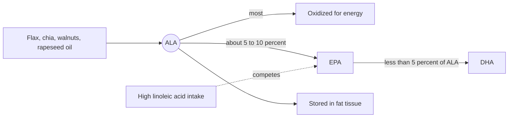

# Alpha-linolenic acid

## Summary

Alpha-linolenic acid (ALA, 18:3 n-3) is the essential omega-3 fatty acid found in plants: flaxseed, chia, walnuts, hemp and rapeseed oil. The body uses most of it for energy and converts only a small share into EPA and very little into DHA. Higher ALA intake is associated with a modestly lower risk of cardiovascular disease in observational studies.

*This note is educational. It is not medical advice and does not replace a doctor, dietitian or pharmacist, especially during pregnancy, illness or when taking medicines.*

## Prerequisites

- [Omega-3 fatty acids](omega-3-fatty-acids.md)

## Core concepts

### Definition

*Alpha-linolenic acid* is an 18-carbon omega-3 fatty acid with three cis double bonds. It is essential because humans cannot place a double bond at the omega-3 position. Sources: flaxseed oil (about 50 to 60 percent ALA), chia seeds, camelina oil, walnuts, rapeseed oil (about 9 percent) and soybean oil (about 7 percent).

### Analogy

ALA is like raw ore. It can be refined into the valuable metals EPA and DHA, but the refinery is small and shared with omega-6 ore, so only a few percent comes out refined. Most of the ore is burned as fuel. The analogy breaks because ALA may also have useful effects of its own, not only as raw material.

### Mechanism

- About 15 to 35 percent of dietary ALA is oxidized for energy within a day in tracer studies.
- Conversion to EPA is roughly 5 to 10 percent and to DHA less than 5 percent; estrogen increases conversion.
- A high intake of linoleic acid competes for delta-6 desaturase and may reduce conversion further.

The diagram shows the fate of dietary ALA.

## Worked example

One tablespoon of ground flaxseed (7 g) contains about 1.6 g of ALA, the adequate intake for men. Even with a generous 10 percent conversion, that becomes only about 160 mg of EPA and much less DHA, below the EFSA target of 250 mg EPA + DHA.

## Trade offs and when to use it

ALA foods are healthy and inexpensive. They are not a full replacement for EPA and DHA, especially in pregnancy, where algal DHA is a vegetarian alternative.

## Common mistakes

- **Relying on flaxseed for DHA.** Conversion to DHA is very low; consider algal oil if no fish is eaten.

## Practice

1. What share of ALA becomes EPA?
2. Name two foods rich in ALA.

### Answers

1. Roughly 5 to 10 percent.
2. Flaxseed and walnuts (also chia and rapeseed oil).

## Further reading

- NIH Office of Dietary Supplements. Omega-3 Fatty Acids: Fact Sheet for Health Professionals. [Link](https://ods.od.nih.gov/factsheets/Omega3FattyAcids-HealthProfessional/). ALA intake and conversion.
- Institute of Medicine (2005). *Dietary Reference Intakes for Energy, Carbohydrate, Fiber, Fat, Fatty Acids, Cholesterol, Protein, and Amino Acids*. National Academies Press. [DOI](https://doi.org/10.17226/10490). Adequate intake of ALA.
