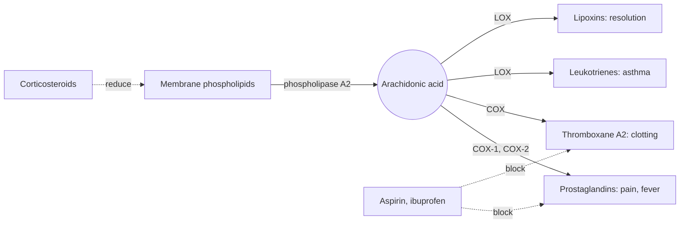

# Arachidonic acid

## Summary

Arachidonic acid (AA, 20:4 n-6) is a long-chain omega-6 fatty acid stored in cell membranes, especially in the brain, muscle and immune cells. When released, it is converted into eicosanoids that drive inflammation, fever, pain, blood clotting and the resolution of inflammation. Common painkillers such as aspirin and ibuprofen work by blocking its conversion. The body makes it from linoleic acid, and meat and eggs supply it directly.

## Prerequisites

- [Omega-6 fatty acids](omega-6-fatty-acids.md)

## Core concepts

### Definition

*Arachidonic acid* is a 20-carbon fatty acid with four cis double bonds. The name comes from arachidic acid, the saturated 20-carbon fatty acid found in peanut oil (*Arachis*). It is part of the phospholipids of most cell membranes and is added to infant formula together with DHA.

### Analogy

Arachidonic acid is like a stock of signal flares kept in every house. In an emergency, the flares are taken out and fired (released and converted to prostaglandins), alerting the neighborhood (immune cells, blood vessels, platelets). Painkillers like ibuprofen are like taking the matches away. The analogy breaks because some products of AA (lipoxins) also signal "emergency over".

### Mechanism

1. Phospholipase A2 releases AA from membrane phospholipids when a cell is stimulated.
2. Cyclooxygenases (COX-1 and COX-2) make prostaglandins (pain, fever, vessel dilation, protection of the stomach lining) and thromboxane A2 (platelet clumping).
3. Lipoxygenases make leukotrienes (bronchial constriction in asthma, attraction of white cells) and lipoxins (resolution).
4. Aspirin blocks COX irreversibly, which explains its antiplatelet effect; ibuprofen and naproxen block it reversibly; corticosteroids reduce the release of AA.
5. AA is also a precursor of endocannabinoids (anandamide).

The diagram shows these pathways and where drugs act.

## Worked example

Low-dose aspirin (75 to 100 mg) blocks COX-1 in platelets permanently. Platelets have no nucleus and cannot make new enzyme, so the effect lasts for the platelet lifespan of about 7 to 10 days. This is why aspirin is usually stopped about a week before some surgeries, on medical advice.

## Trade offs and when to use it

AA is necessary for immune defense, brain function and infant development. AA supplements are sold to bodybuilders for muscle growth, with very little evidence.

## Common mistakes

- **Calling arachidonic acid "bad".** Its products are needed for defense, healing and stomach protection, and some resolve inflammation.

## Practice

1. Which enzymes convert arachidonic acid into prostaglandins?
2. Why does aspirin affect platelets for about a week?

### Answers

1. Cyclooxygenases (COX-1 and COX-2).
2. It blocks COX irreversibly, and platelets cannot make new enzyme.

## Further reading

- Berg, J. M., Tymoczko, J. L., Stryer, L. (2002). *Biochemistry (5th ed.)*. W. H. Freeman, free on NCBI Bookshelf. [Link](https://www.ncbi.nlm.nih.gov/books/NBK21154/). Eicosanoid synthesis and the action of aspirin.
