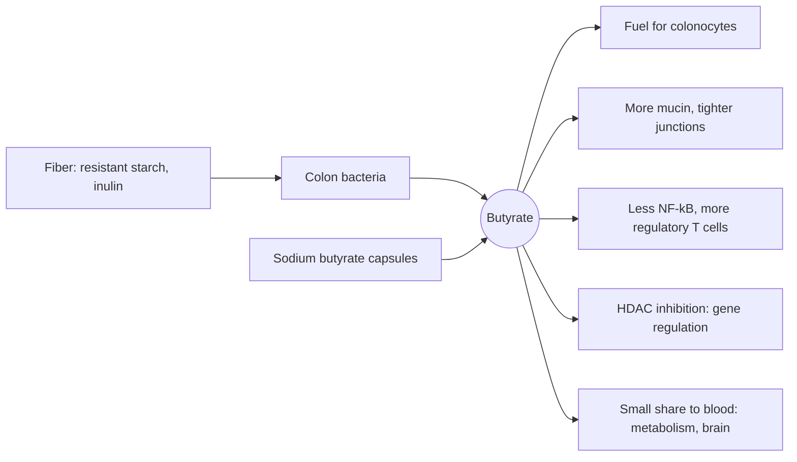

# Butyric acid and sodium butyrate

## Summary

Butyric acid (butyrate) is a short-chain fatty acid with four carbons. Gut bacteria make it by fermenting dietary fiber in the colon, and it is the main fuel of the cells lining the colon. It strengthens the gut barrier and dampens inflammation. Sodium butyrate, its salt, is sold as a supplement for gut health. Most evidence for the effects of butyrate comes from cell and animal studies and from studies of fiber, and few human trials test butyrate supplements directly.

*This note is educational. It is not medical advice and does not replace a doctor, dietitian or pharmacist, especially during pregnancy, illness or when taking medicines.*

## Prerequisites

- [Fatty acids](fatty-acids.md)

## Core concepts

### Definition

*Butyric acid* (4:0) is a saturated short-chain fatty acid (SCFA). With acetate (2 carbons) and propionate (3 carbons) it is one of the three main SCFAs produced in the colon. *Sodium butyrate* is its sodium salt, used in supplements, often in coated capsules that release it further down the gut. Butyric acid occurs in butter (about 3 to 4 percent of milk fat, which gives it its name from Greek *boutyron*), but in the body it is mainly produced in the colon from fiber such as resistant starch and inulin.

### Analogy

Butyrate is like the canteen lunch for the workers who maintain a city wall. The colon lining cells (colonocytes) are the wall workers, and the bacteria are the cooks who turn fiber into their preferred meal. Well-fed workers keep the wall tight (barrier function) and keep the peace with the guards (immune cells). Butyrate pills are like delivering lunch from outside: possible, but most of it may be eaten before it reaches the wall unless the delivery is protected. The analogy breaks because butyrate also sends signals to distant organs.

### Mechanism

1. Bacteria such as *Faecalibacterium prausnitzii*, *Roseburia* and *Eubacterium rectale* ferment fiber into butyrate.
2. Colonocytes absorb butyrate and oxidize it for up to about 70 percent of their energy.
3. Butyrate activates receptors (GPR41, GPR43, GPR109A) and inhibits histone deacetylases (HDACs), which changes gene activity.
4. Effects include more mucin production and stronger tight junctions (barrier), more regulatory T cells and less NF-kB activation (less inflammation), and, in cancer cells that rely on glucose instead of butyrate, slowed growth and apoptosis.
5. Only a small share reaches the blood, where it may influence metabolism and the brain through the gut-brain axis.

The diagram shows the path from fiber to effects.

### Proposed effects and evidence

Each entry states the proposed effect and how strong the human evidence is, using the grades defined in the [Evidence grades](../../../../applied-sciences/medicine-and-health/nutrition/evidence-grades.md) note.

- **Gut health.** Butyrate is the main energy source for the cells of the gut lining. Studies show it supports regeneration of the gut epithelium, which may help in inflammatory bowel disease such as ulcerative colitis and Crohn disease. Small trials of butyrate enemas or oral butyrate in ulcerative colitis gave mixed results. Evidence: limited.
- **Anti-inflammatory action.** Butyrate may reduce gut inflammation by regulating pro-inflammatory cytokines and inhibiting the NF-kB pathway, which is central to the inflammatory response. Shown consistently in cell and animal studies. Evidence: limited in humans.
- **Gut barrier.** Sodium butyrate may strengthen the gut barrier by increasing mucin production, which protects the mucosa, and by strengthening the junctions between cells. Evidence: limited in humans.
- **Anticancer properties.** There is evidence that butyrate may inhibit the growth of cancer cells, especially in the colon, by inducing apoptosis and inhibiting proliferation. Shown in cell and animal studies; human evidence is indirect, through the protective association of fiber with colorectal cancer. Evidence: very limited for supplements.
- **Metabolism.** Butyrate may influence fat and glucose metabolism, which may matter for preventing obesity and type 2 diabetes. Research is ongoing and needs confirmation. Evidence: very limited.
- **Cognitive function.** Early studies suggest butyrate may benefit brain health and cognition through effects on neuroplasticity and possible anti-inflammatory action in the nervous system. Further research is needed. Evidence: very limited.

## Worked example

A diet with 30 g of fiber a day leads to colonic SCFA production of roughly 300 to 600 mmol per day, of which butyrate is about 15 to 20 percent, roughly 45 to 120 mmol. Sodium butyrate has a molar mass of 110 g/mol, so a typical 600 mg capsule supplies about 5.5 mmol, a small fraction of what fiber-fed bacteria produce. Eating more fermentable fiber (oats, legumes, cooled potatoes, onions, chicory) is the main way to raise colonic butyrate.

## Trade offs and when to use it

Sodium butyrate supplements are generally well tolerated but smell strongly (like rancid butter) and add sodium. Uncoated forms are absorbed in the upper gut. Increasing fiber gives butyrate plus other benefits of fiber.

## Common mistakes

- **Taking butyrate while eating little fiber.** Fiber feeds the bacteria that produce far more butyrate.
- **Reading cell study results as proof of anticancer effects.** Human evidence for supplements is lacking.

## Practice

1. Which cells use butyrate as their main fuel?
2. Name the three main short-chain fatty acids.
3. What is the best dietary way to raise colonic butyrate?

### Answers

1. Colonocytes, the cells lining the colon.
2. Acetate, propionate and butyrate.
3. Eat more fermentable fiber such as resistant starch and inulin.

## Further reading

- Koh, A., De Vadder, F., Kovatcheva-Datchary, P. et al. (2016). From dietary fiber to host physiology: short-chain fatty acids as key bacterial metabolites. Cell, 165(6), 1332-1345. [DOI](https://doi.org/10.1016/j.cell.2016.05.041). Review of short-chain fatty acids as bacterial metabolites and their effects on the host.
- Reynolds, A., Mann, J., Cummings, J. et al. (2019). Carbohydrate quality and human health: a series of systematic reviews and meta-analyses. The Lancet, 393(10170), 434-445. [DOI](https://doi.org/10.1016/S0140-6736(18)31809-9). Meta-analyses linking fiber intake to lower disease risk, including colorectal cancer.
