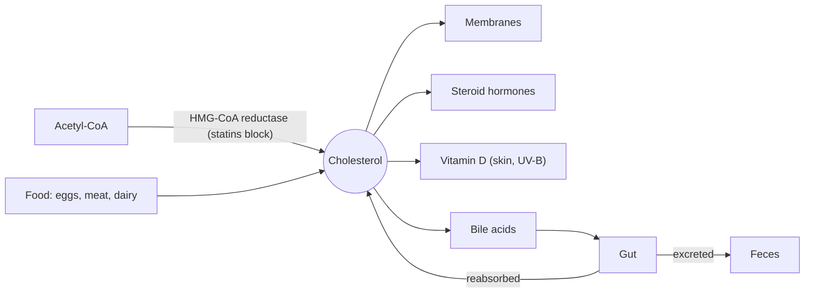

# Cholesterol

## Summary

Cholesterol is a sterol, a lipid with four fused rings, that every animal cell needs. It stiffens cell membranes and is the starting material for steroid hormones, bile acids and vitamin D. The liver makes most of the body's cholesterol, and food supplies the rest. Because it does not dissolve in blood, it travels in lipoproteins. The cholesterol carried in LDL particles causes atherosclerosis when levels are high for many years, which is why "cholesterol" in medicine usually means LDL cholesterol.

## Prerequisites

- [Lipids overview](lipids-overview.md)

## Core concepts

### Definition

*Cholesterol* (C27H46O) is a sterol made of four fused carbon rings, a short hydrocarbon tail and one hydroxyl group. It is amphipathic: the hydroxyl group faces water and the ring system sits among the fatty acid tails in membranes. It occurs only in animal foods; plants contain related phytosterols.

### Analogy

Cholesterol in a membrane is like the rigid spacers placed between flexible slats of a fence. In warm weather it keeps the slats from flapping (reduces fluidity), and in cold weather it keeps them from freezing into a solid block (prevents crystallization). The analogy breaks because cholesterol has a second career entirely unrelated to fences: it is the raw material for hormones.

### Mechanism

**Synthesis.** All 27 carbons come from acetyl-CoA. The rate-limiting enzyme is HMG-CoA reductase, the target of statin drugs. The liver makes most of the roughly 800 to 1,000 mg produced each day. Synthesis falls when dietary intake is high and rises when it is low, which is why dietary cholesterol affects blood cholesterol less than saturated fat does in most people.

**Uses.**

- Membranes: about 30 to 40 percent of the lipid in the plasma membrane of many cells.
- Steroid hormones: cortisol, aldosterone, testosterone, estrogens, progesterone.
- Bile acids: made in the liver, needed for fat digestion; the main route of cholesterol removal.
- Vitamin D: made in the skin from 7-dehydrocholesterol under ultraviolet B light.

**Transport and removal.** The liver packs cholesterol into VLDL, which becomes LDL in the blood; cells take up LDL through LDL receptors. HDL carries excess cholesterol back to the liver. The liver excretes cholesterol into bile, both as cholesterol and as bile acids, and part is reabsorbed in the gut. See [Lipoproteins](lipoproteins.md).

The diagram shows the sources, uses and removal of cholesterol.

### Blood cholesterol values

For adults, the 2019 ESC/EAS guideline sets LDL cholesterol targets by risk category rather than one "normal" value: below 3.0 mmol/L (116 mg/dL) for low risk, below 2.6 mmol/L (100 mg/dL) for moderate risk, below 1.8 mmol/L (70 mg/dL) for high risk and below 1.4 mmol/L (55 mg/dL) for very high risk. To convert mmol/L to mg/dL for cholesterol, multiply by 38.67.

## Worked example

A blood test shows total cholesterol 5.6 mmol/L, HDL 1.3 mmol/L and triglycerides 1.5 mmol/L. The Friedewald formula estimates LDL cholesterol as total cholesterol − HDL − (triglycerides ÷ 2.2) = 5.6 − 1.3 − 0.68 ≈ 3.6 mmol/L, about 140 mg/dL. Non-HDL cholesterol is 5.6 − 1.3 = 4.3 mmol/L. For a person at low risk this LDL is above the target of 3.0 mmol/L. Lifestyle changes (less saturated fat, more fiber, weight loss if needed) typically lower LDL by about 10 to 20 percent, and statins by 30 to 50 percent or more. The formula is unreliable when triglycerides are above about 4.5 mmol/L.

## Trade offs and when to use it

- Cholesterol is essential, and the body makes enough; there is no dietary requirement.
- High LDL cholesterol over decades causes atherosclerosis, shown by genetics, cohorts and drug trials. Very low LDL from drugs has not shown harm in trials.
- Dietary cholesterol (for example from eggs) raises LDL modestly in most people; saturated and trans fats have a larger effect.

## Common mistakes

- **Calling LDL and HDL "cholesterol".** They are lipoprotein particles that carry cholesterol.
- **Avoiding eggs as the main way to lower cholesterol.** Reducing saturated fat usually matters more.
- **Assuming normal cholesterol rules out heart risk.** Blood pressure, smoking, diabetes and lipoprotein(a) also matter.

## Practice

1. Which enzyme do statins inhibit?
2. Name three classes of molecules made from cholesterol.
3. Using the Friedewald formula, estimate LDL for total 6.0, HDL 1.0 and triglycerides 2.2 mmol/L.

### Answers

1. HMG-CoA reductase.
2. Steroid hormones, bile acids and vitamin D.
3. 6.0 − 1.0 − 1.0 = 4.0 mmol/L.

## Further reading

- Mach, F., Baigent, C., Catapano, A. L. et al. (2020). 2019 ESC/EAS Guidelines for the management of dyslipidaemias: lipid modification to reduce cardiovascular risk. European Heart Journal, 41(1), 111-188. [DOI](https://doi.org/10.1093/eurheartj/ehz455). ESC/EAS guideline with LDL targets by risk.
- Berg, J. M., Tymoczko, J. L., Stryer, L. (2002). *Biochemistry (5th ed.)*. W. H. Freeman, free on NCBI Bookshelf. [Link](https://www.ncbi.nlm.nih.gov/books/NBK21154/). Chapter 26 on cholesterol synthesis and steroid hormones.
